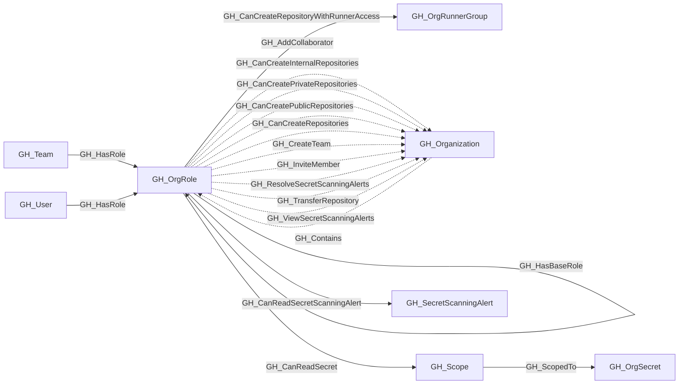

## General Information

Represents an organization-level role such as Owner, Member, or a custom organization role. Org roles define what permissions a user or team has at the organization level. The Owner and Member roles are default (built-in), while custom roles inherit from a base role and can have additional permissions.

## Diagram

## Edges

<Note>
The tables below list edges defined by the GitHub extension only. Additional edges to or from this node may be created by other extensions.
</Note>

### Inbound Edges

| Edge | Source Node | Traversable |
| --- | --- | --- |
| [GH_Contains](/opengraph/extensions/github/edges/gh_contains) | [GH_Organization](/opengraph/extensions/github/nodes/gh_organization) | ❌ |
| [GH_HasBaseRole](/opengraph/extensions/github/edges/gh_hasbaserole) | GH_OrgRole | ✅ |
| [GH_HasRole](/opengraph/extensions/github/edges/gh_hasrole) | [GH_Team](/opengraph/extensions/github/nodes/gh_team) | ✅ |
| [GH_HasRole](/opengraph/extensions/github/edges/gh_hasrole) | [GH_User](/opengraph/extensions/github/nodes/gh_user) | ✅ |

### Outbound Edges

| Edge | Destination Node | Traversable |
| --- | --- | --- |
| [GH_AddCollaborator](/opengraph/extensions/github/edges/gh_addcollaborator) | [GH_Organization](/opengraph/extensions/github/nodes/gh_organization) | ❌ |
| [GH_CanCreateInternalRepositories](/opengraph/extensions/github/edges/gh_cancreateinternalrepositories) | [GH_Organization](/opengraph/extensions/github/nodes/gh_organization) | ❌ |
| [GH_CanCreatePrivateRepositories](/opengraph/extensions/github/edges/gh_cancreateprivaterepositories) | [GH_Organization](/opengraph/extensions/github/nodes/gh_organization) | ❌ |
| [GH_CanCreatePublicRepositories](/opengraph/extensions/github/edges/gh_cancreatepublicrepositories) | [GH_Organization](/opengraph/extensions/github/nodes/gh_organization) | ❌ |
| [GH_CanCreateRepositories](/opengraph/extensions/github/edges/gh_cancreaterepositories) | [GH_Organization](/opengraph/extensions/github/nodes/gh_organization) | ❌ |
| [GH_CanCreateRepositoryWithRunnerAccess](/opengraph/extensions/github/edges/gh_cancreaterepositorywithrunneraccess) | [GH_OrgRunnerGroup](/opengraph/extensions/github/nodes/gh_orgrunnergroup) | ✅ |
| [GH_CanReadSecret](/opengraph/extensions/github/edges/gh_canreadsecret) | [GH_OrgSecret](/opengraph/extensions/github/nodes/gh_orgsecret) | ✅ |
| [GH_CanReadSecret](/opengraph/extensions/github/edges/gh_canreadsecret) | [GH_Scope](/opengraph/extensions/github/nodes/gh_scope) | ✅ |
| [GH_CanReadSecretScanningAlert](/opengraph/extensions/github/edges/gh_canreadsecretscanningalert) | [GH_SecretScanningAlert](/opengraph/extensions/github/nodes/gh_secretscanningalert) | ✅ |
| [GH_CreateTeam](/opengraph/extensions/github/edges/gh_createteam) | [GH_Organization](/opengraph/extensions/github/nodes/gh_organization) | ❌ |
| [GH_HasBaseRole](/opengraph/extensions/github/edges/gh_hasbaserole) | GH_OrgRole | ✅ |
| [GH_InviteMember](/opengraph/extensions/github/edges/gh_invitemember) | [GH_Organization](/opengraph/extensions/github/nodes/gh_organization) | ❌ |
| [GH_ManageOrganizationWebhooks](/opengraph/extensions/github/edges/gh_manageorganizationwebhooks) | [GH_Organization](/opengraph/extensions/github/nodes/gh_organization) | ❌ |
| [GH_OrgBypassCodeScanningDismissalRequests](/opengraph/extensions/github/edges/gh_orgbypasscodescanningdismissalrequests) | [GH_Organization](/opengraph/extensions/github/nodes/gh_organization) | ❌ |
| [GH_OrgBypassSecretScanningClosureRequests](/opengraph/extensions/github/edges/gh_orgbypasssecretscanningclosurerequests) | [GH_Organization](/opengraph/extensions/github/nodes/gh_organization) | ❌ |
| [GH_OrgReviewAndManageSecretScanningBypassRequests](/opengraph/extensions/github/edges/gh_orgreviewandmanagesecretscanningbypassrequests) | [GH_Organization](/opengraph/extensions/github/nodes/gh_organization) | ❌ |
| [GH_OrgReviewAndManageSecretScanningClosureRequests](/opengraph/extensions/github/edges/gh_orgreviewandmanagesecretscanningclosurerequests) | [GH_Organization](/opengraph/extensions/github/nodes/gh_organization) | ❌ |
| [GH_ReadOrganizationActionsUsageMetrics](/opengraph/extensions/github/edges/gh_readorganizationactionsusagemetrics) | [GH_Organization](/opengraph/extensions/github/nodes/gh_organization) | ❌ |
| [GH_ReadOrganizationCustomOrgRole](/opengraph/extensions/github/edges/gh_readorganizationcustomorgrole) | [GH_Organization](/opengraph/extensions/github/nodes/gh_organization) | ❌ |
| [GH_ReadOrganizationCustomRepoRole](/opengraph/extensions/github/edges/gh_readorganizationcustomreporole) | [GH_Organization](/opengraph/extensions/github/nodes/gh_organization) | ❌ |
| [GH_ResolveSecretScanningAlerts](/opengraph/extensions/github/edges/gh_resolvesecretscanningalerts) | [GH_Organization](/opengraph/extensions/github/nodes/gh_organization) | ❌ |
| [GH_TransferRepository](/opengraph/extensions/github/edges/gh_transferrepository) | [GH_Organization](/opengraph/extensions/github/nodes/gh_organization) | ❌ |
| [GH_ViewSecretScanningAlerts](/opengraph/extensions/github/edges/gh_viewsecretscanningalerts) | [GH_Organization](/opengraph/extensions/github/nodes/gh_organization) | ❌ |
| [GH_WriteOrganizationActionsSecrets](/opengraph/extensions/github/edges/gh_writeorganizationactionssecrets) | [GH_Organization](/opengraph/extensions/github/nodes/gh_organization) | ❌ |
| [GH_WriteOrganizationActionsSettings](/opengraph/extensions/github/edges/gh_writeorganizationactionssettings) | [GH_Organization](/opengraph/extensions/github/nodes/gh_organization) | ❌ |
| [GH_WriteOrganizationActionsVariables](/opengraph/extensions/github/edges/gh_writeorganizationactionsvariables) | [GH_Organization](/opengraph/extensions/github/nodes/gh_organization) | ❌ |
| [GH_WriteOrganizationCustomOrgRole](/opengraph/extensions/github/edges/gh_writeorganizationcustomorgrole) | [GH_Organization](/opengraph/extensions/github/nodes/gh_organization) | ✅ |
| [GH_WriteOrganizationCustomRepoRole](/opengraph/extensions/github/edges/gh_writeorganizationcustomreporole) | [GH_Organization](/opengraph/extensions/github/nodes/gh_organization) | ❌ |
| [GH_WriteOrganizationNetworkConfigurations](/opengraph/extensions/github/edges/gh_writeorganizationnetworkconfigurations) | [GH_Organization](/opengraph/extensions/github/nodes/gh_organization) | ❌ |

## Properties

| Name | Type | Description |
| --- | --- | --- |
| `displayname` | `string` |  |
| `environment_name` | `null \| string` | The name of the environment (GitHub organization). |
| `environmentid` | `string` |  |
| `last_seen` | `datetime` |  |
| `name` | `string` |  |
| `node_id` | `string` |  |
| `query_explicit_members` | `null \| string` | Query for explicit members. |
| `query_org_permissions` | `null \| string` | Query for org permissions. |
| `query_repo_permissions` | `null \| string` | Query for repo permissions. |
| `query_unrolled_members` | `null \| string` | Query for unrolled members. |
| `short_name` | `string` | The short display name of the role (e.g., `Owners`, `Members`, or the custom role name). |
| `type` | `string` | `default` for built-in roles (Owner, Member) or `custom` for custom organization roles. |

## References

- [Custom organization role API](https://docs.github.com/en/enterprise-cloud@latest/rest/orgs/organization-roles)
