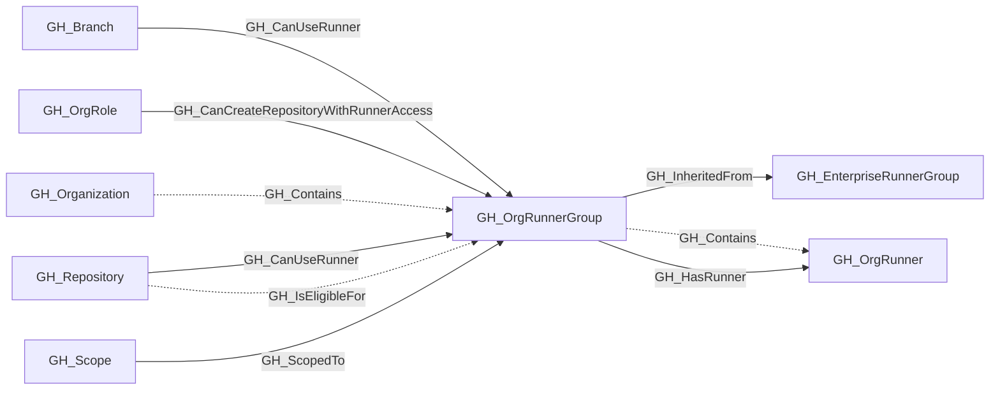

## General Information

Represents a self-hosted runner group visible within a GitHub organization. Organization runner groups may either be native to the organization or inherited from an enterprise runner group.

Native organization runner groups contain [GH_OrgRunner](/opengraph/extensions/github/nodes/gh_orgrunner) nodes directly. Direct memberships also emit [GH_HasRunner](/opengraph/extensions/github/edges/gh_hasrunner) to represent the traversable capability hop from the group to its runners. Inherited organization runner groups do not directly contain organization runners; instead, they link to the source [GH_EnterpriseRunnerGroup](/opengraph/extensions/github/nodes/gh_enterpriserunnergroup) through [GH_InheritedFrom](/opengraph/extensions/github/edges/gh_inheritedfrom) and gain access to the enterprise runners contained there. [GH_IsEligibleFor](/opengraph/extensions/github/edges/gh_iseligiblefor) uses shared runner-group scopes for canonical policies and direct edges for selected policies, while [GH_CanUseRunner](/opengraph/extensions/github/edges/gh_canuserunner) identifies repositories and branches that can dispatch workflows to the group under collected Actions and workflow-restriction settings.

## Diagram

## Edges

<Note>
The tables below list edges defined by the GitHub extension only. Additional edges to or from this node may be created by other extensions.
</Note>

### Inbound Edges

| Edge | Source Node | Traversable |
| --- | --- | --- |
| [GH_CanCreateRepositoryWithRunnerAccess](/opengraph/extensions/github/edges/gh_cancreaterepositorywithrunneraccess) | [GH_OrgRole](/opengraph/extensions/github/nodes/gh_orgrole) | ✅ |
| [GH_CanUseRunner](/opengraph/extensions/github/edges/gh_canuserunner) | [GH_Branch](/opengraph/extensions/github/nodes/gh_branch) | ✅ |
| [GH_CanUseRunner](/opengraph/extensions/github/edges/gh_canuserunner) | [GH_Repository](/opengraph/extensions/github/nodes/gh_repository) | ✅ |
| [GH_Contains](/opengraph/extensions/github/edges/gh_contains) | [GH_Organization](/opengraph/extensions/github/nodes/gh_organization) | ❌ |
| [GH_IsEligibleFor](/opengraph/extensions/github/edges/gh_iseligiblefor) | [GH_Repository](/opengraph/extensions/github/nodes/gh_repository) | ❌ |
| [GH_ScopedTo](/opengraph/extensions/github/edges/gh_scopedto) | [GH_Scope](/opengraph/extensions/github/nodes/gh_scope) | ✅ |

### Outbound Edges

| Edge | Destination Node | Traversable |
| --- | --- | --- |
| [GH_Contains](/opengraph/extensions/github/edges/gh_contains) | [GH_OrgRunner](/opengraph/extensions/github/nodes/gh_orgrunner) | ❌ |
| [GH_HasRunner](/opengraph/extensions/github/edges/gh_hasrunner) | [GH_OrgRunner](/opengraph/extensions/github/nodes/gh_orgrunner) | ✅ |
| [GH_InheritedFrom](/opengraph/extensions/github/edges/gh_inheritedfrom) | [GH_EnterpriseRunnerGroup](/opengraph/extensions/github/nodes/gh_enterpriserunnergroup) | ✅ |

## Properties

| Name | Type | Description |
| --- | --- | --- |
| `allows_public_repositories` | `boolean \| null` | Whether public repositories may use this group. |
| `default` | `boolean \| null` | Whether this is the default runner group. |
| `displayname` | `string` |  |
| `environment_name` | `null \| string` | The name of the environment (GitHub organization or enterprise). |
| `environmentid` | `string` |  |
| `group_id` | `integer \| null` | The GitHub runner group ID. |
| `group_name` | `null \| string` | The runner group display name. |
| `inherited` | `boolean \| null` | Whether this runner group is inherited. |
| `last_seen` | `datetime` |  |
| `name` | `string` |  |
| `node_id` | `string` |  |
| `query_organizations` | `null \| string` | Query for organizations inheriting an enterprise runner group. |
| `query_repositories` | `null \| string` | Query for repositories. |
| `query_runners` | `null \| string` | Query for runners. |
| `restricted_to_workflows` | `boolean \| null` | Whether access is restricted to selected workflows. |
| `runners_url` | `null \| string` | API URL for runners in this group. |
| `scope` | `null \| string` | Whether the runner group is enterprise or organization scoped. |
| `selected_organizations_url` | `null \| string` | API URL for organizations assigned to an enterprise group. |
| `selected_workflows` | `null \| string` | JSON array of selected workflows, if configured. |
| `visibility` | `null \| string` | Which repositories can use this group: `all`, `private`, or `selected`. |

## References

- [Self-hosted runner groups API](https://docs.github.com/en/rest/actions/self-hosted-runner-groups)
