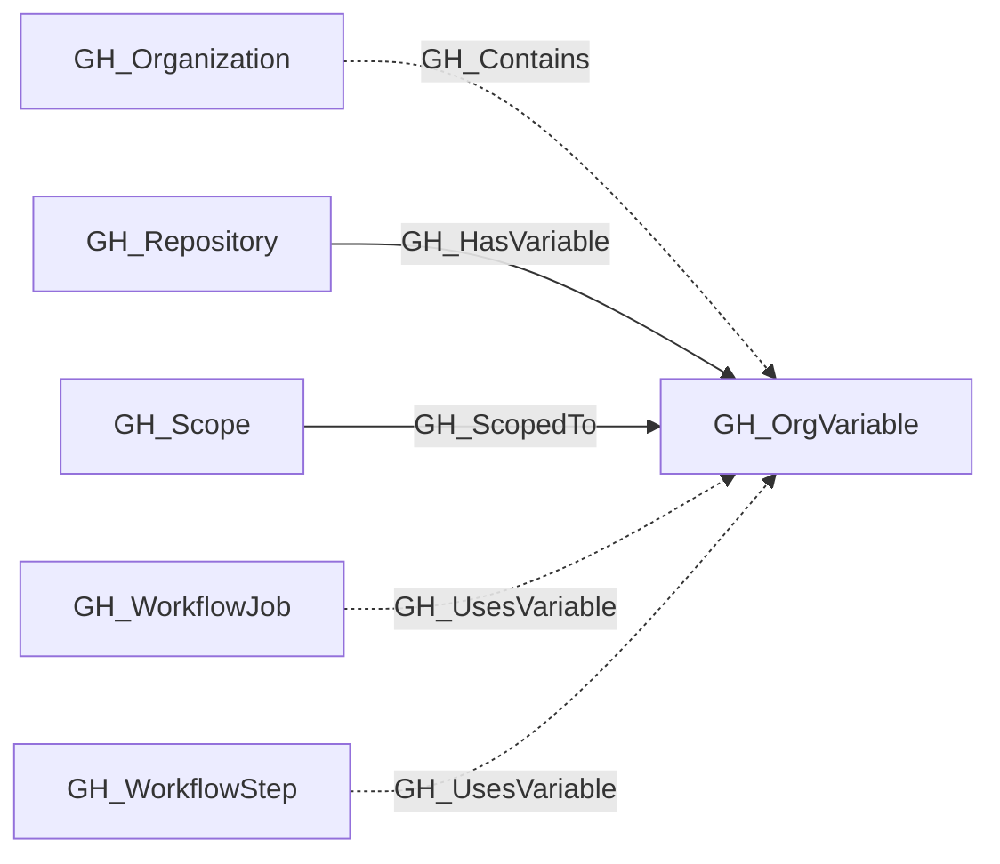

## General Information

Represents an organization-level GitHub Actions variable. All and private/internal visibility uses shared organization-variable [GH_Scope](/opengraph/extensions/github/nodes/gh_scope) nodes; arbitrary selected visibility uses direct [GH_HasVariable](/opengraph/extensions/github/edges/gh_hasvariable) relationships from repositories. Unlike secrets, variable values are readable via the API.

## Diagram

## Edges

<Note>
The tables below list edges defined by the GitHub extension only. Additional edges to or from this node may be created by other extensions.
</Note>

### Inbound Edges

| Edge | Source Node | Traversable |
| --- | --- | --- |
| [GH_Contains](/opengraph/extensions/github/edges/gh_contains) | [GH_Organization](/opengraph/extensions/github/nodes/gh_organization) | ❌ |
| [GH_HasVariable](/opengraph/extensions/github/edges/gh_hasvariable) | [GH_Repository](/opengraph/extensions/github/nodes/gh_repository) | ✅ |
| [GH_ScopedTo](/opengraph/extensions/github/edges/gh_scopedto) | [GH_Scope](/opengraph/extensions/github/nodes/gh_scope) | ✅ |
| [GH_UsesVariable](/opengraph/extensions/github/edges/gh_usesvariable) | [GH_WorkflowJob](/opengraph/extensions/github/nodes/gh_workflowjob) | ❌ |
| [GH_UsesVariable](/opengraph/extensions/github/edges/gh_usesvariable) | [GH_WorkflowStep](/opengraph/extensions/github/nodes/gh_workflowstep) | ❌ |

### Outbound Edges

No verified outbound relationships are available.

## Properties

| Name | Type | Description |
| --- | --- | --- |
| `created_at` | `null \| string` | When the variable was created. |
| `displayname` | `string` |  |
| `environment_name` | `null \| string` | The name of the environment (GitHub organization). |
| `environmentid` | `string` |  |
| `last_seen` | `datetime` |  |
| `name` | `string` |  |
| `node_id` | `string` |  |
| `query_visible_repositories` | `null \| string` | Query for visible repositories. |
| `updated_at` | `null \| string` | When the variable was last updated. |
| `value` | `null \| string` | The plaintext value of the variable. |
| `visibility` | `null \| string` | The variable&#39;s visibility scope: `all` (all repos), `private` (private and internal repos), or `selected` (specific repos). |

## References

- [Actions variables API](https://docs.github.com/en/rest/actions/variables)
