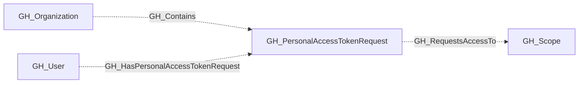

## General Information

Represents a pending request from an organization member to access organization resources with a fine-grained personal access token. PAT requests are linked to their owning user and the organization. An all-repository request also has a non-traversable [GH_RequestsAccessTo](/opengraph/extensions/github/edges/gh_requestsaccessto) edge to the organization's repository/all [GH_Scope](/opengraph/extensions/github/nodes/gh_scope).

The requested permissions are stored separately as `organization_permissions` and `repository_permissions`. Each property is a list of `scope:access` values such as `members:read` or `contents:write`, matching the permission format used on [GH_WorkflowJob](/opengraph/extensions/github/nodes/gh_workflowjob) nodes.

## Diagram

## Edges

<Note>
The tables below list edges defined by the GitHub extension only. Additional edges to or from this node may be created by other extensions.
</Note>

### Inbound Edges

| Edge | Source Node | Traversable |
| --- | --- | --- |
| [GH_Contains](/opengraph/extensions/github/edges/gh_contains) | [GH_Organization](/opengraph/extensions/github/nodes/gh_organization) | ❌ |
| [GH_HasPersonalAccessTokenRequest](/opengraph/extensions/github/edges/gh_haspersonalaccesstokenrequest) | [GH_User](/opengraph/extensions/github/nodes/gh_user) | ❌ |

### Outbound Edges

| Edge | Destination Node | Traversable |
| --- | --- | --- |
| [GH_RequestsAccessTo](/opengraph/extensions/github/edges/gh_requestsaccessto) | [GH_Scope](/opengraph/extensions/github/nodes/gh_scope) | ❌ |

## Properties

| Name | Type | Description |
| --- | --- | --- |
| `displayname` | `string` |  |
| `environmentid` | `string` |  |
| `last_seen` | `datetime` |  |
| `name` | `string` |  |
| `node_id` | `string` |  |
| `org_name` | `null \| string` | The org name property. |
| `organization_permissions` | `array<string> \| null` | Requested organization-scoped permissions in `scope:access` form. |
| `owner_login` | `null \| string` | The login handle of the user who submitted the request. |
| `query_organization_permissions` | `null \| string` | Query for organization permissions. |
| `query_repositories` | `null \| string` | Query for repositories. |
| `query_user` | `null \| string` | Query for user. |
| `reason` | `null \| string` | The rationale provided by the requester for the access request. |
| `repository_permissions` | `array<string> \| null` | Requested repository-scoped permissions in `scope:access` form. |
| `repository_selection` | `null \| string` | Whether the request targets `all`, `subset`, or `none` of the organization&#39;s repositories. |
| `token_name` | `null \| string` | The user-assigned display name of the token. |

## References

- [Personal access token API](https://docs.github.com/en/rest/orgs/personal-access-tokens)
