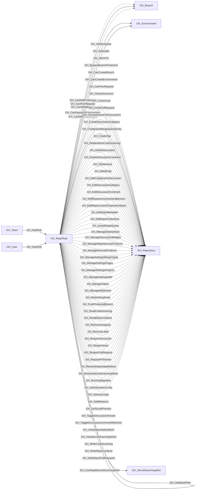

## General Information

Represents a repository-level permission role. Each repository has five default roles (Read, Write, Admin, Triage, Maintain) plus any custom repository roles defined at the organization level. Repo roles define what actions a user or team can perform on a specific repository. Default roles form an inheritance hierarchy (Triage -> Read, Maintain -> Write, Admin includes all), and custom roles inherit from one of the base roles.

## Diagram

## Edges

<Note>
The tables below list edges defined by the GitHub extension only. Additional edges to or from this node may be created by other extensions.
</Note>

### Inbound Edges

| Edge | Source Node | Traversable |
| --- | --- | --- |
| [GH_HasBaseRole](/opengraph/extensions/github/edges/gh_hasbaserole) | GH_RepoRole | ✅ |
| [GH_HasRole](/opengraph/extensions/github/edges/gh_hasrole) | [GH_Team](/opengraph/extensions/github/nodes/gh_team) | ✅ |
| [GH_HasRole](/opengraph/extensions/github/edges/gh_hasrole) | [GH_User](/opengraph/extensions/github/nodes/gh_user) | ✅ |

### Outbound Edges

| Edge | Destination Node | Traversable |
| --- | --- | --- |
| [GH_AddAssignee](/opengraph/extensions/github/edges/gh_addassignee) | [GH_Repository](/opengraph/extensions/github/nodes/gh_repository) | ❌ |
| [GH_AddLabel](/opengraph/extensions/github/edges/gh_addlabel) | [GH_Repository](/opengraph/extensions/github/nodes/gh_repository) | ❌ |
| [GH_AdminTo](/opengraph/extensions/github/edges/gh_adminto) | [GH_Repository](/opengraph/extensions/github/nodes/gh_repository) | ✅ |
| [GH_BypassBranchProtection](/opengraph/extensions/github/edges/gh_bypassbranchprotection) | [GH_Repository](/opengraph/extensions/github/nodes/gh_repository) | ❌ |
| [GH_CanCreateBranch](/opengraph/extensions/github/edges/gh_cancreatebranch) | [GH_Repository](/opengraph/extensions/github/nodes/gh_repository) | ✅ |
| [GH_CanCreateEnvironment](/opengraph/extensions/github/edges/gh_cancreateenvironment) | [GH_Repository](/opengraph/extensions/github/nodes/gh_repository) | ✅ |
| [GH_CanDeployToEnvironment](/opengraph/extensions/github/edges/gh_candeploytoenvironment) | [GH_Environment](/opengraph/extensions/github/nodes/gh_environment) | ✅ |
| [GH_CanEditEnvironment](/opengraph/extensions/github/edges/gh_caneditenvironment) | [GH_Environment](/opengraph/extensions/github/nodes/gh_environment) | ✅ |
| [GH_CanEditProtection](/opengraph/extensions/github/edges/gh_caneditprotection) | [GH_Branch](/opengraph/extensions/github/nodes/gh_branch) | ✅ |
| [GH_CanPwnRequest](/opengraph/extensions/github/edges/gh_canpwnrequest) | [GH_Branch](/opengraph/extensions/github/nodes/gh_branch) | ✅ |
| [GH_CanPwnRequest](/opengraph/extensions/github/edges/gh_canpwnrequest) | [GH_Repository](/opengraph/extensions/github/nodes/gh_repository) | ✅ |
| [GH_CanReadSecretScanningAlert](/opengraph/extensions/github/edges/gh_canreadsecretscanningalert) | [GH_SecretScanningAlert](/opengraph/extensions/github/nodes/gh_secretscanningalert) | ✅ |
| [GH_CanWriteBranch](/opengraph/extensions/github/edges/gh_canwritebranch) | [GH_Branch](/opengraph/extensions/github/nodes/gh_branch) | ✅ |
| [GH_CloseDiscussion](/opengraph/extensions/github/edges/gh_closediscussion) | [GH_Repository](/opengraph/extensions/github/nodes/gh_repository) | ❌ |
| [GH_CloseIssue](/opengraph/extensions/github/edges/gh_closeissue) | [GH_Repository](/opengraph/extensions/github/nodes/gh_repository) | ❌ |
| [GH_ClosePullRequest](/opengraph/extensions/github/edges/gh_closepullrequest) | [GH_Repository](/opengraph/extensions/github/nodes/gh_repository) | ❌ |
| [GH_ConvertIssuesToDiscussions](/opengraph/extensions/github/edges/gh_convertissuestodiscussions) | [GH_Repository](/opengraph/extensions/github/nodes/gh_repository) | ❌ |
| [GH_CreateDiscussionCategory](/opengraph/extensions/github/edges/gh_creatediscussioncategory) | [GH_Repository](/opengraph/extensions/github/nodes/gh_repository) | ❌ |
| [GH_CreateSoloMergeQueueEntry](/opengraph/extensions/github/edges/gh_createsolomergequeueentry) | [GH_Repository](/opengraph/extensions/github/nodes/gh_repository) | ❌ |
| [GH_CreateTag](/opengraph/extensions/github/edges/gh_createtag) | [GH_Repository](/opengraph/extensions/github/nodes/gh_repository) | ❌ |
| [GH_DeleteAlertsCodeScanning](/opengraph/extensions/github/edges/gh_deletealertscodescanning) | [GH_Repository](/opengraph/extensions/github/nodes/gh_repository) | ❌ |
| [GH_DeleteDiscussion](/opengraph/extensions/github/edges/gh_deletediscussion) | [GH_Repository](/opengraph/extensions/github/nodes/gh_repository) | ❌ |
| [GH_DeleteDiscussionComment](/opengraph/extensions/github/edges/gh_deletediscussioncomment) | [GH_Repository](/opengraph/extensions/github/nodes/gh_repository) | ❌ |
| [GH_DeleteIssue](/opengraph/extensions/github/edges/gh_deleteissue) | [GH_Repository](/opengraph/extensions/github/nodes/gh_repository) | ❌ |
| [GH_DeleteTag](/opengraph/extensions/github/edges/gh_deletetag) | [GH_Repository](/opengraph/extensions/github/nodes/gh_repository) | ❌ |
| [GH_EditCategoryOnDiscussion](/opengraph/extensions/github/edges/gh_editcategoryondiscussion) | [GH_Repository](/opengraph/extensions/github/nodes/gh_repository) | ❌ |
| [GH_EditDiscussionCategory](/opengraph/extensions/github/edges/gh_editdiscussioncategory) | [GH_Repository](/opengraph/extensions/github/nodes/gh_repository) | ❌ |
| [GH_EditDiscussionComment](/opengraph/extensions/github/edges/gh_editdiscussioncomment) | [GH_Repository](/opengraph/extensions/github/nodes/gh_repository) | ❌ |
| [GH_EditRepoAnnouncementBanners](/opengraph/extensions/github/edges/gh_editrepoannouncementbanners) | [GH_Repository](/opengraph/extensions/github/nodes/gh_repository) | ❌ |
| [GH_EditRepoCustomPropertiesValues](/opengraph/extensions/github/edges/gh_editrepocustompropertiesvalues) | [GH_Repository](/opengraph/extensions/github/nodes/gh_repository) | ❌ |
| [GH_EditRepoMetadata](/opengraph/extensions/github/edges/gh_editrepometadata) | [GH_Repository](/opengraph/extensions/github/nodes/gh_repository) | ❌ |
| [GH_EditRepoProtections](/opengraph/extensions/github/edges/gh_editrepoprotections) | [GH_Repository](/opengraph/extensions/github/nodes/gh_repository) | ❌ |
| [GH_HasBaseRole](/opengraph/extensions/github/edges/gh_hasbaserole) | GH_RepoRole | ✅ |
| [GH_JumpMergeQueue](/opengraph/extensions/github/edges/gh_jumpmergequeue) | [GH_Repository](/opengraph/extensions/github/nodes/gh_repository) | ❌ |
| [GH_ManageDeployKeys](/opengraph/extensions/github/edges/gh_managedeploykeys) | [GH_Repository](/opengraph/extensions/github/nodes/gh_repository) | ❌ |
| [GH_ManageDiscussionBadges](/opengraph/extensions/github/edges/gh_managediscussionbadges) | [GH_Repository](/opengraph/extensions/github/nodes/gh_repository) | ❌ |
| [GH_ManageRepoSecurityProducts](/opengraph/extensions/github/edges/gh_managereposecurityproducts) | [GH_Repository](/opengraph/extensions/github/nodes/gh_repository) | ❌ |
| [GH_ManageSecurityProducts](/opengraph/extensions/github/edges/gh_managesecurityproducts) | [GH_Repository](/opengraph/extensions/github/nodes/gh_repository) | ❌ |
| [GH_ManageSettingsMergeTypes](/opengraph/extensions/github/edges/gh_managesettingsmergetypes) | [GH_Repository](/opengraph/extensions/github/nodes/gh_repository) | ❌ |
| [GH_ManageSettingsPages](/opengraph/extensions/github/edges/gh_managesettingspages) | [GH_Repository](/opengraph/extensions/github/nodes/gh_repository) | ❌ |
| [GH_ManageSettingsProjects](/opengraph/extensions/github/edges/gh_managesettingsprojects) | [GH_Repository](/opengraph/extensions/github/nodes/gh_repository) | ❌ |
| [GH_ManageSettingsWiki](/opengraph/extensions/github/edges/gh_managesettingswiki) | [GH_Repository](/opengraph/extensions/github/nodes/gh_repository) | ❌ |
| [GH_ManageTopics](/opengraph/extensions/github/edges/gh_managetopics) | [GH_Repository](/opengraph/extensions/github/nodes/gh_repository) | ❌ |
| [GH_ManageWebhooks](/opengraph/extensions/github/edges/gh_managewebhooks) | [GH_Repository](/opengraph/extensions/github/nodes/gh_repository) | ❌ |
| [GH_MarkAsDuplicate](/opengraph/extensions/github/edges/gh_markasduplicate) | [GH_Repository](/opengraph/extensions/github/nodes/gh_repository) | ❌ |
| [GH_PushProtectedBranch](/opengraph/extensions/github/edges/gh_pushprotectedbranch) | [GH_Repository](/opengraph/extensions/github/nodes/gh_repository) | ❌ |
| [GH_ReadCodeScanning](/opengraph/extensions/github/edges/gh_readcodescanning) | [GH_Repository](/opengraph/extensions/github/nodes/gh_repository) | ❌ |
| [GH_ReadRepoContents](/opengraph/extensions/github/edges/gh_readrepocontents) | [GH_Repository](/opengraph/extensions/github/nodes/gh_repository) | ❌ |
| [GH_RemoveAssignee](/opengraph/extensions/github/edges/gh_removeassignee) | [GH_Repository](/opengraph/extensions/github/nodes/gh_repository) | ❌ |
| [GH_RemoveLabel](/opengraph/extensions/github/edges/gh_removelabel) | [GH_Repository](/opengraph/extensions/github/nodes/gh_repository) | ❌ |
| [GH_ReopenDiscussion](/opengraph/extensions/github/edges/gh_reopendiscussion) | [GH_Repository](/opengraph/extensions/github/nodes/gh_repository) | ❌ |
| [GH_ReopenIssue](/opengraph/extensions/github/edges/gh_reopenissue) | [GH_Repository](/opengraph/extensions/github/nodes/gh_repository) | ❌ |
| [GH_ReopenPullRequest](/opengraph/extensions/github/edges/gh_reopenpullrequest) | [GH_Repository](/opengraph/extensions/github/nodes/gh_repository) | ❌ |
| [GH_RequestPrReview](/opengraph/extensions/github/edges/gh_requestprreview) | [GH_Repository](/opengraph/extensions/github/nodes/gh_repository) | ❌ |
| [GH_ResolveDependabotAlerts](/opengraph/extensions/github/edges/gh_resolvedependabotalerts) | [GH_Repository](/opengraph/extensions/github/nodes/gh_repository) | ❌ |
| [GH_ResolveSecretScanningAlerts](/opengraph/extensions/github/edges/gh_resolvesecretscanningalerts) | [GH_Repository](/opengraph/extensions/github/nodes/gh_repository) | ❌ |
| [GH_RunOrgMigration](/opengraph/extensions/github/edges/gh_runorgmigration) | [GH_Repository](/opengraph/extensions/github/nodes/gh_repository) | ❌ |
| [GH_SetInteractionLimits](/opengraph/extensions/github/edges/gh_setinteractionlimits) | [GH_Repository](/opengraph/extensions/github/nodes/gh_repository) | ❌ |
| [GH_SetIssueType](/opengraph/extensions/github/edges/gh_setissuetype) | [GH_Repository](/opengraph/extensions/github/nodes/gh_repository) | ❌ |
| [GH_SetMilestone](/opengraph/extensions/github/edges/gh_setmilestone) | [GH_Repository](/opengraph/extensions/github/nodes/gh_repository) | ❌ |
| [GH_SetSocialPreview](/opengraph/extensions/github/edges/gh_setsocialpreview) | [GH_Repository](/opengraph/extensions/github/nodes/gh_repository) | ❌ |
| [GH_ToggleDiscussionAnswer](/opengraph/extensions/github/edges/gh_togglediscussionanswer) | [GH_Repository](/opengraph/extensions/github/nodes/gh_repository) | ❌ |
| [GH_ToggleDiscussionCommentMinimize](/opengraph/extensions/github/edges/gh_togglediscussioncommentminimize) | [GH_Repository](/opengraph/extensions/github/nodes/gh_repository) | ❌ |
| [GH_ViewDependabotAlerts](/opengraph/extensions/github/edges/gh_viewdependabotalerts) | [GH_Repository](/opengraph/extensions/github/nodes/gh_repository) | ❌ |
| [GH_ViewSecretScanningAlerts](/opengraph/extensions/github/edges/gh_viewsecretscanningalerts) | [GH_Repository](/opengraph/extensions/github/nodes/gh_repository) | ❌ |
| [GH_WriteCodeScanning](/opengraph/extensions/github/edges/gh_writecodescanning) | [GH_Repository](/opengraph/extensions/github/nodes/gh_repository) | ❌ |
| [GH_WriteRepoContents](/opengraph/extensions/github/edges/gh_writerepocontents) | [GH_Repository](/opengraph/extensions/github/nodes/gh_repository) | ❌ |
| [GH_WriteRepoPullRequests](/opengraph/extensions/github/edges/gh_writerepopullrequests) | [GH_Repository](/opengraph/extensions/github/nodes/gh_repository) | ❌ |

## Properties

| Name | Type | Description |
| --- | --- | --- |
| `displayname` | `string` |  |
| `environment_name` | `string` | The name of the environment (GitHub organization). |
| `environmentid` | `string` |  |
| `last_seen` | `datetime` |  |
| `name` | `string` |  |
| `node_id` | `string` |  |
| `query_explicit_teams` | `null \| string` | Query for explicit teams. |
| `query_explicit_users` | `null \| string` | Query for explicit users. |
| `query_repository_permissions` | `null \| string` | Query for repository permissions. |
| `query_unrolled_members` | `null \| string` | Query for unrolled members. |
| `repository_id` | `string` | The node_id of the repository this role belongs to. |
| `repository_name` | `string` | The name of the repository this role belongs to. |
| `short_name` | `string` | The short role name (e.g., `read`, `write`, `admin`, `triage`, `maintain`, or custom role name). |
| `type` | `string` | `default` for built-in roles or `custom` for custom repository roles. |

## References

- [Repository roles](https://docs.github.com/en/organizations/managing-access-to-your-organizations-repositories/repository-roles-for-an-organization)
