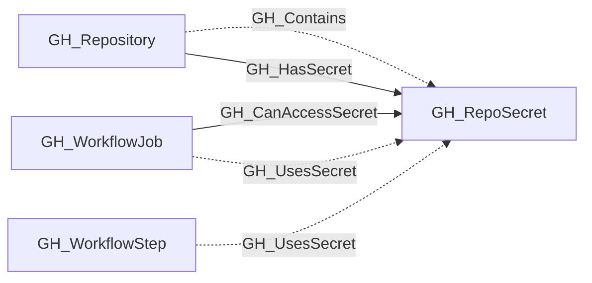

## General Information

Represents a repository-level GitHub Actions secret. These are secrets defined directly on a specific repository and are only accessible to workflows running in that repository.

## Diagram

## Edges

<Note>
The tables below list edges defined by the GitHub extension only. Additional edges to or from this node may be created by other extensions.
</Note>

### Inbound Edges

| Edge | Source Node | Traversable |
| --- | --- | --- |
| [GH_CanAccessSecret](/opengraph/extensions/github/edges/gh_canaccesssecret) | [GH_WorkflowJob](/opengraph/extensions/github/nodes/gh_workflowjob) | ✅ |
| [GH_Contains](/opengraph/extensions/github/edges/gh_contains) | [GH_Repository](/opengraph/extensions/github/nodes/gh_repository) | ❌ |
| [GH_HasSecret](/opengraph/extensions/github/edges/gh_hassecret) | [GH_Repository](/opengraph/extensions/github/nodes/gh_repository) | ✅ |
| [GH_UsesSecret](/opengraph/extensions/github/edges/gh_usessecret) | [GH_WorkflowJob](/opengraph/extensions/github/nodes/gh_workflowjob) | ❌ |
| [GH_UsesSecret](/opengraph/extensions/github/edges/gh_usessecret) | [GH_WorkflowStep](/opengraph/extensions/github/nodes/gh_workflowstep) | ❌ |

### Outbound Edges

No verified outbound relationships are available.

## Properties

| Name | Type | Description |
| --- | --- | --- |
| `created_at` | `null \| string` | When the secret was created. |
| `displayname` | `string` |  |
| `environment_name` | `null \| string` | The name of the environment (GitHub organization). |
| `environmentid` | `string` |  |
| `last_seen` | `datetime` |  |
| `name` | `string` |  |
| `node_id` | `string` |  |
| `query_visible_repositories` | `null \| string` | Query for visible repositories. |
| `repository_id` | `null \| string` | The node_id of the containing repository. |
| `repository_name` | `null \| string` | The name of the containing repository. |
| `updated_at` | `null \| string` | When the secret was last updated. |
| `visibility` | `null \| string` | The secret&#39;s visibility scope. |

## References

- [Actions secrets API](https://docs.github.com/en/rest/actions/secrets)
