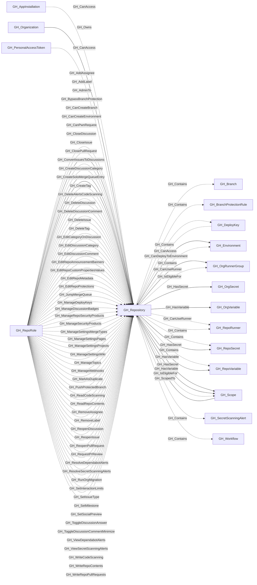

## General Information

Represents a GitHub repository within the organization. Repository nodes capture metadata about the repo including visibility, Actions enablement status, and security configuration. Repository role nodes ([GH_RepoRole](/opengraph/extensions/github/nodes/gh_reporole)) are created alongside each repository to represent the permission levels available.

For repositories with active workflows, the collector records the applicable default workflow permissions and whether workflows may approve pull request reviews. These properties preserve the repository-level policy input later used to derive effective GITHUB_TOKEN permissions for [GH_WorkflowJob](/opengraph/extensions/github/nodes/gh_workflowjob) nodes.

The `branch_count` and `environment_count` properties preserve GitHub-reported totals from the repository GraphQL response. These values can be compared to collected [GH_Branch](/opengraph/extensions/github/nodes/gh_branch) and [GH_Environment](/opengraph/extensions/github/nodes/gh_environment) children to identify incomplete collection before relying on branch- or environment-dependent analysis.

Every repository is linked from its organization's reusable repository/all [GH_Scope](/opengraph/extensions/github/nodes/gh_scope). Private and internal repositories are also linked from repository/private_or_internal. This supports compact one- or two-hop access queries without repeating one [GH_CanAccess](/opengraph/extensions/github/edges/gh_canaccess) edge per credential and repository.

Repositories also point to runner_group/all [GH_Scope](/opengraph/extensions/github/nodes/gh_scope) nodes through [GH_IsEligibleFor](/opengraph/extensions/github/edges/gh_iseligiblefor); private and internal repositories additionally point to runner_group/private_or_internal. Those scopes enumerate canonical runner groups through [GH_ScopedTo](/opengraph/extensions/github/edges/gh_scopedto), while groups with arbitrary selected repository policies remain direct.

Organization secrets and variables with canonical all/private visibility are similarly reached through organization_secret and organization_variable scopes. Repository-owned, environment-owned, and arbitrarily selected organization assets remain direct targets.

Runner, secret, and variable boundary edges are emitted only when the organization has a matching canonical target, so empty scopes do not add per-repository edges.

## Diagram

## Edges

<Note>
The tables below list edges defined by the GitHub extension only. Additional edges to or from this node may be created by other extensions.
</Note>

### Inbound Edges

| Edge | Source Node | Traversable |
| --- | --- | --- |
| [GH_AddAssignee](/opengraph/extensions/github/edges/gh_addassignee) | [GH_RepoRole](/opengraph/extensions/github/nodes/gh_reporole) | ❌ |
| [GH_AddLabel](/opengraph/extensions/github/edges/gh_addlabel) | [GH_RepoRole](/opengraph/extensions/github/nodes/gh_reporole) | ❌ |
| [GH_AdminTo](/opengraph/extensions/github/edges/gh_adminto) | [GH_RepoRole](/opengraph/extensions/github/nodes/gh_reporole) | ✅ |
| [GH_BypassBranchProtection](/opengraph/extensions/github/edges/gh_bypassbranchprotection) | [GH_RepoRole](/opengraph/extensions/github/nodes/gh_reporole) | ❌ |
| [GH_CanAccess](/opengraph/extensions/github/edges/gh_canaccess) | [GH_AppInstallation](/opengraph/extensions/github/nodes/gh_appinstallation) | ❌ |
| [GH_CanAccess](/opengraph/extensions/github/edges/gh_canaccess) | [GH_DeployKey](/opengraph/extensions/github/nodes/gh_deploykey) | ❌ |
| [GH_CanAccess](/opengraph/extensions/github/edges/gh_canaccess) | [GH_PersonalAccessToken](/opengraph/extensions/github/nodes/gh_personalaccesstoken) | ❌ |
| [GH_CanCreateBranch](/opengraph/extensions/github/edges/gh_cancreatebranch) | [GH_RepoRole](/opengraph/extensions/github/nodes/gh_reporole) | ✅ |
| [GH_CanCreateEnvironment](/opengraph/extensions/github/edges/gh_cancreateenvironment) | [GH_RepoRole](/opengraph/extensions/github/nodes/gh_reporole) | ✅ |
| [GH_CanPwnRequest](/opengraph/extensions/github/edges/gh_canpwnrequest) | [GH_RepoRole](/opengraph/extensions/github/nodes/gh_reporole) | ✅ |
| [GH_CloseDiscussion](/opengraph/extensions/github/edges/gh_closediscussion) | [GH_RepoRole](/opengraph/extensions/github/nodes/gh_reporole) | ❌ |
| [GH_CloseIssue](/opengraph/extensions/github/edges/gh_closeissue) | [GH_RepoRole](/opengraph/extensions/github/nodes/gh_reporole) | ❌ |
| [GH_ClosePullRequest](/opengraph/extensions/github/edges/gh_closepullrequest) | [GH_RepoRole](/opengraph/extensions/github/nodes/gh_reporole) | ❌ |
| [GH_ConvertIssuesToDiscussions](/opengraph/extensions/github/edges/gh_convertissuestodiscussions) | [GH_RepoRole](/opengraph/extensions/github/nodes/gh_reporole) | ❌ |
| [GH_CreateDiscussionCategory](/opengraph/extensions/github/edges/gh_creatediscussioncategory) | [GH_RepoRole](/opengraph/extensions/github/nodes/gh_reporole) | ❌ |
| [GH_CreateSoloMergeQueueEntry](/opengraph/extensions/github/edges/gh_createsolomergequeueentry) | [GH_RepoRole](/opengraph/extensions/github/nodes/gh_reporole) | ❌ |
| [GH_CreateTag](/opengraph/extensions/github/edges/gh_createtag) | [GH_RepoRole](/opengraph/extensions/github/nodes/gh_reporole) | ❌ |
| [GH_DeleteAlertsCodeScanning](/opengraph/extensions/github/edges/gh_deletealertscodescanning) | [GH_RepoRole](/opengraph/extensions/github/nodes/gh_reporole) | ❌ |
| [GH_DeleteDiscussion](/opengraph/extensions/github/edges/gh_deletediscussion) | [GH_RepoRole](/opengraph/extensions/github/nodes/gh_reporole) | ❌ |
| [GH_DeleteDiscussionComment](/opengraph/extensions/github/edges/gh_deletediscussioncomment) | [GH_RepoRole](/opengraph/extensions/github/nodes/gh_reporole) | ❌ |
| [GH_DeleteIssue](/opengraph/extensions/github/edges/gh_deleteissue) | [GH_RepoRole](/opengraph/extensions/github/nodes/gh_reporole) | ❌ |
| [GH_DeleteTag](/opengraph/extensions/github/edges/gh_deletetag) | [GH_RepoRole](/opengraph/extensions/github/nodes/gh_reporole) | ❌ |
| [GH_EditCategoryOnDiscussion](/opengraph/extensions/github/edges/gh_editcategoryondiscussion) | [GH_RepoRole](/opengraph/extensions/github/nodes/gh_reporole) | ❌ |
| [GH_EditDiscussionCategory](/opengraph/extensions/github/edges/gh_editdiscussioncategory) | [GH_RepoRole](/opengraph/extensions/github/nodes/gh_reporole) | ❌ |
| [GH_EditDiscussionComment](/opengraph/extensions/github/edges/gh_editdiscussioncomment) | [GH_RepoRole](/opengraph/extensions/github/nodes/gh_reporole) | ❌ |
| [GH_EditRepoAnnouncementBanners](/opengraph/extensions/github/edges/gh_editrepoannouncementbanners) | [GH_RepoRole](/opengraph/extensions/github/nodes/gh_reporole) | ❌ |
| [GH_EditRepoCustomPropertiesValues](/opengraph/extensions/github/edges/gh_editrepocustompropertiesvalues) | [GH_RepoRole](/opengraph/extensions/github/nodes/gh_reporole) | ❌ |
| [GH_EditRepoMetadata](/opengraph/extensions/github/edges/gh_editrepometadata) | [GH_RepoRole](/opengraph/extensions/github/nodes/gh_reporole) | ❌ |
| [GH_EditRepoProtections](/opengraph/extensions/github/edges/gh_editrepoprotections) | [GH_RepoRole](/opengraph/extensions/github/nodes/gh_reporole) | ❌ |
| [GH_JumpMergeQueue](/opengraph/extensions/github/edges/gh_jumpmergequeue) | [GH_RepoRole](/opengraph/extensions/github/nodes/gh_reporole) | ❌ |
| [GH_ManageDeployKeys](/opengraph/extensions/github/edges/gh_managedeploykeys) | [GH_RepoRole](/opengraph/extensions/github/nodes/gh_reporole) | ❌ |
| [GH_ManageDiscussionBadges](/opengraph/extensions/github/edges/gh_managediscussionbadges) | [GH_RepoRole](/opengraph/extensions/github/nodes/gh_reporole) | ❌ |
| [GH_ManageRepoSecurityProducts](/opengraph/extensions/github/edges/gh_managereposecurityproducts) | [GH_RepoRole](/opengraph/extensions/github/nodes/gh_reporole) | ❌ |
| [GH_ManageSecurityProducts](/opengraph/extensions/github/edges/gh_managesecurityproducts) | [GH_RepoRole](/opengraph/extensions/github/nodes/gh_reporole) | ❌ |
| [GH_ManageSettingsMergeTypes](/opengraph/extensions/github/edges/gh_managesettingsmergetypes) | [GH_RepoRole](/opengraph/extensions/github/nodes/gh_reporole) | ❌ |
| [GH_ManageSettingsPages](/opengraph/extensions/github/edges/gh_managesettingspages) | [GH_RepoRole](/opengraph/extensions/github/nodes/gh_reporole) | ❌ |
| [GH_ManageSettingsProjects](/opengraph/extensions/github/edges/gh_managesettingsprojects) | [GH_RepoRole](/opengraph/extensions/github/nodes/gh_reporole) | ❌ |
| [GH_ManageSettingsWiki](/opengraph/extensions/github/edges/gh_managesettingswiki) | [GH_RepoRole](/opengraph/extensions/github/nodes/gh_reporole) | ❌ |
| [GH_ManageTopics](/opengraph/extensions/github/edges/gh_managetopics) | [GH_RepoRole](/opengraph/extensions/github/nodes/gh_reporole) | ❌ |
| [GH_ManageWebhooks](/opengraph/extensions/github/edges/gh_managewebhooks) | [GH_RepoRole](/opengraph/extensions/github/nodes/gh_reporole) | ❌ |
| [GH_MarkAsDuplicate](/opengraph/extensions/github/edges/gh_markasduplicate) | [GH_RepoRole](/opengraph/extensions/github/nodes/gh_reporole) | ❌ |
| [GH_Owns](/opengraph/extensions/github/edges/gh_owns) | [GH_Organization](/opengraph/extensions/github/nodes/gh_organization) | ✅ |
| [GH_PushProtectedBranch](/opengraph/extensions/github/edges/gh_pushprotectedbranch) | [GH_RepoRole](/opengraph/extensions/github/nodes/gh_reporole) | ❌ |
| [GH_ReadCodeScanning](/opengraph/extensions/github/edges/gh_readcodescanning) | [GH_RepoRole](/opengraph/extensions/github/nodes/gh_reporole) | ❌ |
| [GH_ReadRepoContents](/opengraph/extensions/github/edges/gh_readrepocontents) | [GH_RepoRole](/opengraph/extensions/github/nodes/gh_reporole) | ❌ |
| [GH_RemoveAssignee](/opengraph/extensions/github/edges/gh_removeassignee) | [GH_RepoRole](/opengraph/extensions/github/nodes/gh_reporole) | ❌ |
| [GH_RemoveLabel](/opengraph/extensions/github/edges/gh_removelabel) | [GH_RepoRole](/opengraph/extensions/github/nodes/gh_reporole) | ❌ |
| [GH_ReopenDiscussion](/opengraph/extensions/github/edges/gh_reopendiscussion) | [GH_RepoRole](/opengraph/extensions/github/nodes/gh_reporole) | ❌ |
| [GH_ReopenIssue](/opengraph/extensions/github/edges/gh_reopenissue) | [GH_RepoRole](/opengraph/extensions/github/nodes/gh_reporole) | ❌ |
| [GH_ReopenPullRequest](/opengraph/extensions/github/edges/gh_reopenpullrequest) | [GH_RepoRole](/opengraph/extensions/github/nodes/gh_reporole) | ❌ |
| [GH_RequestPrReview](/opengraph/extensions/github/edges/gh_requestprreview) | [GH_RepoRole](/opengraph/extensions/github/nodes/gh_reporole) | ❌ |
| [GH_ResolveDependabotAlerts](/opengraph/extensions/github/edges/gh_resolvedependabotalerts) | [GH_RepoRole](/opengraph/extensions/github/nodes/gh_reporole) | ❌ |
| [GH_ResolveSecretScanningAlerts](/opengraph/extensions/github/edges/gh_resolvesecretscanningalerts) | [GH_RepoRole](/opengraph/extensions/github/nodes/gh_reporole) | ❌ |
| [GH_RunOrgMigration](/opengraph/extensions/github/edges/gh_runorgmigration) | [GH_RepoRole](/opengraph/extensions/github/nodes/gh_reporole) | ❌ |
| [GH_ScopedTo](/opengraph/extensions/github/edges/gh_scopedto) | [GH_Scope](/opengraph/extensions/github/nodes/gh_scope) | ✅ |
| [GH_SetInteractionLimits](/opengraph/extensions/github/edges/gh_setinteractionlimits) | [GH_RepoRole](/opengraph/extensions/github/nodes/gh_reporole) | ❌ |
| [GH_SetIssueType](/opengraph/extensions/github/edges/gh_setissuetype) | [GH_RepoRole](/opengraph/extensions/github/nodes/gh_reporole) | ❌ |
| [GH_SetMilestone](/opengraph/extensions/github/edges/gh_setmilestone) | [GH_RepoRole](/opengraph/extensions/github/nodes/gh_reporole) | ❌ |
| [GH_SetSocialPreview](/opengraph/extensions/github/edges/gh_setsocialpreview) | [GH_RepoRole](/opengraph/extensions/github/nodes/gh_reporole) | ❌ |
| [GH_ToggleDiscussionAnswer](/opengraph/extensions/github/edges/gh_togglediscussionanswer) | [GH_RepoRole](/opengraph/extensions/github/nodes/gh_reporole) | ❌ |
| [GH_ToggleDiscussionCommentMinimize](/opengraph/extensions/github/edges/gh_togglediscussioncommentminimize) | [GH_RepoRole](/opengraph/extensions/github/nodes/gh_reporole) | ❌ |
| [GH_ViewDependabotAlerts](/opengraph/extensions/github/edges/gh_viewdependabotalerts) | [GH_RepoRole](/opengraph/extensions/github/nodes/gh_reporole) | ❌ |
| [GH_ViewSecretScanningAlerts](/opengraph/extensions/github/edges/gh_viewsecretscanningalerts) | [GH_RepoRole](/opengraph/extensions/github/nodes/gh_reporole) | ❌ |
| [GH_WriteCodeScanning](/opengraph/extensions/github/edges/gh_writecodescanning) | [GH_RepoRole](/opengraph/extensions/github/nodes/gh_reporole) | ❌ |
| [GH_WriteRepoContents](/opengraph/extensions/github/edges/gh_writerepocontents) | [GH_RepoRole](/opengraph/extensions/github/nodes/gh_reporole) | ❌ |
| [GH_WriteRepoPullRequests](/opengraph/extensions/github/edges/gh_writerepopullrequests) | [GH_RepoRole](/opengraph/extensions/github/nodes/gh_reporole) | ❌ |

### Outbound Edges

| Edge | Destination Node | Traversable |
| --- | --- | --- |
| [GH_CanAssumeIdentity](/opengraph/extensions/github/edges/gh_canassumeidentity) | `AWS_Role` | ✅ |
| [GH_CanAssumeIdentity](/opengraph/extensions/github/edges/gh_canassumeidentity) | `AZFederatedIdentityCredential` | ✅ |
| [GH_CanDeployToEnvironment](/opengraph/extensions/github/edges/gh_candeploytoenvironment) | [GH_Environment](/opengraph/extensions/github/nodes/gh_environment) | ✅ |
| [GH_CanUseRunner](/opengraph/extensions/github/edges/gh_canuserunner) | [GH_OrgRunnerGroup](/opengraph/extensions/github/nodes/gh_orgrunnergroup) | ✅ |
| [GH_CanUseRunner](/opengraph/extensions/github/edges/gh_canuserunner) | [GH_RepoRunner](/opengraph/extensions/github/nodes/gh_reporunner) | ✅ |
| [GH_Contains](/opengraph/extensions/github/edges/gh_contains) | [GH_Branch](/opengraph/extensions/github/nodes/gh_branch) | ❌ |
| [GH_Contains](/opengraph/extensions/github/edges/gh_contains) | [GH_BranchProtectionRule](/opengraph/extensions/github/nodes/gh_branchprotectionrule) | ❌ |
| [GH_Contains](/opengraph/extensions/github/edges/gh_contains) | [GH_DeployKey](/opengraph/extensions/github/nodes/gh_deploykey) | ❌ |
| [GH_Contains](/opengraph/extensions/github/edges/gh_contains) | [GH_Environment](/opengraph/extensions/github/nodes/gh_environment) | ❌ |
| [GH_Contains](/opengraph/extensions/github/edges/gh_contains) | [GH_RepoRunner](/opengraph/extensions/github/nodes/gh_reporunner) | ❌ |
| [GH_Contains](/opengraph/extensions/github/edges/gh_contains) | [GH_RepoSecret](/opengraph/extensions/github/nodes/gh_reposecret) | ❌ |
| [GH_Contains](/opengraph/extensions/github/edges/gh_contains) | [GH_RepoVariable](/opengraph/extensions/github/nodes/gh_repovariable) | ❌ |
| [GH_Contains](/opengraph/extensions/github/edges/gh_contains) | [GH_SecretScanningAlert](/opengraph/extensions/github/nodes/gh_secretscanningalert) | ❌ |
| [GH_Contains](/opengraph/extensions/github/edges/gh_contains) | [GH_Workflow](/opengraph/extensions/github/nodes/gh_workflow) | ❌ |
| [GH_HasSecret](/opengraph/extensions/github/edges/gh_hassecret) | [GH_OrgSecret](/opengraph/extensions/github/nodes/gh_orgsecret) | ✅ |
| [GH_HasSecret](/opengraph/extensions/github/edges/gh_hassecret) | [GH_RepoSecret](/opengraph/extensions/github/nodes/gh_reposecret) | ✅ |
| [GH_HasSecret](/opengraph/extensions/github/edges/gh_hassecret) | [GH_Scope](/opengraph/extensions/github/nodes/gh_scope) | ✅ |
| [GH_HasVariable](/opengraph/extensions/github/edges/gh_hasvariable) | [GH_OrgVariable](/opengraph/extensions/github/nodes/gh_orgvariable) | ✅ |
| [GH_HasVariable](/opengraph/extensions/github/edges/gh_hasvariable) | [GH_RepoVariable](/opengraph/extensions/github/nodes/gh_repovariable) | ✅ |
| [GH_HasVariable](/opengraph/extensions/github/edges/gh_hasvariable) | [GH_Scope](/opengraph/extensions/github/nodes/gh_scope) | ✅ |
| [GH_IsEligibleFor](/opengraph/extensions/github/edges/gh_iseligiblefor) | [GH_OrgRunnerGroup](/opengraph/extensions/github/nodes/gh_orgrunnergroup) | ❌ |
| [GH_IsEligibleFor](/opengraph/extensions/github/edges/gh_iseligiblefor) | [GH_Scope](/opengraph/extensions/github/nodes/gh_scope) | ❌ |

## Properties

| Name | Type | Description |
| --- | --- | --- |
| `actions_enabled` | `boolean \| null` | Whether GitHub Actions is enabled for this repository. |
| `allow_forking` | `boolean \| null` | Whether forking is allowed. |
| `archived` | `boolean \| null` | Whether the repository is archived. |
| `branch_count` | `integer \| null` | Number of branch refs reported by GitHub for this repository. |
| `branch_ruleset_count` | `integer \| null` | Number of branch-targeted rulesets that apply to this repository. |
| `can_approve_pull_request_reviews` | `boolean \| null` | Whether workflows may approve pull request reviews. |
| `collected` | `boolean` | Collected/generated by OpenHound |
| `created_at` | `null \| string` | When the repository was created. |
| `database_id` | `integer \| null` | The repository&#39;s numeric GitHub database ID used in immutable OIDC subjects. |
| `default_branch` | `null \| string` | The name of the default branch (e.g., `main`). |
| `default_workflow_permissions` | `null \| string` | The repository&#39;s applicable default GITHUB_TOKEN workflow permissions. |
| `deploy_key_count` | `integer \| null` | Number of deploy keys reported by GitHub for this repository. |
| `description` | `null \| string` | The repository description. |
| `disabled` | `boolean \| null` | Whether the repository is disabled. |
| `displayname` | `string` |  |
| `environment_count` | `integer \| null` | Number of deployment environments reported by GitHub for this repository. |
| `environment_name` | `null \| string` | The name of the environment (GitHub organization). |
| `environmentid` | `string` |  |
| `forks` | `integer \| null` | Number of forks. |
| `full_name` | `null \| string` | The fully qualified name (e.g., `org/repo`). |
| `has_branch_rulesets` | `boolean \| null` | Whether at least one branch-targeted ruleset applies to this repository. |
| `html_url` | `null \| string` | URL to the repository on GitHub. |
| `last_seen` | `datetime` |  |
| `name` | `string` |  |
| `node_id` | `string` |  |
| `open_issues` | `integer \| null` | Number of open issues (includes pull requests). |
| `open_issues_count` | `integer \| null` | Number of open issues. |
| `owner_database_id` | `integer \| null` | The numeric GitHub database ID of the repository owner used in immutable OIDC subjects. |
| `owner_id` | `null \| string` | The opaque GraphQL node ID of the repository owner. |
| `owner_name` | `null \| string` | The login of the repository owner. |
| `private` | `boolean \| null` | Whether the repository is private. |
| `pushed_at` | `null \| string` | When the repository last had a push. |
| `query_branch_protection_rules` | `null \| string` | Query for branch protection rules. |
| `query_branches` | `null \| string` | Query for branches. |
| `query_deploy_keys` | `null \| string` | Query for deploy keys. |
| `query_environments` | `null \| string` | Query for environments. |
| `query_explicit_readers` | `null \| string` | Query for explicit readers. |
| `query_explicit_writers` | `null \| string` | Query for explicit writers. |
| `query_protected_branches` | `null \| string` | Query for protected branches. |
| `query_roles` | `null \| string` | Query for roles. |
| `query_runners` | `null \| string` | Query for runners. |
| `query_secret_scanning_alerts` | `null \| string` | Query for secret scanning alerts. |
| `query_secrets` | `null \| string` | Query for secrets. |
| `query_teams` | `null \| string` | Query for teams. |
| `query_unrolled_readers` | `null \| string` | Query for unrolled readers. |
| `query_unrolled_writers` | `null \| string` | Query for unrolled writers. |
| `query_variables` | `null \| string` | Query for variables. |
| `query_workflows` | `null \| string` | Query for workflows. |
| `secret_scanning` | `null \| string` | Status of secret scanning (e.g., `enabled`, `disabled`). |
| `self_hosted_runners_enabled` | `boolean \| null` | Whether the repository may use self-hosted runners. |
| `size` | `integer \| null` | Repository size in kilobytes as reported by GitHub. |
| `updated_at` | `null \| string` | When the repository was last updated. |
| `visibility` | `null \| string` | The visibility level: `public`, `private`, or `internal`. |
| `watchers` | `integer \| null` | Number of watchers. |
| `web_commit_signoff_required` | `boolean \| null` | Whether web-based commits require sign-off. |

## References

- [Repository roles](https://docs.github.com/en/organizations/managing-access-to-your-organizations-repositories/repository-roles-for-an-organization)
