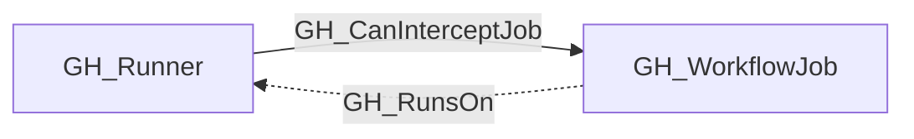

## General Information

Generic label applied to GitHub self-hosted runner nodes across enterprise, organization, and repository scope.

## Diagram

## Edges

<Note>
The tables below list edges defined by the GitHub extension only. Additional edges to or from this node may be created by other extensions.
</Note>

### Inbound Edges

| Edge | Source Node | Traversable |
| --- | --- | --- |
| [GH_RunsOn](/opengraph/extensions/github/edges/gh_runson) | [GH_WorkflowJob](/opengraph/extensions/github/nodes/gh_workflowjob) | ❌ |

### Outbound Edges

| Edge | Destination Node | Traversable |
| --- | --- | --- |
| [GH_CanInterceptJob](/opengraph/extensions/github/edges/gh_caninterceptjob) | [GH_WorkflowJob](/opengraph/extensions/github/nodes/gh_workflowjob) | ✅ |

## Properties

| Name | Type | Description |
| --- | --- | --- |
| `busy` | `boolean \| null` | Whether the runner is currently busy. |
| `displayname` | `string` |  |
| `environment_name` | `null \| string` | The name of the environment (GitHub organization). |
| `environmentid` | `string` |  |
| `ephemeral` | `boolean \| null` | Whether the runner is ephemeral. |
| `labels` | `null \| string` | JSON array of runner labels. |
| `last_seen` | `datetime` |  |
| `name` | `string` |  |
| `node_id` | `string` |  |
| `os` | `null \| string` | The runner operating system. |
| `query_group` | `null \| string` | Query for group. |
| `query_interceptable_jobs` | `null \| string` | Query for workflow jobs the runner can intercept. |
| `query_jobs` | `null \| string` | Query for workflow jobs that can be scheduled on the runner. |
| `query_repositories` | `null \| string` | Query for repositories. |
| `repository_full_name` | `null \| string` | The full repository name for repository-scoped runners. |
| `repository_id` | `null \| string` | The repository node_id for repository-scoped runners. |
| `repository_name` | `null \| string` | The repository name for repository-scoped runners. |
| `runner_group_id` | `integer \| null` | The associated runner group ID. |
| `runner_group_name` | `null \| string` | The associated runner group name. |
| `runner_group_visibility` | `null \| string` | Runner group visibility when organization scoped. |
| `runner_id` | `integer \| null` | The GitHub runner ID. |
| `scope` | `null \| string` | Whether the runner is enterprise, organization, or repository scoped. |
| `status` | `null \| string` | The runner status. |

## References

- [Self-hosted runners API](https://docs.github.com/en/rest/actions/self-hosted-runners)
