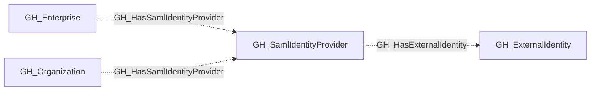

## General Information

Represents a SAML identity provider configured for an organization or enterprise. This node captures the SAML SSO configuration details and serves as the parent container for external identity mappings. Through external identities, it enables linking GitHub users to their corporate identities in the identity provider.

## Diagram

This node also carries the non-display secondary kind [`GH_IdentityProvider`](/opengraph/extensions/github/nodes/gh_identityprovider), shared with enterprise OIDC providers.

## Edges

<Note>
The tables below list edges defined by the GitHub extension only. Additional edges to or from this node may be created by other extensions.
</Note>

### Inbound Edges

| Edge | Source Node | Traversable |
| --- | --- | --- |
| [GH_HasSamlIdentityProvider](/opengraph/extensions/github/edges/gh_hassamlidentityprovider) | [GH_Enterprise](/opengraph/extensions/github/nodes/gh_enterprise) | ❌ |
| [GH_HasSamlIdentityProvider](/opengraph/extensions/github/edges/gh_hassamlidentityprovider) | [GH_Organization](/opengraph/extensions/github/nodes/gh_organization) | ❌ |

### Outbound Edges

No verified outbound relationships are available.

## Properties

| Name | Type | Description |
| --- | --- | --- |
| `digest_method` | `null \| string` | The digest method used by the SAML provider. |
| `displayname` | `string` |  |
| `environment_name` | `null \| string` | The name of the environment (GitHub organization). |
| `environmentid` | `string` |  |
| `foreign_environment_id` | `null \| string` | The ID of the foreign environment linked to this provider. |
| `github_deployment_id` | `null \| string` |  |
| `github_web_origin` | `null \| string` |  |
| `idp_certificate` | `null \| string` | The identity provider&#39;s X.509 certificate. |
| `issuer` | `null \| string` | The SAML issuer URL. |
| `last_seen` | `datetime` |  |
| `name` | `string` |  |
| `node_id` | `string` |  |
| `query_environments` | `null \| string` | Query for environments. |
| `query_external_identities` | `null \| string` | Query for external identities. |
| `signature_method` | `null \| string` | The signature method used by the SAML provider. |
| `sso_url` | `null \| string` | The SAML single sign-on URL. |

## References

- [SAML single sign-on](https://docs.github.com/en/enterprise-cloud@latest/authentication/authenticating-with-single-sign-on/about-authentication-with-single-sign-on)
