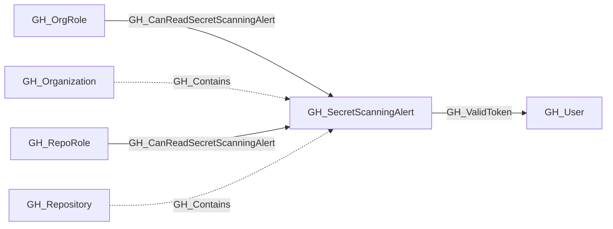

## General Information

Represents a GitHub secret scanning alert detected in a repository. Secret scanning alerts are raised when GitHub detects a known secret pattern (such as an API key, token, or credential) committed to a repository. The alert captures the secret type, validity status, and current resolution state.

## Diagram

## Edges

<Note>
The tables below list edges defined by the GitHub extension only. Additional edges to or from this node may be created by other extensions.
</Note>

### Inbound Edges

| Edge | Source Node | Traversable |
| --- | --- | --- |
| [GH_CanReadSecretScanningAlert](/opengraph/extensions/github/edges/gh_canreadsecretscanningalert) | [GH_OrgRole](/opengraph/extensions/github/nodes/gh_orgrole) | ✅ |
| [GH_CanReadSecretScanningAlert](/opengraph/extensions/github/edges/gh_canreadsecretscanningalert) | [GH_RepoRole](/opengraph/extensions/github/nodes/gh_reporole) | ✅ |
| [GH_Contains](/opengraph/extensions/github/edges/gh_contains) | [GH_Organization](/opengraph/extensions/github/nodes/gh_organization) | ❌ |
| [GH_Contains](/opengraph/extensions/github/edges/gh_contains) | [GH_Repository](/opengraph/extensions/github/nodes/gh_repository) | ❌ |

### Outbound Edges

| Edge | Destination Node | Traversable |
| --- | --- | --- |
| [GH_ValidToken](/opengraph/extensions/github/edges/gh_validtoken) | [GH_User](/opengraph/extensions/github/nodes/gh_user) | ✅ |

## Properties

| Name | Type | Description |
| --- | --- | --- |
| `displayname` | `string` |  |
| `environmentid` | `string` |  |
| `last_seen` | `datetime` |  |
| `name` | `string` |  |
| `node_id` | `string` |  |
| `query_alert_viewers` | `null \| string` | Query for alert viewers. |
| `query_repository` | `null \| string` | Query for repository. |
| `repository_name` | `null \| string` | The name of the repository where the secret was detected. |
| `secret_type` | `null \| string` | The type of secret detected (e.g., `github_personal_access_token`, `aws_access_key_id`). |
| `secret_type_display_name` | `null \| string` | A human-readable name for the secret type. |
| `state` | `null \| string` | The alert state (e.g., `open`, `resolved`). |
| `url` | `null \| string` | The HTML URL to view the alert on GitHub. |
| `validity` | `null \| string` | The validity status of the detected secret (e.g., `active`, `inactive`, `unknown`). |

## References

- [Secret scanning API](https://docs.github.com/en/rest/secret-scanning/secret-scanning)
