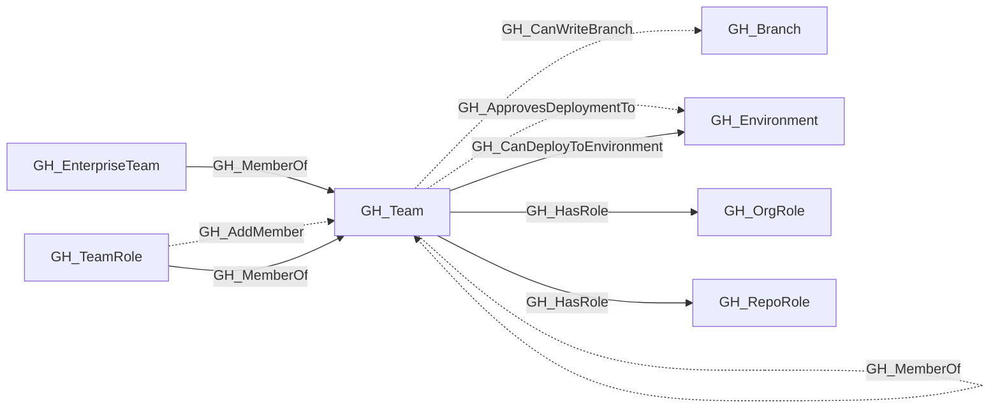

## General Information

Represents a GitHub team within the organization. Teams can have parent-child relationships, contain members with different roles (Member, Maintainer), and be assigned to repository roles.

## Diagram

## Edges

<Note>
The tables below list edges defined by the GitHub extension only. Additional edges to or from this node may be created by other extensions.
</Note>

### Inbound Edges

| Edge | Source Node | Traversable |
| --- | --- | --- |
| [GH_AddMember](/opengraph/extensions/github/edges/gh_addmember) | [GH_TeamRole](/opengraph/extensions/github/nodes/gh_teamrole) | ❌ |
| [GH_MemberOf](/opengraph/extensions/github/edges/gh_memberof) | [GH_EnterpriseTeam](/opengraph/extensions/github/nodes/gh_enterpriseteam) | ✅ |
| [GH_MemberOf](/opengraph/extensions/github/edges/gh_memberof) | GH_Team | ✅ |
| [GH_MemberOf](/opengraph/extensions/github/edges/gh_memberof) | [GH_TeamRole](/opengraph/extensions/github/nodes/gh_teamrole) | ✅ |

### Outbound Edges

| Edge | Destination Node | Traversable |
| --- | --- | --- |
| [GH_ApprovesDeploymentTo](/opengraph/extensions/github/edges/gh_approvesdeploymentto) | [GH_Environment](/opengraph/extensions/github/nodes/gh_environment) | ❌ |
| [GH_CanDeployToEnvironment](/opengraph/extensions/github/edges/gh_candeploytoenvironment) | [GH_Environment](/opengraph/extensions/github/nodes/gh_environment) | ✅ |
| [GH_CanWriteBranch](/opengraph/extensions/github/edges/gh_canwritebranch) | [GH_Branch](/opengraph/extensions/github/nodes/gh_branch) | ✅ |
| [GH_HasRole](/opengraph/extensions/github/edges/gh_hasrole) | [GH_OrgRole](/opengraph/extensions/github/nodes/gh_orgrole) | ✅ |
| [GH_HasRole](/opengraph/extensions/github/edges/gh_hasrole) | [GH_RepoRole](/opengraph/extensions/github/nodes/gh_reporole) | ✅ |
| [GH_MemberOf](/opengraph/extensions/github/edges/gh_memberof) | GH_Team | ✅ |

## Properties

| Name | Type | Description |
| --- | --- | --- |
| `collected` | `boolean` | Collected/generated by OpenHound |
| `description` | `null \| string` | The team&#39;s description. |
| `displayname` | `string` |  |
| `environment_name` | `null \| string` | The name of the environment (GitHub organization). |
| `environmentid` | `string` |  |
| `external_group_id` | `integer \| null` | GitHub&#39;s org-scoped external IdP group identifier. |
| `external_group_name` | `null \| string` | The external IdP group name reported by GitHub. |
| `github_team_id` | `null \| string` | The raw GitHub team node ID. |
| `last_seen` | `datetime` |  |
| `name` | `string` |  |
| `node_id` | `string` |  |
| `privacy` | `null \| string` | The team&#39;s privacy level (e.g., `visible`, `secret`). |
| `query_child_teams` | `null \| string` | Query for child teams. |
| `query_first_degree_maintainers` | `null \| string` | Query for first degree maintainers. |
| `query_first_degree_members` | `null \| string` | Query for first degree members. |
| `query_repositories` | `null \| string` | Query for repositories. |
| `query_unrolled_maintainers` | `null \| string` | Query for unrolled maintainers. |
| `query_unrolled_members` | `null \| string` | Query for unrolled members. |
| `slug` | `null \| string` | The team&#39;s URL-safe slug identifier. |
| `type` | `null \| string` | The team type, such as `enterprise` for projected enterprise teams. |

## References

- [Team membership API](https://docs.github.com/en/rest/teams/members)
