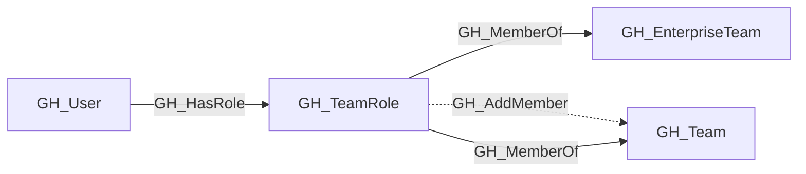

## General Information

Represents a role within a GitHub team. Each team has two built-in roles: Member and Maintainer. Maintainers can add and remove team members. Team roles connect users to teams and transitively to any repository roles assigned to the team.

## Diagram

## Edges

<Note>
The tables below list edges defined by the GitHub extension only. Additional edges to or from this node may be created by other extensions.
</Note>

### Inbound Edges

| Edge | Source Node | Traversable |
| --- | --- | --- |
| [GH_HasRole](/opengraph/extensions/github/edges/gh_hasrole) | [GH_User](/opengraph/extensions/github/nodes/gh_user) | ✅ |

### Outbound Edges

| Edge | Destination Node | Traversable |
| --- | --- | --- |
| [GH_AddMember](/opengraph/extensions/github/edges/gh_addmember) | [GH_Team](/opengraph/extensions/github/nodes/gh_team) | ❌ |
| [GH_MemberOf](/opengraph/extensions/github/edges/gh_memberof) | [GH_EnterpriseTeam](/opengraph/extensions/github/nodes/gh_enterpriseteam) | ✅ |
| [GH_MemberOf](/opengraph/extensions/github/edges/gh_memberof) | [GH_Team](/opengraph/extensions/github/nodes/gh_team) | ✅ |

## Properties

| Name | Type | Description |
| --- | --- | --- |
| `displayname` | `string` |  |
| `enterpriseid` | `null \| string` | The containing enterprise node ID. |
| `environment_name` | `null \| string` | The enterprise environment name. The name of the environment (GitHub organization). |
| `environmentid` | `string` |  |
| `last_seen` | `datetime` |  |
| `name` | `string` |  |
| `node_id` | `string` |  |
| `query_members` | `null \| string` | Query for members. Query for role members. |
| `query_repositories` | `null \| string` | Query for repositories. |
| `query_team` | `null \| string` | Query for team. Query for the team. |
| `short_name` | `null \| string` | The role short name. The short role name: `member` or `maintainer`. |
| `team_id` | `null \| string` | The enterprise team node ID. The team id property. |
| `team_name` | `null \| string` | The team display name. The team name property. |
| `type` | `null \| string` | Always `default` for team roles. The role type. |

## References

- [Team membership API](https://docs.github.com/en/rest/teams/members)
