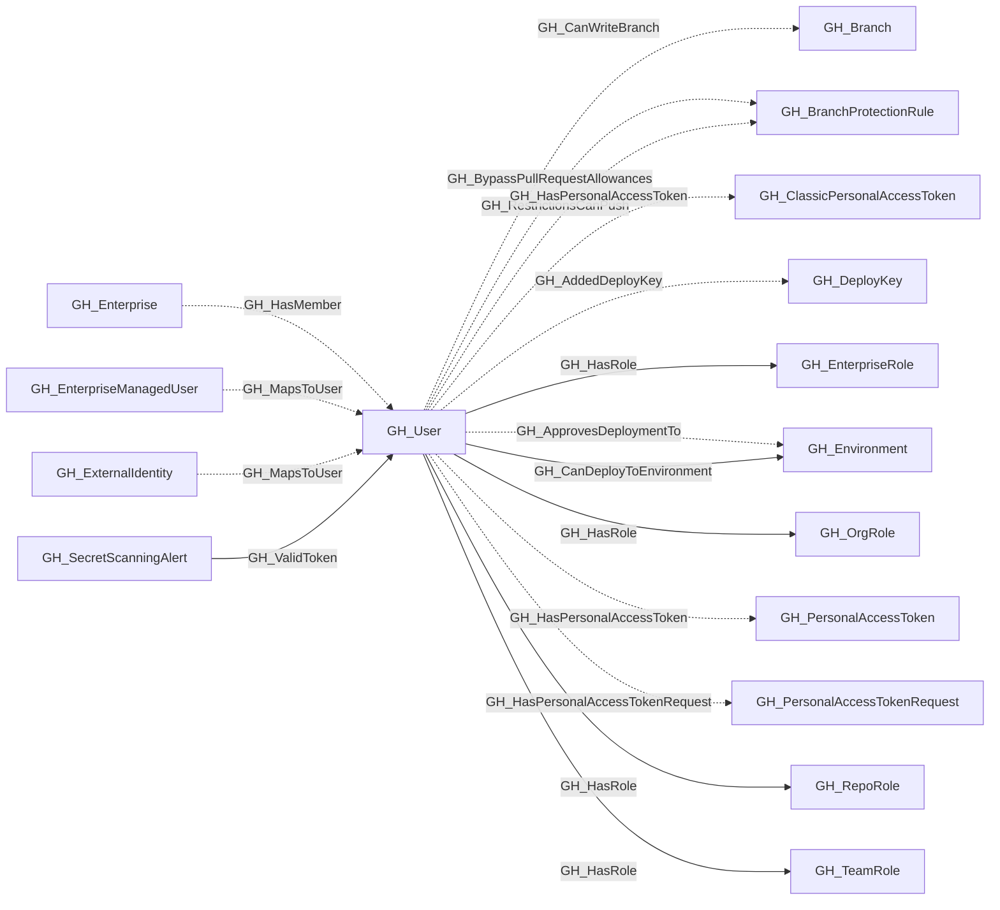

## General Information

Represents a GitHub user who is a member of the organization. Users are associated with organization roles (Owner or Member) and can be assigned to repository roles and team roles.

## Diagram

## Edges

<Note>
The tables below list edges defined by the GitHub extension only. Additional edges to or from this node may be created by other extensions.
</Note>

### Inbound Edges

| Edge | Source Node | Traversable |
| --- | --- | --- |
| [GH_HasMember](/opengraph/extensions/github/edges/gh_hasmember) | [GH_Enterprise](/opengraph/extensions/github/nodes/gh_enterprise) | ❌ |
| [GH_MapsToUser](/opengraph/extensions/github/edges/gh_mapstouser) | [GH_EnterpriseManagedUser](/opengraph/extensions/github/nodes/gh_enterprisemanageduser) | ❌ |
| [GH_MapsToUser](/opengraph/extensions/github/edges/gh_mapstouser) | [GH_ExternalIdentity](/opengraph/extensions/github/nodes/gh_externalidentity) | ❌ |
| [GH_ValidToken](/opengraph/extensions/github/edges/gh_validtoken) | [GH_SecretScanningAlert](/opengraph/extensions/github/nodes/gh_secretscanningalert) | ✅ |

### Outbound Edges

| Edge | Destination Node | Traversable |
| --- | --- | --- |
| [GH_AddedDeployKey](/opengraph/extensions/github/edges/gh_addeddeploykey) | [GH_DeployKey](/opengraph/extensions/github/nodes/gh_deploykey) | ❌ |
| [GH_ApprovesDeploymentTo](/opengraph/extensions/github/edges/gh_approvesdeploymentto) | [GH_Environment](/opengraph/extensions/github/nodes/gh_environment) | ❌ |
| [GH_BypassPullRequestAllowances](/opengraph/extensions/github/edges/gh_bypasspullrequestallowances) | [GH_BranchProtectionRule](/opengraph/extensions/github/nodes/gh_branchprotectionrule) | ❌ |
| [GH_CanDeployToEnvironment](/opengraph/extensions/github/edges/gh_candeploytoenvironment) | [GH_Environment](/opengraph/extensions/github/nodes/gh_environment) | ✅ |
| [GH_CanWriteBranch](/opengraph/extensions/github/edges/gh_canwritebranch) | [GH_Branch](/opengraph/extensions/github/nodes/gh_branch) | ✅ |
| [GH_HasPersonalAccessToken](/opengraph/extensions/github/edges/gh_haspersonalaccesstoken) | [GH_ClassicPersonalAccessToken](/opengraph/extensions/github/nodes/gh_classicpersonalaccesstoken) | ❌ |
| [GH_HasPersonalAccessToken](/opengraph/extensions/github/edges/gh_haspersonalaccesstoken) | [GH_PersonalAccessToken](/opengraph/extensions/github/nodes/gh_personalaccesstoken) | ❌ |
| [GH_HasPersonalAccessTokenRequest](/opengraph/extensions/github/edges/gh_haspersonalaccesstokenrequest) | [GH_PersonalAccessTokenRequest](/opengraph/extensions/github/nodes/gh_personalaccesstokenrequest) | ❌ |
| [GH_HasRole](/opengraph/extensions/github/edges/gh_hasrole) | [GH_EnterpriseRole](/opengraph/extensions/github/nodes/gh_enterpriserole) | ✅ |
| [GH_HasRole](/opengraph/extensions/github/edges/gh_hasrole) | [GH_OrgRole](/opengraph/extensions/github/nodes/gh_orgrole) | ✅ |
| [GH_HasRole](/opengraph/extensions/github/edges/gh_hasrole) | [GH_RepoRole](/opengraph/extensions/github/nodes/gh_reporole) | ✅ |
| [GH_HasRole](/opengraph/extensions/github/edges/gh_hasrole) | [GH_TeamRole](/opengraph/extensions/github/nodes/gh_teamrole) | ✅ |
| [GH_Owns](/opengraph/extensions/github/edges/gh_owns) | [GH_App](/opengraph/extensions/github/nodes/gh_app) | ✅ |
| [GH_RestrictionsCanPush](/opengraph/extensions/github/edges/gh_restrictionscanpush) | [GH_BranchProtectionRule](/opengraph/extensions/github/nodes/gh_branchprotectionrule) | ❌ |

## Properties

| Name | Type | Description |
| --- | --- | --- |
| `collected` | `boolean` | Collected/generated by OpenHound Whether this user was collected directly. |
| `company` | `null \| string` | The company listed on the user&#39;s profile. The user&#39;s company. |
| `displayname` | `string` |  |
| `email` | `null \| string` | The user&#39;s public email address. The user&#39;s public email. |
| `environment_name` | `null \| string` | The enterprise environment name. The name of the environment (GitHub organization) the user belongs to. |
| `environmentid` | `string` |  |
| `full_name` | `null \| string` | The user&#39;s display name. The user&#39;s full name from their profile. |
| `last_seen` | `datetime` |  |
| `login` | `null \| string` | The GitHub login. The user&#39;s GitHub login handle. |
| `name` | `string` |  |
| `node_id` | `string` |  |
| `query_branches` | `null \| string` | Query for branches. |
| `query_enterprises` | `null \| string` | Query for enterprise memberships. |
| `query_personal_access_tokens` | `null \| string` | Query for personal access tokens. |
| `query_repositories` | `null \| string` | Query for repositories. |
| `query_roles` | `null \| string` | Query for roles. |
| `query_teams` | `null \| string` | Query for teams. |

## References

- [Organization roles](https://docs.github.com/en/organizations/managing-peoples-access-to-your-organization-with-roles/roles-in-an-organization)
