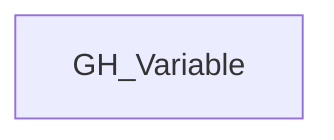

## General Information

Generic label applied to GitHub variable nodes across organization, repository, and environment scope.

## Diagram

## Edges

<Note>
The tables below list edges defined by the GitHub extension only. Additional edges to or from this node may be created by other extensions.
</Note>

### Inbound Edges

No verified inbound relationships are available.

### Outbound Edges

No verified outbound relationships are available.

## Properties

| Name | Type | Description |
| --- | --- | --- |
| `created_at` | `datetime \| null \| null \| string` | When the variable was created. |
| `deployment_environment_name` | `string` | The name of the deployment environment (GitHub organization). |
| `deployment_environmentid` | `null \| string` |  |
| `displayname` | `string` |  |
| `environment_name` | `null \| string \| string` | The name of the environment (GitHub organization). |
| `environmentid` | `string` |  |
| `last_seen` | `datetime` |  |
| `name` | `string` |  |
| `node_id` | `string` |  |
| `query_visible_repositories` | `null \| string` | Query for visible repositories. |
| `repository_id` | `null \| string \| string` | The id of the containing repository. The node_id of the containing repository. |
| `repository_name` | `null \| string \| string` | The name of the containing repository. |
| `updated_at` | `datetime \| null \| null \| string` | When the variable was last updated. |
| `value` | `null \| string \| string` | The plaintext value of the variable. |
| `visibility` | `null \| string` | The variable&#39;s visibility scope: `all` (all repos), `private` (private and internal repos), or `selected` (specific repos). |

## References

- [Actions variables API](https://docs.github.com/en/rest/actions/variables)
