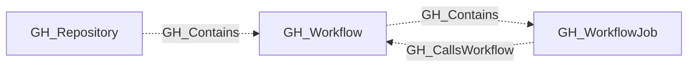

## General Information

Represents a GitHub Actions workflow defined in a repository. Workflow nodes capture the workflow definition metadata including its file path, state, containing repository, and the full YAML contents of the workflow file. Only repositories with GitHub Actions enabled are queried for workflows.

When present, `workflow_permissions` captures the top-level `permissions` declaration from the workflow YAML.

## Diagram

## Edges

<Note>
The tables below list edges defined by the GitHub extension only. Additional edges to or from this node may be created by other extensions.
</Note>

### Inbound Edges

| Edge | Source Node | Traversable |
| --- | --- | --- |
| [GH_CallsWorkflow](/opengraph/extensions/github/edges/gh_callsworkflow) | [GH_WorkflowJob](/opengraph/extensions/github/nodes/gh_workflowjob) | ❌ |
| [GH_Contains](/opengraph/extensions/github/edges/gh_contains) | [GH_Repository](/opengraph/extensions/github/nodes/gh_repository) | ❌ |

### Outbound Edges

| Edge | Destination Node | Traversable |
| --- | --- | --- |
| [GH_Contains](/opengraph/extensions/github/edges/gh_contains) | [GH_WorkflowJob](/opengraph/extensions/github/nodes/gh_workflowjob) | ❌ |

## Properties

| Name | Type | Description |
| --- | --- | --- |
| `branch` | `null \| string` | The branch where the workflow file was found. |
| `contents` | `null \| string` | The content of the workflow file. |
| `displayname` | `string` |  |
| `environment_name` | `null \| string` | The name of the environment (GitHub organization). |
| `environmentid` | `string` |  |
| `html_url` | `null \| string` | The GitHub web URL for the workflow file. |
| `is_pwn_requestable` | `boolean` |  |
| `last_seen` | `datetime` |  |
| `name` | `string` |  |
| `node_id` | `string` |  |
| `path` | `null \| string` | The file path of the workflow definition (e.g., `.github/workflows/ci.yml`). |
| `query_editors` | `null \| string` | Query for editors. |
| `query_execution` | `null \| string` | Query for workflow executions. |
| `query_jobs` | `null \| string` | Query for workflow jobs. |
| `query_references` | `null \| string` | Query for workflow references (secrets and variables). |
| `query_repository` | `null \| string` | Query for repository. |
| `repository_id` | `null \| string` | The node_id of the containing repository. |
| `repository_name` | `null \| string` | The full name of the containing repository. |
| `short_name` | `null \| string` | The workflow&#39;s display name. |
| `state` | `null \| string` | The workflow state (e.g., `active`, `disabled_manually`). |
| `trigger_dispatch_inputs` | `array<string> \| null` |  |
| `triggers` | `array<string> \| null` |  |
| `url` | `null \| string` | The API URL for the workflow. |
| `workflow_permissions` | `array<string> \| null` | Permissions declared at the workflow level. |

## References

- [Secure use of GitHub Actions](https://docs.github.com/en/actions/reference/security/secure-use)
