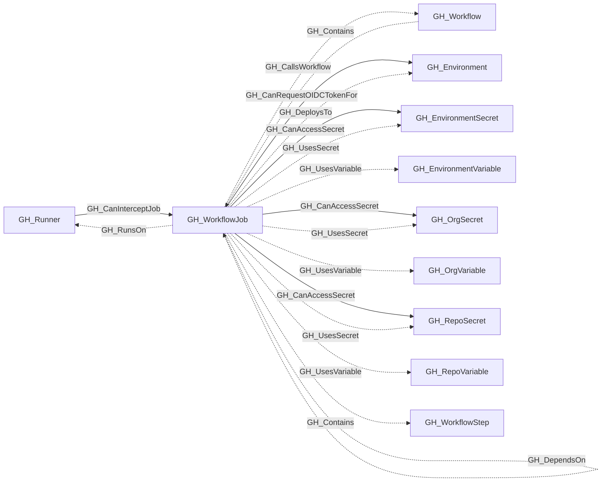

## General Information

Represents a single job within a GitHub Actions workflow. Jobs are the top-level execution units of a workflow — they run on a runner, hold a set of steps, and can declare permissions, environments, and dependencies on other jobs.

When the job has a statically resolvable self-hosted `runs-on` selector, [GH_RunsOn](/opengraph/extensions/github/edges/gh_runson) edges identify each [GH_Runner](/opengraph/extensions/github/nodes/gh_runner) that currently satisfies the declared label and runner-group constraints under the repository's runner access policy. These edges represent schedulability, not historical execution.

When present, `job_permissions` captures the job-level `permissions` declaration from the workflow YAML. `effective_github_token_permissions` captures the calculated static `GITHUB_TOKEN` permissions after applying the repository default, workflow-level declaration, and job-level declaration.

[GH_CanAccessSecret](/opengraph/extensions/github/edges/gh_canaccesssecret) edges identify secrets statically referenced by the job's modeled steps or job-level `env` block that the job execution context can access. [GH_CanInterceptJob](/opengraph/extensions/github/edges/gh_caninterceptjob) edges from [GH_Runner](/opengraph/extensions/github/nodes/gh_runner) nodes not explicitly marked ephemeral identify jobs whose future execution context may be exposed if that runner is controlled. When a job targets an environment and its effective permissions include `id-token:write`, [GH_CanRequestOIDCTokenFor](/opengraph/extensions/github/edges/gh_canrequestoidctokenfor) identifies a static upper-bound OIDC capability for that environment. Runtime permission recalculation, such as forked `pull_request` permission downgrades, may prevent a specific execution from requesting OIDC even when this edge exists.

When `runs_on_is_dynamic` is true, runner matching and interception status remain unresolved: the collector does not emit [GH_CanInterceptJob](/opengraph/extensions/github/edges/gh_caninterceptjob) edges for the job, so `query_interceptable_jobs` cannot match it and the absence of an edge must not be treated as evidence that the job is definitively non-interceptable.

## Diagram

## Edges

<Note>
The tables below list edges defined by the GitHub extension only. Additional edges to or from this node may be created by other extensions.
</Note>

### Inbound Edges

| Edge | Source Node | Traversable |
| --- | --- | --- |
| [GH_CanInterceptJob](/opengraph/extensions/github/edges/gh_caninterceptjob) | [GH_Runner](/opengraph/extensions/github/nodes/gh_runner) | ✅ |
| [GH_Contains](/opengraph/extensions/github/edges/gh_contains) | [GH_Workflow](/opengraph/extensions/github/nodes/gh_workflow) | ❌ |
| [GH_DependsOn](/opengraph/extensions/github/edges/gh_dependson) | GH_WorkflowJob | ❌ |

### Outbound Edges

| Edge | Destination Node | Traversable |
| --- | --- | --- |
| [GH_CallsWorkflow](/opengraph/extensions/github/edges/gh_callsworkflow) | [GH_Workflow](/opengraph/extensions/github/nodes/gh_workflow) | ❌ |
| [GH_CanAccessSecret](/opengraph/extensions/github/edges/gh_canaccesssecret) | [GH_EnvironmentSecret](/opengraph/extensions/github/nodes/gh_environmentsecret) | ✅ |
| [GH_CanAccessSecret](/opengraph/extensions/github/edges/gh_canaccesssecret) | [GH_OrgSecret](/opengraph/extensions/github/nodes/gh_orgsecret) | ✅ |
| [GH_CanAccessSecret](/opengraph/extensions/github/edges/gh_canaccesssecret) | [GH_RepoSecret](/opengraph/extensions/github/nodes/gh_reposecret) | ✅ |
| [GH_CanRequestOIDCTokenFor](/opengraph/extensions/github/edges/gh_canrequestoidctokenfor) | [GH_Environment](/opengraph/extensions/github/nodes/gh_environment) | ✅ |
| [GH_Contains](/opengraph/extensions/github/edges/gh_contains) | [GH_WorkflowStep](/opengraph/extensions/github/nodes/gh_workflowstep) | ❌ |
| [GH_DependsOn](/opengraph/extensions/github/edges/gh_dependson) | GH_WorkflowJob | ❌ |
| [GH_DeploysTo](/opengraph/extensions/github/edges/gh_deploysto) | [GH_Environment](/opengraph/extensions/github/nodes/gh_environment) | ❌ |
| [GH_RunsOn](/opengraph/extensions/github/edges/gh_runson) | [GH_Runner](/opengraph/extensions/github/nodes/gh_runner) | ❌ |
| [GH_UsesSecret](/opengraph/extensions/github/edges/gh_usessecret) | [GH_EnvironmentSecret](/opengraph/extensions/github/nodes/gh_environmentsecret) | ❌ |
| [GH_UsesSecret](/opengraph/extensions/github/edges/gh_usessecret) | [GH_OrgSecret](/opengraph/extensions/github/nodes/gh_orgsecret) | ❌ |
| [GH_UsesSecret](/opengraph/extensions/github/edges/gh_usessecret) | [GH_RepoSecret](/opengraph/extensions/github/nodes/gh_reposecret) | ❌ |
| [GH_UsesVariable](/opengraph/extensions/github/edges/gh_usesvariable) | [GH_EnvironmentVariable](/opengraph/extensions/github/nodes/gh_environmentvariable) | ❌ |
| [GH_UsesVariable](/opengraph/extensions/github/edges/gh_usesvariable) | [GH_OrgVariable](/opengraph/extensions/github/nodes/gh_orgvariable) | ❌ |
| [GH_UsesVariable](/opengraph/extensions/github/edges/gh_usesvariable) | [GH_RepoVariable](/opengraph/extensions/github/nodes/gh_repovariable) | ❌ |

## Properties

| Name | Type | Description |
| --- | --- | --- |
| `container` | `null \| string` | The optional container configuration. |
| `displayname` | `string` |  |
| `effective_github_token_permissions` | `array<string> \| null` | Calculated GITHUB_TOKEN permissions after repository defaults and declarations are applied. |
| `environment` | `null \| string` | The deployment environment name. |
| `environment_name` | `null \| string` | The name of the GitHub organization. |
| `environmentid` | `string` |  |
| `is_self_hosted` | `boolean` | Whether the job targets self-hosted runners. |
| `job_key` | `null \| string` | The YAML key for the job. |
| `job_permissions` | `array<string> \| null` | Optional permissions declared at the job level; absent when the job has no declaration. |
| `last_seen` | `datetime` |  |
| `name` | `string` |  |
| `node_id` | `string` |  |
| `permissions` | `array<string> \| null` | Applicable declared workflow or job permissions after job-over-workflow precedence. |
| `query_accessible_secrets` | `null \| string` | Query for secrets accessible to the job execution context. |
| `query_references` | `null \| string` | Query for workflow references (secrets and variables). |
| `query_repository` | `null \| string` | Query for repository. |
| `query_runners` | `null \| string` | Query for eligible self-hosted runners. |
| `query_steps` | `null \| string` | Query for workflow steps. |
| `repository_id` | `null \| string` | The containing repository node ID. |
| `repository_name` | `null \| string` | The containing repository name. |
| `runs_on` | `array<string> \| null` | The runner label expression for the job. |
| `runs_on_group` | `null \| string` | The statically declared runner group, if any. |
| `runs_on_is_dynamic` | `boolean` | Whether runs-on contains a GitHub Actions expression. |
| `runs_on_labels` | `array<string> \| null` | The normalized runner labels from runs-on. |
| `uses_reusable` | `null \| string` | The reusable workflow reference used by this job. |
| `workflow_node_id` | `null \| string` | The parent workflow node ID. |

## References

- [Workflow jobs API](https://docs.github.com/en/rest/actions/workflow-jobs)
