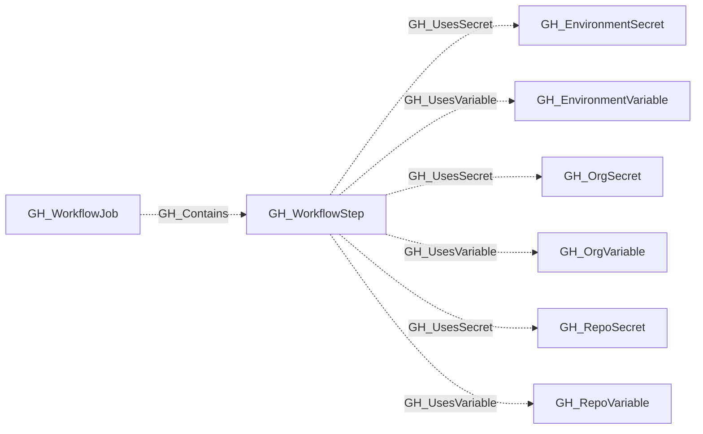

## General Information

Represents a single step within a GitHub Actions job. A step is either a `uses:` action reference or a `run:` shell command. Steps are the leaf nodes of the workflow execution tree and are the primary location where secrets and variables are consumed.

## Diagram

## Edges

<Note>
The tables below list edges defined by the GitHub extension only. Additional edges to or from this node may be created by other extensions.
</Note>

### Inbound Edges

| Edge | Source Node | Traversable |
| --- | --- | --- |
| [GH_Contains](/opengraph/extensions/github/edges/gh_contains) | [GH_WorkflowJob](/opengraph/extensions/github/nodes/gh_workflowjob) | ❌ |

### Outbound Edges

| Edge | Destination Node | Traversable |
| --- | --- | --- |
| [GH_UsesSecret](/opengraph/extensions/github/edges/gh_usessecret) | [GH_EnvironmentSecret](/opengraph/extensions/github/nodes/gh_environmentsecret) | ❌ |
| [GH_UsesSecret](/opengraph/extensions/github/edges/gh_usessecret) | [GH_OrgSecret](/opengraph/extensions/github/nodes/gh_orgsecret) | ❌ |
| [GH_UsesSecret](/opengraph/extensions/github/edges/gh_usessecret) | [GH_RepoSecret](/opengraph/extensions/github/nodes/gh_reposecret) | ❌ |
| [GH_UsesVariable](/opengraph/extensions/github/edges/gh_usesvariable) | [GH_EnvironmentVariable](/opengraph/extensions/github/nodes/gh_environmentvariable) | ❌ |
| [GH_UsesVariable](/opengraph/extensions/github/edges/gh_usesvariable) | [GH_OrgVariable](/opengraph/extensions/github/nodes/gh_orgvariable) | ❌ |
| [GH_UsesVariable](/opengraph/extensions/github/edges/gh_usesvariable) | [GH_RepoVariable](/opengraph/extensions/github/nodes/gh_repovariable) | ❌ |

## Properties

| Name | Type | Description |
| --- | --- | --- |
| `action` | `null \| string` | The full action reference from `uses`. |
| `action_name` | `null \| string` | The action name. |
| `action_owner` | `null \| string` | The action owner. |
| `action_ref` | `null \| string` | The action ref. |
| `action_slug` | `null \| string` | The action owner/name without ref. |
| `contents` | `null \| string` | The full parsed step definition. |
| `displayname` | `string` |  |
| `environment_name` | `null \| string` | The name of the GitHub organization. |
| `environmentid` | `string` |  |
| `is_pinned` | `boolean` | Whether the action ref is a full commit SHA. |
| `job_node_id` | `null \| string` | The parent workflow job node ID. |
| `last_seen` | `datetime` |  |
| `name` | `string` |  |
| `node_id` | `string` |  |
| `query_references` | `null \| string` | Query for secrets and variables referenced by the step. |
| `query_repository` | `null \| string` | Query for containing repository. |
| `repository_id` | `null \| string` | The containing repository node ID. |
| `repository_name` | `null \| string` | The containing repository name. |
| `run` | `null \| string` | The shell command body for `run` steps. |
| `step_index` | `integer \| null` | The zero-based step index within the parent job. |
| `type` | `null \| string` | The step type: `uses`, `run`, or `unknown`. |
| `workflow_node_id` | `null \| string` | The parent workflow node ID. |

## References

- [Secure use of GitHub Actions](https://docs.github.com/en/actions/reference/security/secure-use)
