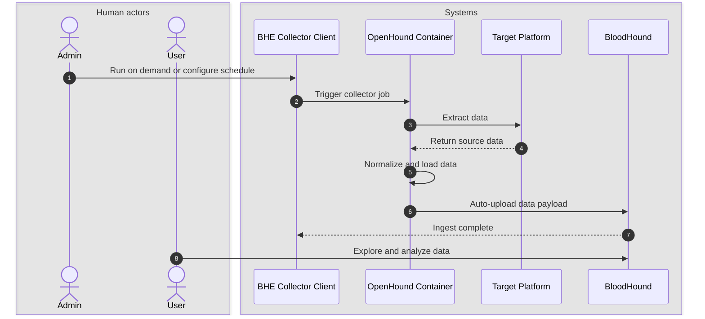
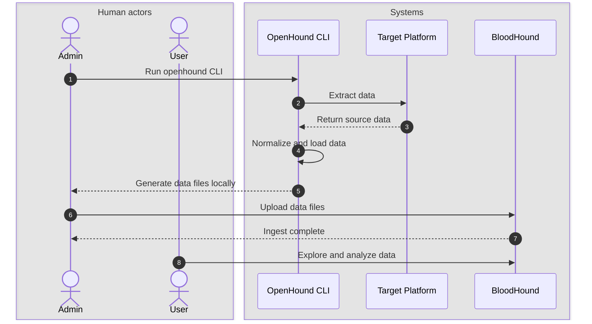

As described in the [OpenGraph Overview](/opengraph/overview), extensions that include an extension definition schema enrich collector-generated <Tooltip tip="The formatted data generated by an OpenGraph collector that you upload in BloodHound." cta="Learn more" href="/opengraph/developer/graph-data">data payloads</Tooltip> to produce structured graphs. Structured graphs enable enhanced features in BloodHound, such as pathfinding, findings, and metrics.

<Note>
  Extensions that do not include an extension definition schema produce generic graphs.
</Note>

Extensions can include the following components:

| Component | Description |
|---|---|
| **Extension definition schema** | A file that defines graph structure, including node types, edge types, traversability behavior, and visual configurations. Both BloodHound Community and BloodHound Enterprise use the same extension definition schema format. |
| **Collector** | A tool (for example, OpenHound, AzureHound, or SharpHound) that authenticates to a third-party platform, collects the data of interest, and packages it into a standardized data payload that BloodHound can ingest. |
| **Cypher saved queries** | Custom Cypher queries provided by extension developers. |
| **Privilege Zone rules** | Custom rules provided by extension developers to categorize nodes into Privilege Zones based on their properties and relationships. |
| **Findings** | Insights or observations provided by extension developers derived from the ingested data, which can be used to identify risk and remediation guidance. Findings are visible in BloodHound Enterprise only. |

## Extension bundles

An **extension bundle** packages an extension definition schema with supported assets (such as saved queries and Privilege Zone rules) so you can install them together.

When a bundle is published for an OpenGraph extension, use it as the primary installation option. The **OpenGraph Management** page accepts one bundle (`.zip`) or one schema (`.json`) file per upload. See [Package an extension bundle](/opengraph/developer/extension-bundles) for the bundle format.

<Note>
  Do not assume a bundle is available for every extension. Check the extension's distribution source for a bundle that matches your BloodHound version.
</Note>

## Before you begin

Review the extension's setup documentation and obtain its bundle or schema if you need to install it. If you use a collector, check its version compatibility and prerequisites.

<Note>
  Only users with the Administrator [role](/manage-bloodhound/auth/users-and-roles#user-role-definitions) can manage extensions.
</Note>

The extension's management model determines how it receives updates, regardless of whether it is distributed as a bundle or a standalone schema:

| Management model | Examples | Management behavior |
|---|---|---|
| **Built-in** | Active Directory, Azure | Included in BloodHound. Administrators cannot delete these extensions. |
| **Pre-installed** | GitHub, Jamf, Okta in BloodHound Enterprise | Follow [automatic update rules](#automatic-updates). Administrators can also upload a newer version when supported. |
| **Manually managed** | SCIM, custom, and community-built extensions | Administrators install and update these extensions manually. |

<Note>
  Pre-installed extensions in BloodHound Enterprise can include findings and remediation guidance when that feature is enabled in your environment. Contact your account team for availability.
</Note>

## Workflow

The workflow for generic and structured OpenGraph data is largely the same. The main difference is that structured graphs require an extension definition schema to be installed.

An Administrator can ensure availability either by verifying a pre-installed extension or by uploading one manually. After that, users with read access can view installed extensions and use the resulting structured graph data.

<Note>
  For [OpenHound](/openhound/overview) collectors (GitHub, Jamf, and Okta), upload behavior depends on both deployment model and BloodHound edition. 

  Only BloodHound Enterprise can accept payloads directly through the API. BloodHound Community requires manual file upload.
</Note>

### Get an extension

Use a published bundle for the current BloodHound version when one is available. A bundle installs the schema and the supported assets it contains.

If no bundle is available, install the schema and then add supported assets separately.

<Tip>
  For OpenHound extensions, the [OpenHound CLI](/openhound/upload-extension-assets) is an optional convenience for applicable assets; it is not required to install or manage other extensions.
</Tip>

### Collect data

Installing an extension prepares BloodHound to interpret its data. You must also collect and upload data from the target platform. Extension providers should supply a compatible collector and instructions for running it.

For OpenHound collectors, upload behavior depends on edition and runtime model: Enterprise can ingest through the API (often automatic when using a collector client), while Community requires manual file upload from locally run collector executables.

The following diagrams illustrate the recurring OpenHound collection and upload cycle that keeps extension data current in BloodHound Enterprise and Community Edition.

**BloodHound Enterprise (containerized)**

**BloodHound Community (CLI)**

## Verify or install an extension

Before you upload structured OpenGraph data, make sure BloodHound has the matching extension definition schema. Use the bundle path when a matching bundle is published; otherwise use the schema-only path below.

Pre-installed extensions, such as GitHub, Jamf, and Okta in BloodHound Enterprise, usually only need verification.

In both BloodHound Enterprise and BloodHound Community Edition, administrators must manually install and manage any extensions that are not built-in or pre-installed. These include community extensions and SpecterOps extensions that are not yet pre-installed.

<Note>
  Only users with the Administrator [role](/manage-bloodhound/auth/users-and-roles#user-role-definitions) can install, update, and delete extension definition schemas.
</Note>

After the extension is installed, BloodHound produces structured graphs for data payloads that conform to the extension.

<Steps>
  <Step title="Open the OpenGraph Management page">
	In the left menu, click **Administration** > **OpenGraph Management**.
  </Step>
  <Step title="Verify or install extensions">
		Choose the path that matches your scenario: 

		<Tabs>
		  <Tab title="Verify an extension">
			Confirm the extension appears in the list of active extensions.

			For example, confirm that BloodHound Enterprise lists the built-in Active Directory and Azure extensions and the pre-installed GitHub, Jamf, and Okta extensions.

			<Frame>
			  
			</Frame>
		  </Tab>
		  <Tab title="Install an extension">
			1. Click **Upload File** and click the canvas area to open a file system dialog.

			   Alternatively, you can drag and drop a file onto the canvas area.
			
			1. Choose one `.zip` extension bundle or one `.json` schema-only extension. The upload dialog accepts only one file at a time.

				<Note>
  		    	  A schema-only installation does not install saved queries or Privilege Zone rules. You must add them separately (if they exist).
          		</Note>

			1. Click **Upload** and wait for the installation and validation process to finish.

				<Frame>
				  
				</Frame>

			1. Confirm the extension appears in the list of active extensions and that the version shown matches the schema you expect BloodHound to use.

			   <Note>
			     You may need to refresh the page to see the newly installed extension in the list of active extensions.
			   </Note>

			   <Frame>
			     
			   </Frame>
		  </Tab>
		</Tabs>
  </Step>
</Steps>

## Update an extension

Collectors and extensions are versioned separately. To avoid compatibility issues, do not update collectors independently without confirming extension compatibility. Update collectors and extension definition schemas together whenever possible.

For a manually managed extension, install its new bundle or schema through the same workflow. For a pre-installed extension, you can install a newer version manually, but it follows automatic update rules.

### Automatic updates

In BloodHound Enterprise, the pre-installed GitHub, Jamf, and Okta extensions follow automatic update rules.

At startup, BloodHound Enterprise updates a pre-installed extension when the version in the current release is newer than the installed version. If you upload a newer version manually, it remains installed until a later release provides a newer version.

If you want to update a pre-installed extension outside the standard BloodHound Enterprise release cycle, coordinate with your account team.

<Note>
  A manually installed older version of a pre-installed extension may be replaced at startup if the current BloodHound Enterprise release includes a newer version. Contact your account team if you need help maintaining a rollback across restarts.
</Note>

## Delete an extension

Deleting an extension removes the extension definition schema from BloodHound, but leaves the underlying data intact. Associated data reverts to generic graphs, which means structured graph capabilities are no longer available. You can still use node search and Cypher queries on the [Explore](/analyze-data/explore/search#search) page to explore the data.

If you want to delete the data associated with an extension, you can do so separately on the **Database Management** page.

To delete an extension, click the <Icon icon="trash"/> (trash) icon next to it in the list of active extensions and confirm the deletion in the prompt.

<Note>
  You cannot delete built-in extensions (Active Directory and Azure).
  
  In BloodHound Enterprise, Administrators can delete pre-installed extensions (GitHub, Jamf, and Okta), but BloodHound Enterprise [reinstalls](/opengraph/extensions/manage#automatic-updates) them at the next application restart.
</Note>

## Upload data

After an Administrator installs an extension or verifies that an extension is present, users can upload data payloads that conform to the extension definition schema and take advantage of structured graph capabilities in BloodHound.

For extensions that use OpenHound collectors (GitHub, Jamf, and Okta), AzureHound, or SharpHound, how data is uploaded depends on your BloodHound edition:

- **BloodHound Enterprise**: The collector client can upload data directly through the API. In containerized deployments, upload is typically automatic.
- **BloodHound Community**: After running the OpenHound, AzureHound, or SharpHound collector executables locally and generating data files, follow the manual upload steps below.

  <Note>
	For extensions that do not use OpenHound collectors, follow the manual upload steps below.
  </Note>

<Steps>
  <Step title="Upload data">
	Upload a data payload that conforms to the installed extension definition schema.

	1. In the left menu, click <Icon icon="arrow-up-from-bracket"/> **Quick Upload**.

	1. Click the **Upload File** canvas to open a file system dialog or drag and drop the data payload file(s) onto the canvas.

	1. Click **Upload** to begin the data ingestion and validation process.

	   <Tip>
	   	The file either uploads successfully or fails in the modal. You can then go to the [File Ingest](/collect-data/enterprise-collection/monitor#file-ingest) page to review ingest and analysis progress.
	   </Tip>
  </Step>

  <Step title="Explore and analyze">
    Use the enhanced features enabled by the extension to explore and analyze your OpenGraph data in BloodHound.

	| Feature | Description |
	|---|---|
	| Pathfinding | Use [Pathfinding](/analyze-data/explore/search#pathfinding) to identify attack paths and analyze traversable relationships across all platforms and environments, including built-in and extension-defined kinds. |
	| Saved queries | [Import](/analyze-data/explore/cypher-search#import-and-export) extension-specific saved queries so you can quickly run pre-defined Cypher queries on the **Explore** page. |
	| Privilege Zone rules | If your Administrator configured extension-specific Privilege Zone [rules](/analyze-data/privilege-zones/rules) during initial setup, BloodHound automatically assigns matching nodes to zones, giving you clearer prioritization and zone-aware analysis. |
	| Findings and remediation | When available, use findings and remediation information to prioritize and address issues in your environment. |
  </Step>
</Steps>
