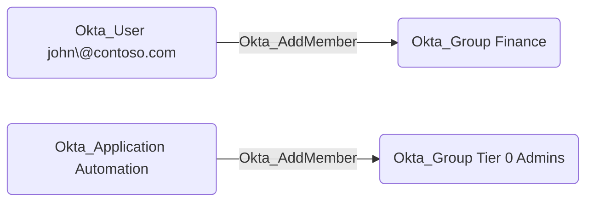

## Edge Schema

- Traversable: ✅

| Source | Destination |
| --- | --- |
| [Okta_Application](/opengraph/extensions/okta/nodes/okta_application) | [Okta_Group](/opengraph/extensions/okta/nodes/okta_group) |
| [Okta_Group](/opengraph/extensions/okta/nodes/okta_group) | [Okta_Group](/opengraph/extensions/okta/nodes/okta_group) |
| [Okta_User](/opengraph/extensions/okta/nodes/okta_user) | [Okta_Group](/opengraph/extensions/okta/nodes/okta_group) |

## General Information

The traversable Okta_AddMember edges represent custom role permissions that allow a principal (user, group, or application) to add or remove members in scoped Okta groups. These edges are created when a custom role includes the `okta.groups.members.manage` or `okta.groups.manage` permissions.



## Abuse Info

A controlled user or service application with effective membership-management authority can add an existing controlled user to an in-scope Okta-managed group. For group-sourced permissions, authenticate as a controlled authorized member. An OAuth caller also needs the management scope for the operation. Membership can confer the group's app assignments or other grants, but protected administrator groups and imported groups have additional restrictions. The emitted permission edge is not proof that a protected-group write will succeed.

1. Select a controlled group and user. Record all existing memberships and confirm that the user is not already a member. Use native Okta API IDs, not normalized BloodHound IDs. In the Admin Console, inspect the target group and its people before making a change.
2. Authenticate as the source principal. These examples use its SSWS token; OAuth callers replace the header with `Authorization: Bearer $OKTA_ACCESS_TOKEN`. Retrieve the group and its membership first. Only groups with `type: OKTA_GROUP` support this write; imported `APP_GROUP` memberships must be changed in their source directory.

```bash
export OKTA_ORG="https://example.okta.com"
export OKTA_API_TOKEN="YOUR_CONTROLLED_IDENTITY_TOKEN"
export GROUP_ID="YOUR_OKTA_GROUP_ID"
export USER_ID="YOUR_CONTROLLED_OKTA_USER_ID"
curl -i -sS -H "Authorization: SSWS $OKTA_API_TOKEN" \
  -H "Accept: application/json" "$OKTA_ORG/api/v1/groups/$GROUP_ID"
curl -i -sS -H "Authorization: SSWS $OKTA_API_TOKEN" \
  -H "Accept: application/json" "$OKTA_ORG/api/v1/groups/$GROUP_ID/users"
```

3. Add only the controlled user. A successful request returns HTTP 204. In the Admin Console, the equivalent operation adds the selected person to the target group. A 403 does not authorize switching to a more privileged token to claim the source's access.

```bash
curl -i -sS -X PUT -H "Authorization: SSWS $OKTA_API_TOKEN" \
  -H "Accept: application/json" "$OKTA_ORG/api/v1/groups/$GROUP_ID/users/$USER_ID"
```

4. Verify membership with the list request below, following every pagination link. Confirm the controlled user's ID appears. Separately check the intended app or administrator grant; group membership alone does not prove a downstream session or bypass sign-on policy.

```bash
curl -i -sS -H "Authorization: SSWS $OKTA_API_TOKEN" \
  -H "Accept: application/json" "$OKTA_ORG/api/v1/groups/$GROUP_ID/users"
```

### Reverting Abuse Actions

Remove only the membership added during this test. Preserve the source's pre-existing permission and every membership recorded before the test. If the controlled user was already a member, do not remove it.

Revert using Admin Console:

1. Open the target group, find the controlled person, and remove only the test-added membership.
2. Verify the original membership inventory. If the test used a downstream app, sign out of the test session and check that no test-created downstream access remains; membership removal alone does not prove a session has ended.

Revert using API:

```bash
curl -i -sS -X DELETE -H "Authorization: SSWS $OKTA_API_TOKEN" \
  -H "Accept: application/json" "$OKTA_ORG/api/v1/groups/$GROUP_ID/users/$USER_ID"
curl -i -sS -H "Authorization: SSWS $OKTA_API_TOKEN" \
  -H "Accept: application/json" "$OKTA_ORG/api/v1/groups/$GROUP_ID/users"
```

Deletion returns HTTP 204. Follow pagination and confirm the controlled user's ID is absent and the original members remain. Restore any separately recorded downstream test changes through the destination's supported process.

## Opsec Considerations

Correlate the source principal, group ID, user ID, and request time in the Okta System Log with group membership changes. [Group](/resources/nodes/group)-derived application access can also produce provisioning events and downstream sign-ins. Existing sessions may outlive a membership change. These procedures are reviewed against official API documentation but have not been exercised in a lab.

## References

- [Assign a user to a group](https://developer.okta.com/docs/api/openapi/okta-management/management/tags/group/other/assignusertogroup)
- [Unassign a user from a group](https://developer.okta.com/docs/api/openapi/okta-management/management/tags/group/other/unassignuserfromgroup)
- [Standard administrator permissions and protected groups](https://help.okta.com/en-us/Content/topics/security/administrators-admin-comparison.htm)
- [Okta System Log](https://developer.okta.com/docs/api/openapi/okta-management/management/tags/systemlog)
