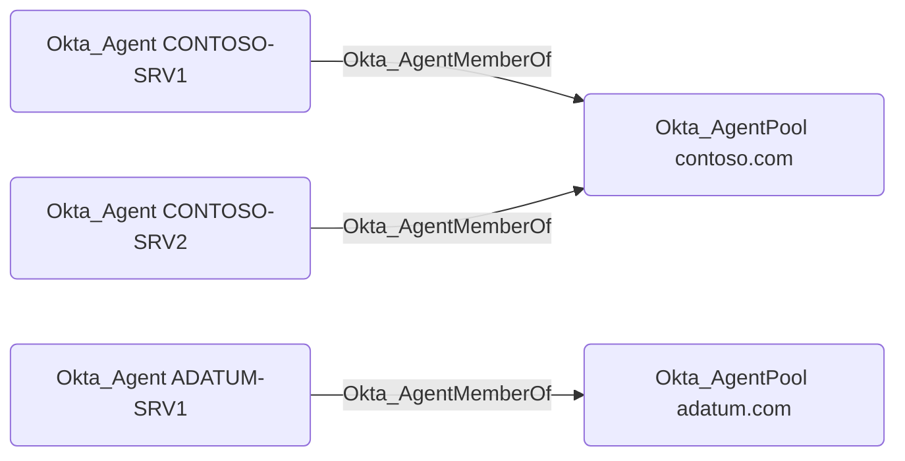

## Edge Schema

- Traversable: ✅

| Source | Destination |
| --- | --- |
| [Okta_Agent](/opengraph/extensions/okta/nodes/okta_agent) | [Okta_AgentPool](/opengraph/extensions/okta/nodes/okta_agentpool) |

## General Information

Okta_AgentMemberOf edges represent membership of an [Okta_Agent](/opengraph/extensions/okta/nodes/okta_agent) in an [Okta_AgentPool](/opengraph/extensions/okta/nodes/okta_agentpool).

Active Directory Agent Pools and their agents can be visualized in BloodHound as follows:



<Info>
Traversable edges between [Okta_AgentPool](/opengraph/extensions/okta/nodes/okta_agentpool) and AD Domain nodes are not modeled in the current version of the Okta BloodHound extension. Support for this is planned for a future release.
</Info>

## Abuse Info

Control of an agent host may affect the directory integration served by its agent pool. Pool membership identifies that integration; it does not prove directory-wide privileges or supply an agent credential. Review the host and service-account permissions before drawing a compromise conclusion.

1. Establish control of the source identity or system described above. Inherited group access requires a controlled member. Use native Okta IDs from the API, not normalized BloodHound object IDs.
2. Inspect **agent pools** through the matching object in the Okta Admin Console, or use this read-only API check. The token must belong to the identity being assessed; a separate administrator’s token does not prove the source’s access. OAuth callers use `Authorization: Bearer $OKTA_ACCESS_TOKEN` instead.

```bash
export OKTA_ORG="https://example.okta.com"
export OKTA_API_TOKEN="YOUR_CONTROLLED_IDENTITY_TOKEN"
curl -i -sS -H "Authorization: SSWS $OKTA_API_TOKEN" \
  -H "Accept: application/json" "$OKTA_ORG/api/v1/agentPools"
```

3. Expect HTTP 200 and confirm the response identifies the intended tenant and object. Follow pagination for a complete list. Compare the returned scope, membership, or configuration with the represented relationship; a 403 or an empty response does not prove the relationship is absent. This inspection does not validate additional compromise claims.

## Opsec Considerations

Correlate host process and service activity with agent health and import failures. Okta logs alone do not establish what ran on the host. Review the Okta System Log alongside the relevant source-system logs. The API check above reads state; no environmental change or restoration is included in it. These steps have not been exercised against a lab.


## References

- [Directory agent pools](https://developer.okta.com/docs/api/openapi/okta-management/management/tags/agentpools)
- [Okta System Log](https://developer.okta.com/docs/api/openapi/okta-management/management/tags/systemlog)
