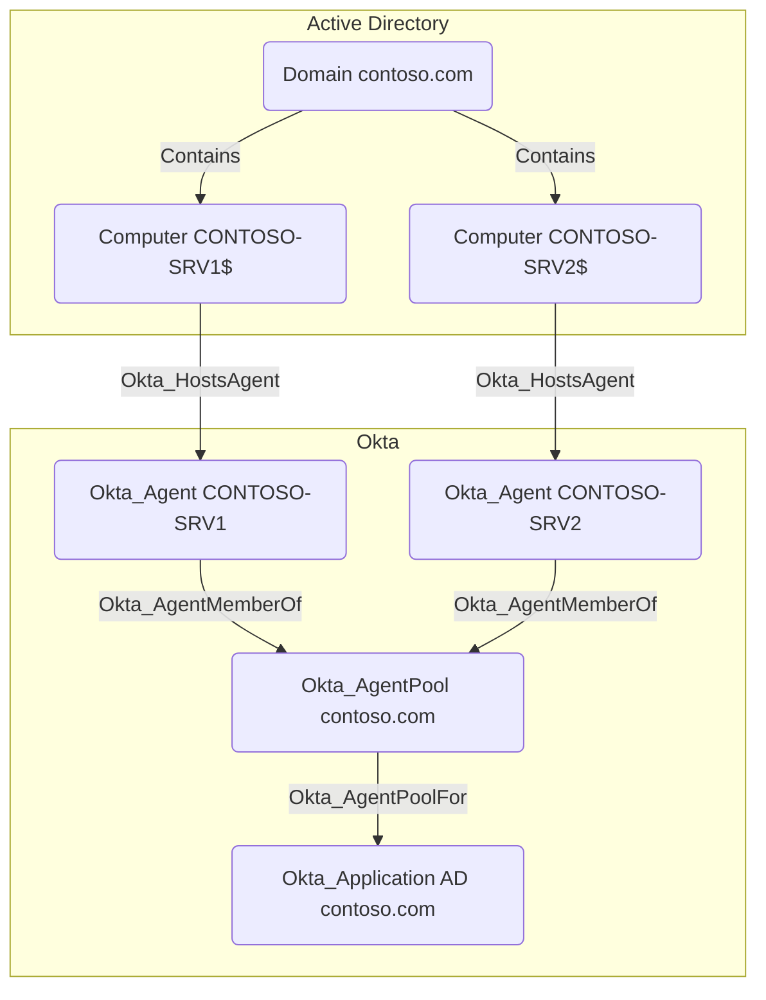

## Edge Schema

- Traversable: ✅

| Source | Destination |
| --- | --- |
| [Okta_AgentPool](/opengraph/extensions/okta/nodes/okta_agentpool) | [Okta_Application](/opengraph/extensions/okta/nodes/okta_application) |

## General Information

Okta_AgentPoolFor edges connect a directory [Okta_AgentPool](/opengraph/extensions/okta/nodes/okta_agentpool) to the backing [Okta_Application](/opengraph/extensions/okta/nodes/okta_application) used for directory integration.


## Abuse Info

The backing directory application identifies which integration depends on the agent pool. A compromised pool can influence only the operations its agents and directory credentials are authorized to perform. Pool-to-AD-domain control is not established by this edge.

1. Establish control of the source identity or system described above. Inherited group access requires a controlled member. Use native Okta IDs from the API, not normalized BloodHound object IDs.
2. Inspect **backing directory application** through the matching object in the Okta Admin Console, or use this read-only API check. The token must belong to the identity being assessed; a separate administrator’s token does not prove the source’s access. OAuth callers use `Authorization: Bearer $OKTA_ACCESS_TOKEN` instead.

```bash
export OKTA_ORG="https://example.okta.com"
export OKTA_API_TOKEN="YOUR_CONTROLLED_IDENTITY_TOKEN"
export APP_ID="YOUR_OKTA_APPLICATION_ID"
curl -i -sS -H "Authorization: SSWS $OKTA_API_TOKEN" \
  -H "Accept: application/json" "$OKTA_ORG/api/v1/apps/$APP_ID"
```

3. Expect HTTP 200 and confirm the response identifies the intended tenant and object. Follow pagination for a complete list. Compare the returned scope, membership, or configuration with the represented relationship; a 403 or an empty response does not prove the relationship is absent. This inspection does not validate additional compromise claims.

## Opsec Considerations

Review agent health, directory import and delegated authentication anomalies, together with directory service-account activity. Review the Okta System Log alongside the relevant source-system logs. The API check above reads state; no environmental change or restoration is included in it. These steps have not been exercised against a lab.


## References

- [Directory agent pools](https://developer.okta.com/docs/api/openapi/okta-management/management/tags/agentpools)
- [Okta System Log](https://developer.okta.com/docs/api/openapi/okta-management/management/tags/systemlog)
