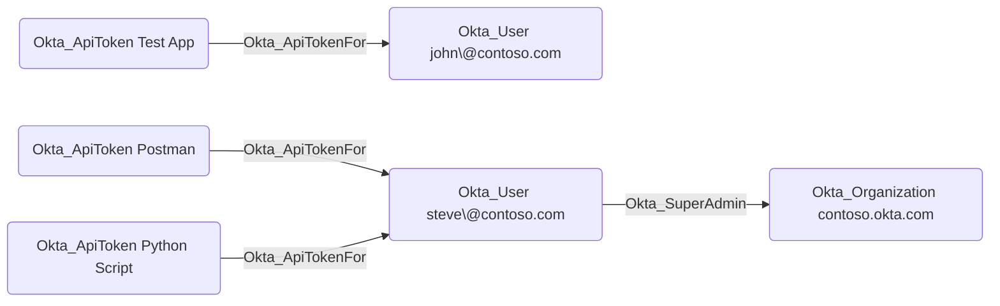

## Edge Schema

- Traversable: ✅

| Source | Destination |
| --- | --- |
| [Okta_ApiToken](/opengraph/extensions/okta/nodes/okta_apitoken) | [Okta_User](/opengraph/extensions/okta/nodes/okta_user) |

## General Information

The traversable Okta_ApiTokenFor edges represent the API token assignments for users in Okta, represented by the [Okta_User](/opengraph/extensions/okta/nodes/okta_user) nodes:



## Abuse Info

Possession of the raw SSWS token permits API calls with its issuing user’s current privileges, subject to network restrictions and token validity. The token node contains metadata; its presence in BloodHound does not disclose a usable token.

1. Establish control of the source identity or system described above. Inherited group access requires a controlled member. Use native Okta IDs from the API, not normalized BloodHound object IDs.
2. Inspect **authenticated user** through the matching object in the Okta Admin Console, or use this read-only API check. The token must belong to the identity being assessed; a separate administrator’s token does not prove the source’s access. OAuth callers use `Authorization: Bearer $OKTA_ACCESS_TOKEN` instead.

```bash
export OKTA_ORG="https://example.okta.com"
export OKTA_API_TOKEN="YOUR_CONTROLLED_IDENTITY_TOKEN"
curl -i -sS -H "Authorization: SSWS $OKTA_API_TOKEN" \
  -H "Accept: application/json" "$OKTA_ORG/api/v1/users/me"
```

3. Expect HTTP 200 and confirm the response identifies the intended tenant and object. Follow pagination for a complete list. Compare the returned scope, membership, or configuration with the represented relationship; a 403 or an empty response does not prove the relationship is absent. This inspection does not validate additional compromise claims.

## Opsec Considerations

Correlate API activity with the token owner, source address, and token metadata. Reading a graph token node causes no Okta API activity. Review the Okta System Log alongside the relevant source-system logs. The API check above reads state; no environmental change or restoration is included in it. These steps have not been exercised against a lab.


## References

- [API token privileges and lifecycle](https://developer.okta.com/docs/guides/create-an-api-token/main/)
- [Okta System Log](https://developer.okta.com/docs/api/openapi/okta-management/management/tags/systemlog)
