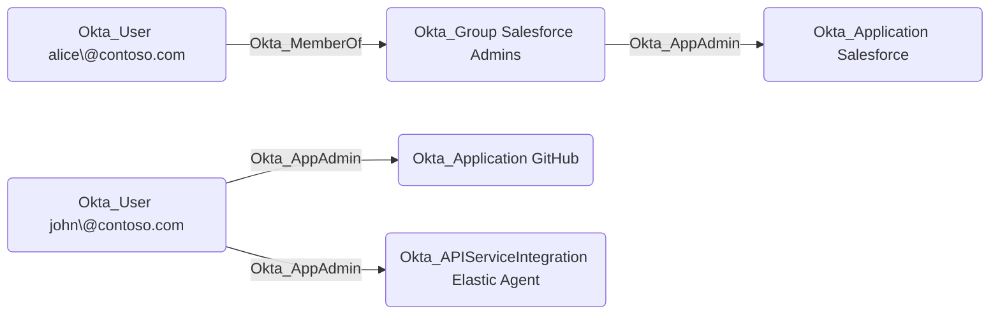

## Edge Schema

- Traversable: ✅

| Source | Destination |
| --- | --- |
| [Okta_Application](/opengraph/extensions/okta/nodes/okta_application) | [Okta_ApiServiceIntegration](/opengraph/extensions/okta/nodes/okta_apiserviceintegration) |
| [Okta_Application](/opengraph/extensions/okta/nodes/okta_application) | [Okta_Application](/opengraph/extensions/okta/nodes/okta_application) |
| [Okta_Group](/opengraph/extensions/okta/nodes/okta_group) | [Okta_ApiServiceIntegration](/opengraph/extensions/okta/nodes/okta_apiserviceintegration) |
| [Okta_Group](/opengraph/extensions/okta/nodes/okta_group) | [Okta_Application](/opengraph/extensions/okta/nodes/okta_application) |
| [Okta_User](/opengraph/extensions/okta/nodes/okta_user) | [Okta_ApiServiceIntegration](/opengraph/extensions/okta/nodes/okta_apiserviceintegration) |
| [Okta_User](/opengraph/extensions/okta/nodes/okta_user) | [Okta_Application](/opengraph/extensions/okta/nodes/okta_application) |

## General Information

The traversable Okta_AppAdmin edges represent Application Administrator role assignments. Application Administrators can manage application configurations, user assignments, and provisioning settings for their assigned applications.

