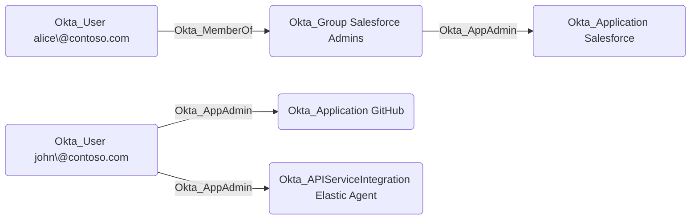

## Edge Schema

- Traversable: ✅

| Source | Destination |
| --- | --- |
| [Okta_Application](/opengraph/extensions/okta/nodes/okta_application) | [Okta_ApiServiceIntegration](/opengraph/extensions/okta/nodes/okta_apiserviceintegration) |
| [Okta_Application](/opengraph/extensions/okta/nodes/okta_application) | [Okta_Application](/opengraph/extensions/okta/nodes/okta_application) |
| [Okta_Group](/opengraph/extensions/okta/nodes/okta_group) | [Okta_ApiServiceIntegration](/opengraph/extensions/okta/nodes/okta_apiserviceintegration) |
| [Okta_Group](/opengraph/extensions/okta/nodes/okta_group) | [Okta_Application](/opengraph/extensions/okta/nodes/okta_application) |
| [Okta_User](/opengraph/extensions/okta/nodes/okta_user) | [Okta_ApiServiceIntegration](/opengraph/extensions/okta/nodes/okta_apiserviceintegration) |
| [Okta_User](/opengraph/extensions/okta/nodes/okta_user) | [Okta_Application](/opengraph/extensions/okta/nodes/okta_application) |

## General Information

The traversable Okta_AppAdmin edges represent Application Administrator role assignments. Application Administrators can manage application configurations, user assignments, and provisioning settings for their assigned applications.



## Abuse Info

Authenticate as the assigned application administrator, or as an authorized member of the source group. Application scope limits which integrations can be managed. Inspect the target integration and use its documented assignment or configuration workflow; role assignment does not automatically confer access to every application’s downstream tenant.

1. Establish control of the source identity or system described above. Inherited group access requires a controlled member. Use native Okta IDs from the API, not normalized BloodHound object IDs.
2. Inspect **application in the administrator scope** through the matching object in the Okta Admin Console, or use this read-only API check. The token must belong to the identity being assessed; a separate administrator’s token does not prove the source’s access. OAuth callers use `Authorization: Bearer $OKTA_ACCESS_TOKEN` instead.

```bash
export OKTA_ORG="https://example.okta.com"
export OKTA_API_TOKEN="YOUR_CONTROLLED_IDENTITY_TOKEN"
export APP_ID="YOUR_OKTA_APPLICATION_ID"
curl -i -sS -H "Authorization: SSWS $OKTA_API_TOKEN" \
  -H "Accept: application/json" "$OKTA_ORG/api/v1/apps/$APP_ID"
```

3. Expect HTTP 200 and confirm the response identifies the intended tenant and object. Follow pagination for a complete list. Compare the returned scope, membership, or configuration with the represented relationship; a 403 or an empty response does not prove the relationship is absent. This inspection does not validate additional compromise claims.

## Opsec Considerations

Review app configuration and assignment changes and downstream sign-ins. Correlate administrator scope with the affected app ID. Review the Okta System Log alongside the relevant source-system logs. The API check above reads state; no environmental change or restoration is included in it. These steps have not been exercised against a lab.


## References

- [User role assignments and targets](https://developer.okta.com/docs/api/openapi/okta-management/management/tags/roleassignmentauser)
- [Okta System Log](https://developer.okta.com/docs/api/openapi/okta-management/management/tags/systemlog)

- [Standard administrator permissions and restrictions](https://help.okta.com/en-us/Content/topics/security/administrators-admin-comparison.htm)
