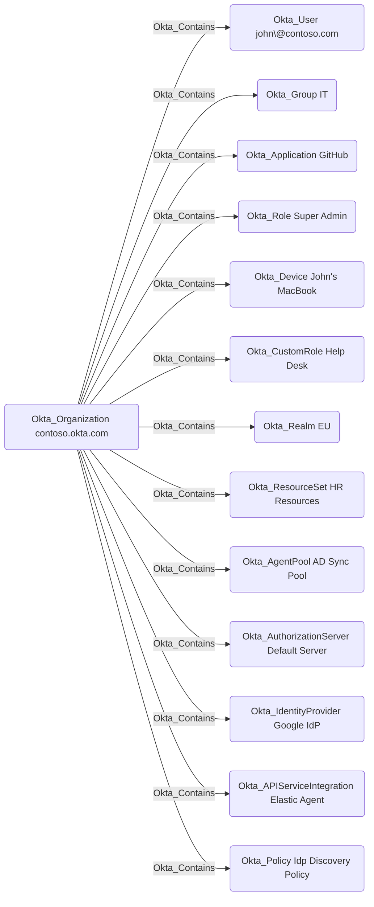

## Edge Schema

- Traversable: ✅

| Source | Destination |
| --- | --- |
| [Okta_Organization](/opengraph/extensions/okta/nodes/okta_organization) | [Okta_AgentPool](/opengraph/extensions/okta/nodes/okta_agentpool) |
| [Okta_Organization](/opengraph/extensions/okta/nodes/okta_organization) | [Okta_ApiServiceIntegration](/opengraph/extensions/okta/nodes/okta_apiserviceintegration) |
| [Okta_Organization](/opengraph/extensions/okta/nodes/okta_organization) | [Okta_Application](/opengraph/extensions/okta/nodes/okta_application) |
| [Okta_Organization](/opengraph/extensions/okta/nodes/okta_organization) | [Okta_AuthorizationServer](/opengraph/extensions/okta/nodes/okta_authorizationserver) |
| [Okta_Organization](/opengraph/extensions/okta/nodes/okta_organization) | [Okta_CustomRole](/opengraph/extensions/okta/nodes/okta_customrole) |
| [Okta_Organization](/opengraph/extensions/okta/nodes/okta_organization) | [Okta_Device](/opengraph/extensions/okta/nodes/okta_device) |
| [Okta_Organization](/opengraph/extensions/okta/nodes/okta_organization) | [Okta_Group](/opengraph/extensions/okta/nodes/okta_group) |
| [Okta_Organization](/opengraph/extensions/okta/nodes/okta_organization) | [Okta_IdentityProvider](/opengraph/extensions/okta/nodes/okta_identityprovider) |
| [Okta_Organization](/opengraph/extensions/okta/nodes/okta_organization) | [Okta_Policy](/opengraph/extensions/okta/nodes/okta_policy) |
| [Okta_Organization](/opengraph/extensions/okta/nodes/okta_organization) | [Okta_Realm](/opengraph/extensions/okta/nodes/okta_realm) |
| [Okta_Organization](/opengraph/extensions/okta/nodes/okta_organization) | [Okta_ResourceSet](/opengraph/extensions/okta/nodes/okta_resourceset) |
| [Okta_Organization](/opengraph/extensions/okta/nodes/okta_organization) | [Okta_Role](/opengraph/extensions/okta/nodes/okta_role) |
| [Okta_Organization](/opengraph/extensions/okta/nodes/okta_organization) | [Okta_RoleAssignment](/opengraph/extensions/okta/nodes/okta_roleassignment) |
| [Okta_Organization](/opengraph/extensions/okta/nodes/okta_organization) | [Okta_User](/opengraph/extensions/okta/nodes/okta_user) |

## General Information

The traversable Okta_Contains edges represent the containment relationships between the organization and other entities in Okta. The organization node will have Okta_Contains edges to all other nodes in the graph, with some exceptions.

