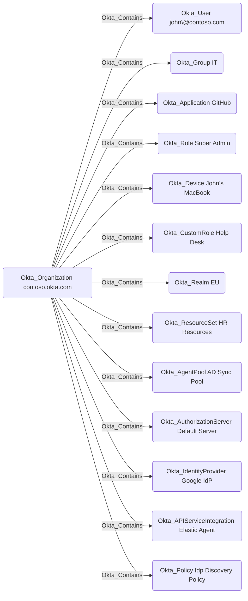

## Edge Schema

- Traversable: ✅

| Source | Destination |
| --- | --- |
| [Okta_Organization](/opengraph/extensions/okta/nodes/okta_organization) | [Okta_AgentPool](/opengraph/extensions/okta/nodes/okta_agentpool) |
| [Okta_Organization](/opengraph/extensions/okta/nodes/okta_organization) | [Okta_ApiServiceIntegration](/opengraph/extensions/okta/nodes/okta_apiserviceintegration) |
| [Okta_Organization](/opengraph/extensions/okta/nodes/okta_organization) | [Okta_Application](/opengraph/extensions/okta/nodes/okta_application) |
| [Okta_Organization](/opengraph/extensions/okta/nodes/okta_organization) | [Okta_AuthorizationServer](/opengraph/extensions/okta/nodes/okta_authorizationserver) |
| [Okta_Organization](/opengraph/extensions/okta/nodes/okta_organization) | [Okta_CustomRole](/opengraph/extensions/okta/nodes/okta_customrole) |
| [Okta_Organization](/opengraph/extensions/okta/nodes/okta_organization) | [Okta_Device](/opengraph/extensions/okta/nodes/okta_device) |
| [Okta_Organization](/opengraph/extensions/okta/nodes/okta_organization) | [Okta_Group](/opengraph/extensions/okta/nodes/okta_group) |
| [Okta_Organization](/opengraph/extensions/okta/nodes/okta_organization) | [Okta_IdentityProvider](/opengraph/extensions/okta/nodes/okta_identityprovider) |
| [Okta_Organization](/opengraph/extensions/okta/nodes/okta_organization) | [Okta_Policy](/opengraph/extensions/okta/nodes/okta_policy) |
| [Okta_Organization](/opengraph/extensions/okta/nodes/okta_organization) | [Okta_Realm](/opengraph/extensions/okta/nodes/okta_realm) |
| [Okta_Organization](/opengraph/extensions/okta/nodes/okta_organization) | [Okta_ResourceSet](/opengraph/extensions/okta/nodes/okta_resourceset) |
| [Okta_Organization](/opengraph/extensions/okta/nodes/okta_organization) | [Okta_Role](/opengraph/extensions/okta/nodes/okta_role) |
| [Okta_Organization](/opengraph/extensions/okta/nodes/okta_organization) | [Okta_RoleAssignment](/opengraph/extensions/okta/nodes/okta_roleassignment) |
| [Okta_Organization](/opengraph/extensions/okta/nodes/okta_organization) | [Okta_User](/opengraph/extensions/okta/nodes/okta_user) |

## General Information

The traversable Okta_Contains edges represent the containment relationships between the organization and other entities in Okta. The organization node will have Okta_Contains edges to all other nodes in the graph, with some exceptions.



## Abuse Info

Control of the organization is the prerequisite for following this containment path. Merely reading its organization record grants no rights over contained objects. Follow the incoming administrative path to establish who controls the organization.

1. Establish control of the source identity or system described above. Inherited group access requires a controlled member. Use native Okta IDs from the API, not normalized BloodHound object IDs.
2. Inspect **organization metadata** through the matching object in the Okta Admin Console, or use this read-only API check. The token must belong to the identity being assessed; a separate administrator’s token does not prove the source’s access. OAuth callers use `Authorization: Bearer $OKTA_ACCESS_TOKEN` instead.

```bash
export OKTA_ORG="https://example.okta.com"
export OKTA_API_TOKEN="YOUR_CONTROLLED_IDENTITY_TOKEN"
curl -i -sS -H "Authorization: SSWS $OKTA_API_TOKEN" \
  -H "Accept: application/json" "$OKTA_ORG/api/v1/org"
```

3. Expect HTTP 200 and confirm the response identifies the intended tenant and object. Follow pagination for a complete list. Compare the returned scope, membership, or configuration with the represented relationship; a 403 or an empty response does not prove the relationship is absent. This inspection does not validate additional compromise claims.

## Opsec Considerations

Organization administration and changes to the particular contained object are the relevant audit activity. Review the Okta System Log alongside the relevant source-system logs. The API check above reads state; no environmental change or restoration is included in it. These steps have not been exercised against a lab.


## References

- [Application management](https://developer.okta.com/docs/api/openapi/okta-management/management/tags/application)
- [Okta System Log](https://developer.okta.com/docs/api/openapi/okta-management/management/tags/systemlog)
