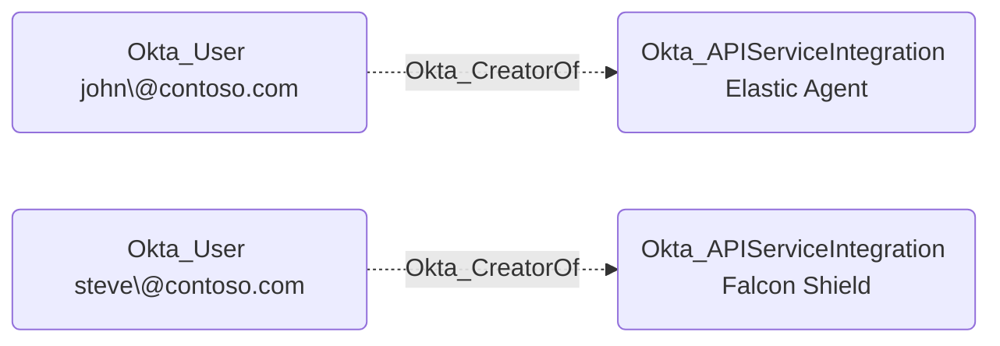

## Edge Schema

- Traversable: ❌

| Source | Destination |
| --- | --- |
| [Okta_User](/opengraph/extensions/okta/nodes/okta_user) | [Okta_ApiServiceIntegration](/opengraph/extensions/okta/nodes/okta_apiserviceintegration) |

## General Information

The non-traversable Okta_CreatorOf edges represent the creator relationships between API Service Integration instances and users in Okta:

## References

- [API service integration authentication](https://developer.okta.com/docs/guides/build-api-integration/main/)
