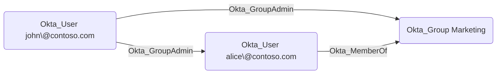

## Edge Schema

- Traversable: ✅

| Source | Destination |
| --- | --- |
| [Okta_Application](/opengraph/extensions/okta/nodes/okta_application) | [Okta_Group](/opengraph/extensions/okta/nodes/okta_group) |
| [Okta_Application](/opengraph/extensions/okta/nodes/okta_application) | [Okta_User](/opengraph/extensions/okta/nodes/okta_user) |
| [Okta_Group](/opengraph/extensions/okta/nodes/okta_group) | [Okta_Group](/opengraph/extensions/okta/nodes/okta_group) |
| [Okta_Group](/opengraph/extensions/okta/nodes/okta_group) | [Okta_User](/opengraph/extensions/okta/nodes/okta_user) |
| [Okta_User](/opengraph/extensions/okta/nodes/okta_user) | [Okta_Group](/opengraph/extensions/okta/nodes/okta_group) |
| [Okta_User](/opengraph/extensions/okta/nodes/okta_user) | [Okta_User](/opengraph/extensions/okta/nodes/okta_user) |

## General Information

The traversable Okta_GroupAdmin edges represent [Group](/resources/nodes/group) Administrator (also known as [User](/resources/nodes/user) Administrator) role assignments. [Group](/resources/nodes/group) Administrators can manage users and groups within their assigned scope.

Target group memberships are flattened when the assignment is evaluated.
