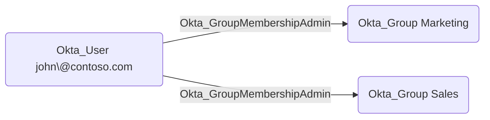

## Edge Schema

- Traversable: ✅

| Source | Destination |
| --- | --- |
| [Okta_Application](/opengraph/extensions/okta/nodes/okta_application) | [Okta_Group](/opengraph/extensions/okta/nodes/okta_group) |
| [Okta_Group](/opengraph/extensions/okta/nodes/okta_group) | [Okta_Group](/opengraph/extensions/okta/nodes/okta_group) |
| [Okta_User](/opengraph/extensions/okta/nodes/okta_user) | [Okta_Group](/opengraph/extensions/okta/nodes/okta_group) |

## General Information

The traversable Okta_GroupMembershipAdmin edges represent [Group](/resources/nodes/group) Membership Administrator role assignments. [Group](/resources/nodes/group) Membership Administrators can add and remove members from groups within their assigned scope but cannot modify the groups themselves.

