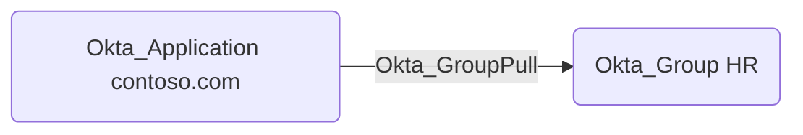

## Edge Schema

- Traversable: ✅

| Source | Destination |
| --- | --- |
| [Okta_Application](/opengraph/extensions/okta/nodes/okta_application) | [Okta_Group](/opengraph/extensions/okta/nodes/okta_group) |

## General Information

The traversable Okta_GroupPull edges represent the group synchronization relationships from applications to Okta:

