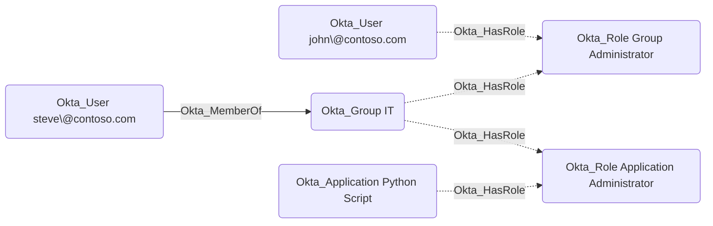

## Edge Schema

- Traversable: ❌

| Source | Destination |
| --- | --- |
| [Okta_Application](/opengraph/extensions/okta/nodes/okta_application) | [Okta_CustomRole](/opengraph/extensions/okta/nodes/okta_customrole) |
| [Okta_Application](/opengraph/extensions/okta/nodes/okta_application) | [Okta_Role](/opengraph/extensions/okta/nodes/okta_role) |
| [Okta_Group](/opengraph/extensions/okta/nodes/okta_group) | [Okta_CustomRole](/opengraph/extensions/okta/nodes/okta_customrole) |
| [Okta_Group](/opengraph/extensions/okta/nodes/okta_group) | [Okta_Role](/opengraph/extensions/okta/nodes/okta_role) |
| [Okta_User](/opengraph/extensions/okta/nodes/okta_user) | [Okta_CustomRole](/opengraph/extensions/okta/nodes/okta_customrole) |
| [Okta_User](/opengraph/extensions/okta/nodes/okta_user) | [Okta_Role](/opengraph/extensions/okta/nodes/okta_role) |

## General Information

The non-traversable Okta_HasRole edges represent the role assignments for users in Okta:

## References

- [User role assignments and targets](https://developer.okta.com/docs/api/openapi/okta-management/management/tags/roleassignmentauser)
