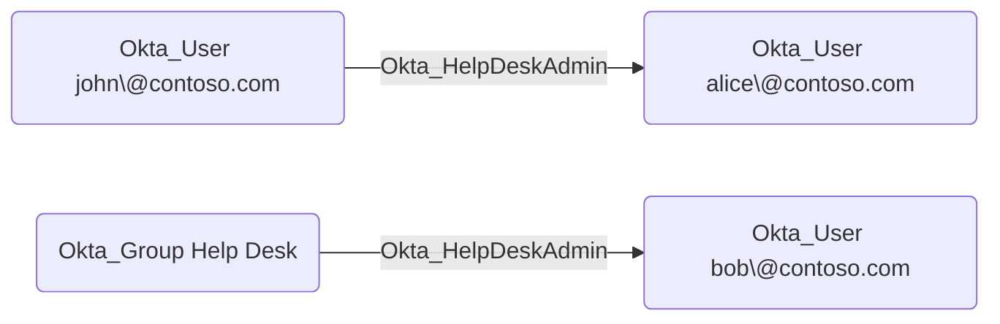

## Edge Schema

- Traversable: ✅

| Source | Destination |
| --- | --- |
| [Okta_Application](/opengraph/extensions/okta/nodes/okta_application) | [Okta_User](/opengraph/extensions/okta/nodes/okta_user) |
| [Okta_Group](/opengraph/extensions/okta/nodes/okta_group) | [Okta_User](/opengraph/extensions/okta/nodes/okta_user) |
| [Okta_User](/opengraph/extensions/okta/nodes/okta_user) | [Okta_User](/opengraph/extensions/okta/nodes/okta_user) |

## General Information

The traversable Okta_HelpDeskAdmin edges represent Help Desk Administrator role assignments. Help Desk Administrators can perform password resets, unlock accounts, and reset MFA factors for users within their assigned scope.



## Abuse Info

Authenticate as the assigned Help Desk Administrator and establish the protected-user and resource boundaries before assessing reset capabilities. Inspect the target user and its enrollment rather than assuming help-desk access bypasses MFA. Password and factor reset tests require the recovery preparations described in their respective edge sources.

1. Establish control of the source identity or system described above. Inherited group access requires a controlled member. Use native Okta IDs from the API, not normalized BloodHound object IDs.
2. Inspect **scoped user factor inventory** through the matching object in the Okta Admin Console, or use this read-only API check. The token must belong to the identity being assessed; a separate administrator’s token does not prove the source’s access. OAuth callers use `Authorization: Bearer $OKTA_ACCESS_TOKEN` instead.

```bash
export OKTA_ORG="https://example.okta.com"
export OKTA_API_TOKEN="YOUR_CONTROLLED_IDENTITY_TOKEN"
export USER_ID="YOUR_OKTA_USER_ID"
curl -i -sS -H "Authorization: SSWS $OKTA_API_TOKEN" \
  -H "Accept: application/json" "$OKTA_ORG/api/v1/users/$USER_ID/factors"
```

3. Expect HTTP 200 and confirm the response identifies the intended tenant and object. Follow pagination for a complete list. Compare the returned scope, membership, or configuration with the represented relationship; a 403 or an empty response does not prove the relationship is absent. This inspection does not validate additional compromise claims.

## Opsec Considerations

Review recovery, account-unlock and factor-reset activity with target user notifications and subsequent sign-ins. Review the Okta System Log alongside the relevant source-system logs. The API check above reads state; no environmental change or restoration is included in it. These steps have not been exercised against a lab.


## References

- [User role assignments and targets](https://developer.okta.com/docs/api/openapi/okta-management/management/tags/roleassignmentauser)
- [Okta System Log](https://developer.okta.com/docs/api/openapi/okta-management/management/tags/systemlog)

- [Standard administrator permissions and restrictions](https://help.okta.com/en-us/Content/topics/security/administrators-admin-comparison.htm)
