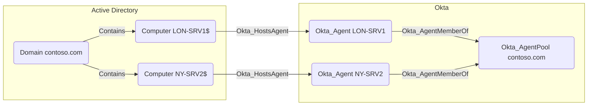

## Edge Schema

- Traversable: ✅

| Source | Destination |
| --- | --- |
| [Computer](/resources/nodes/computer) | [Okta_Agent](/opengraph/extensions/okta/nodes/okta_agent) |

## General Information

Hybrid Okta_HostsAgent edges connect an AD [Computer](/resources/nodes/computer) node to the [Okta_Agent](/opengraph/extensions/okta/nodes/okta_agent) running on that host.



## Abuse Info

Operating-system control of the AD computer is the prerequisite for inspecting or interfering with its agent service. This hosting relationship is not itself remote code execution. Match the host to the collected agent before assessing its directory credentials or delegated-authentication responsibilities.

1. Establish control of the source identity or system described above. Inherited group access requires a controlled member. Use native Okta IDs from the API, not normalized BloodHound object IDs.
2. Inspect **agent pool host context** through the matching object in the Okta Admin Console, or use this read-only API check. The token must belong to the identity being assessed; a separate administrator’s token does not prove the source’s access. OAuth callers use `Authorization: Bearer $OKTA_ACCESS_TOKEN` instead.

```bash
export OKTA_ORG="https://example.okta.com"
export OKTA_API_TOKEN="YOUR_CONTROLLED_IDENTITY_TOKEN"
curl -i -sS -H "Authorization: SSWS $OKTA_API_TOKEN" \
  -H "Accept: application/json" "$OKTA_ORG/api/v1/agentPools"
```

3. Expect HTTP 200 and confirm the response identifies the intended tenant and object. Follow pagination for a complete list. Compare the returned scope, membership, or configuration with the represented relationship; a 403 or an empty response does not prove the relationship is absent. This inspection does not validate additional compromise claims.

## Opsec Considerations

Use host EDR, Windows service/process logs, directory authentication logs, and Okta agent health. A host lookup does not validate an agent takeover. Review the Okta System Log alongside the relevant source-system logs. The API check above reads state; no environmental change or restoration is included in it. These steps have not been exercised against a lab.


## References

- [Directory agent pools](https://developer.okta.com/docs/api/openapi/okta-management/management/tags/agentpools)
- [Okta System Log](https://developer.okta.com/docs/api/openapi/okta-management/management/tags/systemlog)
