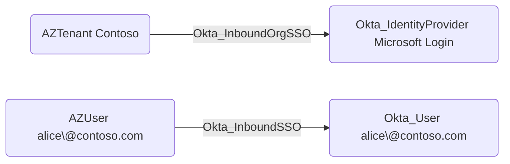

## Edge Schema

- Traversable: ✅

| Source | Destination |
| --- | --- |
| [AZUser](/resources/nodes/az-user) | [Okta_User](/opengraph/extensions/okta/nodes/okta_user) |

## General Information

The [Okta_InboundOrgSSO](/opengraph/extensions/okta/edges/okta_inboundorgsso) and Okta_InboundSSO hybrid edges connect external tenants and users to Okta entities:



## Abuse Info

Use the controlled upstream account through the existing provider’s sign-in flow and verify the resulting Okta user. The provider’s subject and account-linking rules must match that account; a similar email alone is insufficient. This procedure does not change claims, routing, or identity links.

1. Establish control of the source identity or system described above. Inherited group access requires a controlled member. Use native Okta IDs from the API, not normalized BloodHound object IDs.
2. Inspect **existing provider account links** through the matching object in the Okta Admin Console, or use this read-only API check. The token must belong to the identity being assessed; a separate administrator’s token does not prove the source’s access. OAuth callers use `Authorization: Bearer $OKTA_ACCESS_TOKEN` instead.

```bash
export OKTA_ORG="https://example.okta.com"
export OKTA_API_TOKEN="YOUR_CONTROLLED_IDENTITY_TOKEN"
export IDP_ID="YOUR_OKTA_IDP_ID"
curl -i -sS -H "Authorization: SSWS $OKTA_API_TOKEN" \
  -H "Accept: application/json" "$OKTA_ORG/api/v1/idps/$IDP_ID/users"
```

3. Expect HTTP 200 and confirm the response identifies the intended tenant and object. Follow pagination for a complete list. Compare the returned scope, membership, or configuration with the represented relationship; a 403 or an empty response does not prove the relationship is absent. This inspection does not validate additional compromise claims.

## Opsec Considerations

Correlate upstream login and token issuance with Okta account linking and authentication results. Preserve the actual subject and tenant identifiers in redacted evidence. Review the Okta System Log alongside the relevant source-system logs. The API check above reads state; no environmental change or restoration is included in it. These steps have not been exercised against a lab.


## References

- [Identity providers](https://developer.okta.com/docs/api/openapi/okta-management/management/tags/identityprovider)
- [Okta System Log](https://developer.okta.com/docs/api/openapi/okta-management/management/tags/systemlog)

- [Identity-provider account links](https://developer.okta.com/docs/api/openapi/okta-management/management/tags/identityproviderusers)
