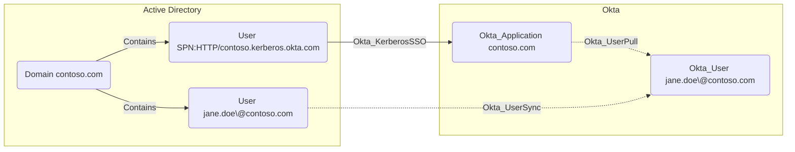

## Edge Schema

- Traversable: ✅

| Source | Destination |
| --- | --- |
| [User](/resources/nodes/user) | [Okta_Application](/opengraph/extensions/okta/nodes/okta_application) |

## General Information

The schema defines this relationship, but the documented collector implementation disables its emission while array-based matching is unsupported. A missing edge is not evidence that agentless Desktop SSO is disabled in Okta.

Hybrid traversable Okta_KerberosSSO edges represent [agentless desktop SSO](https://help.okta.com/en-us/content/topics/directory/ad-dsso-about-workflow.htm) trust from an on-prem AD [User](/resources/nodes/user) account to an AD-backed [Okta_Application](/opengraph/extensions/okta/nodes/okta_application).

