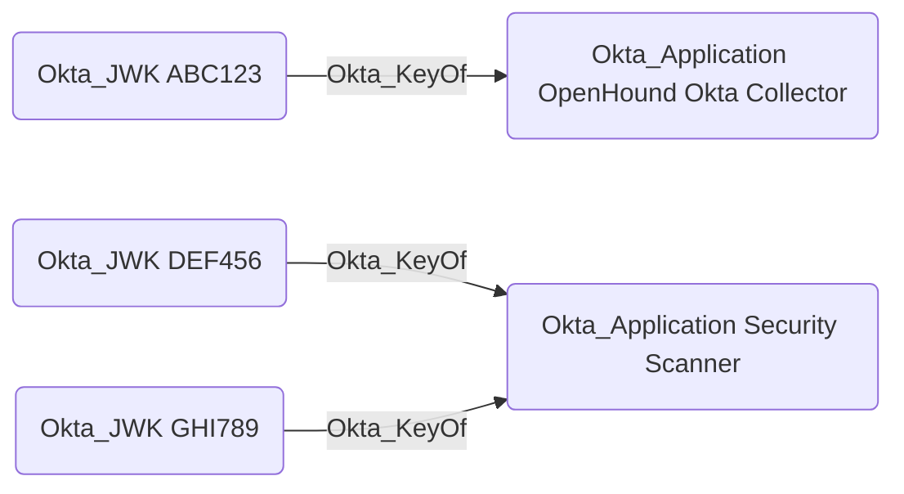

## Edge Schema

- Traversable: ✅

| Source | Destination |
| --- | --- |
| [Okta_JWK](/opengraph/extensions/okta/nodes/okta_jwk) | [Okta_Application](/opengraph/extensions/okta/nodes/okta_application) |

## General Information

The traversable Okta_KeyOf edges represent the relationships between applications [Okta_Application](/opengraph/extensions/okta/nodes/okta_application) and their JWKs:



Possession of the private key corresponding to a JWK allows an attacker to authenticate as the application. The Okta_KeyOf edge can be used in BloodHound to understand which applications use JWK-based authentication and trace potential attack paths involving compromised private keys.

## Abuse Info

The private RSA key corresponding to the registered public JWK can authenticate the linked service app with a signed client assertion. A public JWK or its key ID cannot sign assertions. Confirm client ID, key ID, intended organization, allowed scopes, and administrator assignments.

1. Establish control of the source identity or system described above. Inherited group access requires a controlled member. Use native Okta IDs from the API, not normalized BloodHound object IDs.
2. Inspect **registered client public keys** through the matching object in the Okta Admin Console, or use this read-only API check. The token must belong to the identity being assessed; a separate administrator’s token does not prove the source’s access. OAuth callers use `Authorization: Bearer $OKTA_ACCESS_TOKEN` instead.

```bash
export OKTA_ORG="https://example.okta.com"
export OKTA_API_TOKEN="YOUR_CONTROLLED_IDENTITY_TOKEN"
export APP_ID="YOUR_OKTA_APPLICATION_ID"
curl -i -sS -H "Authorization: SSWS $OKTA_API_TOKEN" \
  -H "Accept: application/json" "$OKTA_ORG/api/v1/apps/$APP_ID/credentials/jwks"
```

3. Expect HTTP 200 and confirm the response identifies the intended tenant and object. Follow pagination for a complete list. Compare the returned scope, membership, or configuration with the represented relationship; a 403 or an empty response does not prove the relationship is absent. This inspection does not validate additional compromise claims.

## Opsec Considerations

Correlate token issuance and API use with the service app. A local copy of a public key is not evidence that the private key was accessed. Review the Okta System Log alongside the relevant source-system logs. The API check above reads state; no environmental change or restoration is included in it. These steps have not been exercised against a lab.


## References

- [OAuth service app authentication](https://developer.okta.com/docs/guides/implement-oauth-for-okta-serviceapp/main/)
- [Okta System Log](https://developer.okta.com/docs/api/openapi/okta-management/management/tags/systemlog)
