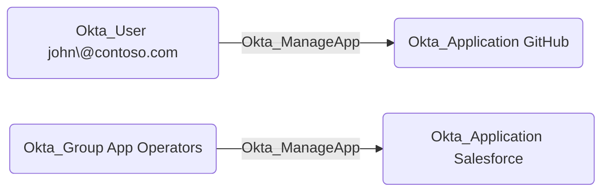

## Edge Schema

- Traversable: ✅

| Source | Destination |
| --- | --- |
| [Okta_Application](/opengraph/extensions/okta/nodes/okta_application) | [Okta_Application](/opengraph/extensions/okta/nodes/okta_application) |
| [Okta_Group](/opengraph/extensions/okta/nodes/okta_group) | [Okta_Application](/opengraph/extensions/okta/nodes/okta_application) |
| [Okta_User](/opengraph/extensions/okta/nodes/okta_user) | [Okta_Application](/opengraph/extensions/okta/nodes/okta_application) |

## General Information

The traversable Okta_ManageApp edges correspond to the `okta.apps.manage` custom role permissions that allow a principal (user, group, or application) to fully manage Okta applications and their members.

