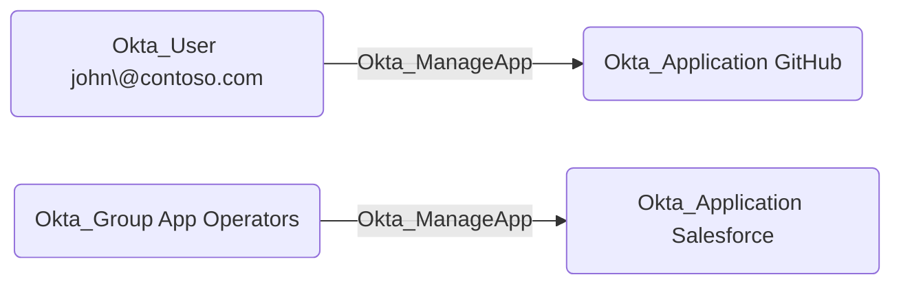

## Edge Schema

- Traversable: ✅

| Source | Destination |
| --- | --- |
| [Okta_Application](/opengraph/extensions/okta/nodes/okta_application) | [Okta_Application](/opengraph/extensions/okta/nodes/okta_application) |
| [Okta_Group](/opengraph/extensions/okta/nodes/okta_group) | [Okta_Application](/opengraph/extensions/okta/nodes/okta_application) |
| [Okta_User](/opengraph/extensions/okta/nodes/okta_user) | [Okta_Application](/opengraph/extensions/okta/nodes/okta_application) |

## General Information

The traversable Okta_ManageApp edges correspond to the `okta.apps.manage` custom role permissions that allow a principal (user, group, or application) to fully manage Okta applications and their members.



## Abuse Info

A controlled source principal can administer an application in the custom role’s resource scope. Assess assignments and provisioning separately from federation-signing control. Use the application read below to confirm the exact integration; changing a sign-on endpoint or credential requires an integration-specific restoration plan.

1. Establish control of the source identity or system described above. Inherited group access requires a controlled member. Use native Okta IDs from the API, not normalized BloodHound object IDs.
2. Inspect **managed application** through the matching object in the Okta Admin Console, or use this read-only API check. The token must belong to the identity being assessed; a separate administrator’s token does not prove the source’s access. OAuth callers use `Authorization: Bearer $OKTA_ACCESS_TOKEN` instead.

```bash
export OKTA_ORG="https://example.okta.com"
export OKTA_API_TOKEN="YOUR_CONTROLLED_IDENTITY_TOKEN"
export APP_ID="YOUR_OKTA_APPLICATION_ID"
curl -i -sS -H "Authorization: SSWS $OKTA_API_TOKEN" \
  -H "Accept: application/json" "$OKTA_ORG/api/v1/apps/$APP_ID"
```

3. Expect HTTP 200 and confirm the response identifies the intended tenant and object. Follow pagination for a complete list. Compare the returned scope, membership, or configuration with the represented relationship; a 403 or an empty response does not prove the relationship is absent. This inspection does not validate additional compromise claims.

## Opsec Considerations

Correlate application configuration, assignment and provisioning changes with the acting principal. Application administration can produce downstream effects outside Okta. Review the Okta System Log alongside the relevant source-system logs. The API check above reads state; no environmental change or restoration is included in it. These steps have not been exercised against a lab.


## References

- [Application management](https://developer.okta.com/docs/api/openapi/okta-management/management/tags/application)
- [Okta System Log](https://developer.okta.com/docs/api/openapi/okta-management/management/tags/systemlog)
