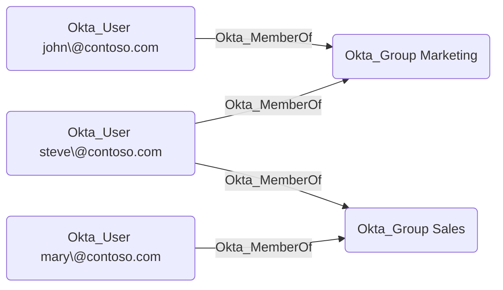

## Edge Schema

- Traversable: ✅

| Source | Destination |
| --- | --- |
| [Okta_User](/opengraph/extensions/okta/nodes/okta_user) | [Okta_Group](/opengraph/extensions/okta/nodes/okta_group) |

## General Information

The traversable Okta_MemberOf edges represent the membership relationships between users and groups in Okta:



## Abuse Info

Control of an existing user can provide permissions assigned to the destination group. Follow the group’s outgoing permission edges and resource scope. [Group](/resources/nodes/group) membership alone neither supplies a password nor overrides authentication policy.

1. Establish control of the source identity or system described above. Inherited group access requires a controlled member. Use native Okta IDs from the API, not normalized BloodHound object IDs.
2. Inspect **current group members** through the matching object in the Okta Admin Console, or use this read-only API check. The token must belong to the identity being assessed; a separate administrator’s token does not prove the source’s access. OAuth callers use `Authorization: Bearer $OKTA_ACCESS_TOKEN` instead.

```bash
export OKTA_ORG="https://example.okta.com"
export OKTA_API_TOKEN="YOUR_CONTROLLED_IDENTITY_TOKEN"
export GROUP_ID="YOUR_OKTA_GROUP_ID"
curl -i -sS -H "Authorization: SSWS $OKTA_API_TOKEN" \
  -H "Accept: application/json" "$OKTA_ORG/api/v1/groups/$GROUP_ID/users"
```

3. Expect HTTP 200 and confirm the response identifies the intended tenant and object. Follow pagination for a complete list. Compare the returned scope, membership, or configuration with the represented relationship; a 403 or an empty response does not prove the relationship is absent. This inspection does not validate additional compromise claims.

## Opsec Considerations

Correlate the user’s authentication and authorized actions with group membership history. Using an existing membership does not require adding or removing members. Review the Okta System Log alongside the relevant source-system logs. The API check above reads state; no environmental change or restoration is included in it. These steps have not been exercised against a lab.


## References

- [Groups and membership operations](https://developer.okta.com/docs/api/openapi/okta-management/management/tags/group)
- [Okta System Log](https://developer.okta.com/docs/api/openapi/okta-management/management/tags/systemlog)
