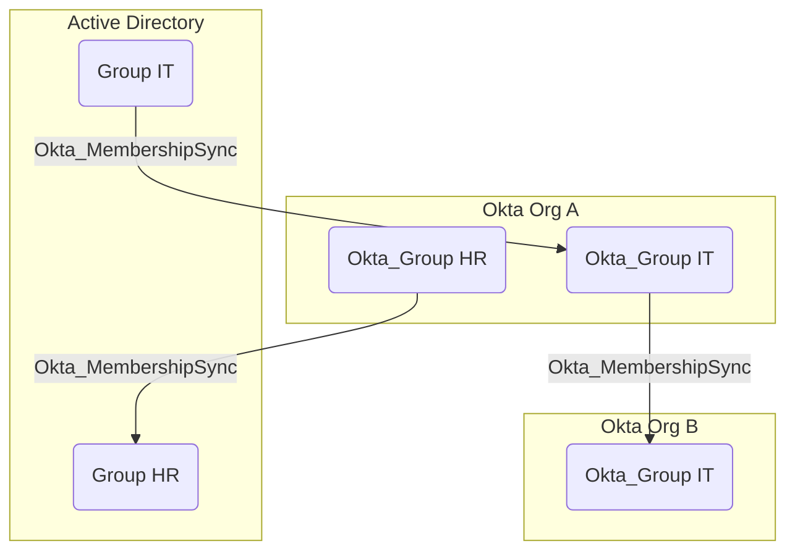
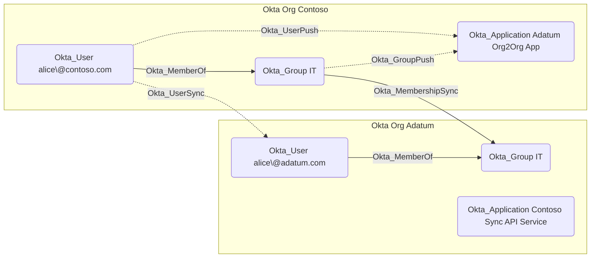

## Edge Schema

- Traversable: ✅

| Source | Destination |
| --- | --- |
| [Group](/resources/nodes/group) | [Okta_Group](/opengraph/extensions/okta/nodes/okta_group) |
| [Okta_Group](/opengraph/extensions/okta/nodes/okta_group) | [AZGroup](/resources/nodes/az-group) |
| [Okta_Group](/opengraph/extensions/okta/nodes/okta_group) | [Group](/resources/nodes/group) |
| [Okta_Group](/opengraph/extensions/okta/nodes/okta_group) | [Okta_Group](/opengraph/extensions/okta/nodes/okta_group) |

## General Information

The traversable hybrid Okta_MembershipSync edges represent the synchronization relationships between groups in external directories and their corresponding groups in Okta:





## Abuse Info

An authoritative external directory group can influence the linked Okta group through import. Source-group write authority is an additional prerequisite; the graph mapping does not grant it. Inspect the Okta group members and compare them with the source directory using its approved read tooling.

1. Establish control of the source identity or system described above. Inherited group access requires a controlled member. Use native Okta IDs from the API, not normalized BloodHound object IDs.
2. Inspect **imported okta membership** through the matching object in the Okta Admin Console, or use this read-only API check. The token must belong to the identity being assessed; a separate administrator’s token does not prove the source’s access. OAuth callers use `Authorization: Bearer $OKTA_ACCESS_TOKEN` instead.

```bash
export OKTA_ORG="https://example.okta.com"
export OKTA_API_TOKEN="YOUR_CONTROLLED_IDENTITY_TOKEN"
export GROUP_ID="YOUR_OKTA_GROUP_ID"
curl -i -sS -H "Authorization: SSWS $OKTA_API_TOKEN" \
  -H "Accept: application/json" "$OKTA_ORG/api/v1/groups/$GROUP_ID/users"
```

3. Expect HTTP 200 and confirm the response identifies the intended tenant and object. Follow pagination for a complete list. Compare the returned scope, membership, or configuration with the represented relationship; a 403 or an empty response does not prove the relationship is absent. This inspection does not validate additional compromise claims.

## Opsec Considerations

Correlate directory membership changes with agent/import activity, Okta group changes, and resulting application access. Review the Okta System Log alongside the relevant source-system logs. The API check above reads state; no environmental change or restoration is included in it. These steps have not been exercised against a lab.


## References

- [Groups and membership operations](https://developer.okta.com/docs/api/openapi/okta-management/management/tags/group)
- [Okta System Log](https://developer.okta.com/docs/api/openapi/okta-management/management/tags/systemlog)
