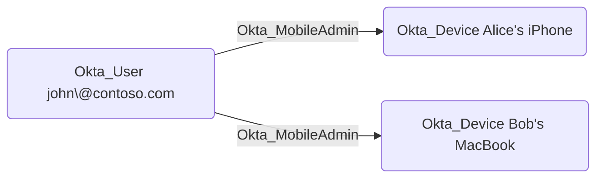

## Edge Schema

- Traversable: ✅

| Source | Destination |
| --- | --- |
| [Okta_Application](/opengraph/extensions/okta/nodes/okta_application) | [Okta_Device](/opengraph/extensions/okta/nodes/okta_device) |
| [Okta_Group](/opengraph/extensions/okta/nodes/okta_group) | [Okta_Device](/opengraph/extensions/okta/nodes/okta_device) |
| [Okta_User](/opengraph/extensions/okta/nodes/okta_user) | [Okta_Device](/opengraph/extensions/okta/nodes/okta_device) |

## General Information

The traversable Okta_MobileAdmin edges represent Mobile Administrator role assignments. Mobile Administrators can manage mobile device settings and configurations within their assigned scope.

