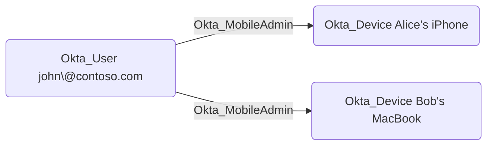

## Edge Schema

- Traversable: ✅

| Source | Destination |
| --- | --- |
| [Okta_Application](/opengraph/extensions/okta/nodes/okta_application) | [Okta_Device](/opengraph/extensions/okta/nodes/okta_device) |
| [Okta_Group](/opengraph/extensions/okta/nodes/okta_group) | [Okta_Device](/opengraph/extensions/okta/nodes/okta_device) |
| [Okta_User](/opengraph/extensions/okta/nodes/okta_user) | [Okta_Device](/opengraph/extensions/okta/nodes/okta_device) |

## General Information

The traversable Okta_MobileAdmin edges represent Mobile Administrator role assignments. Mobile Administrators can manage mobile device settings and configurations within their assigned scope.



## Abuse Info

Authenticate as the assigned Mobile Administrator and inspect the destination device context and effective scope. Inventory and mobile-administration privileges are not operating-system execution or unrestricted access to an enrolled user’s account. No device wipe, lock, or management experiment is prescribed by this source.

1. Establish control of the source identity or system described above. Inherited group access requires a controlled member. Use native Okta IDs from the API, not normalized BloodHound object IDs.
2. Inspect **device inventory** through the matching object in the Okta Admin Console, or use this read-only API check. The token must belong to the identity being assessed; a separate administrator’s token does not prove the source’s access. OAuth callers use `Authorization: Bearer $OKTA_ACCESS_TOKEN` instead.

```bash
export OKTA_ORG="https://example.okta.com"
export OKTA_API_TOKEN="YOUR_CONTROLLED_IDENTITY_TOKEN"
curl -i -sS -H "Authorization: SSWS $OKTA_API_TOKEN" \
  -H "Accept: application/json" "$OKTA_ORG/api/v1/devices"
```

3. Expect HTTP 200 and confirm the response identifies the intended tenant and object. Follow pagination for a complete list. Compare the returned scope, membership, or configuration with the represented relationship; a 403 or an empty response does not prove the relationship is absent. This inspection does not validate additional compromise claims.

## Opsec Considerations

Correlate device management activity with endpoint/MDM telemetry and user-visible effects; device inventory alone does not show local execution. Review the Okta System Log alongside the relevant source-system logs. The API check above reads state; no environmental change or restoration is included in it. These steps have not been exercised against a lab.


## References

- [User role assignments and targets](https://developer.okta.com/docs/api/openapi/okta-management/management/tags/roleassignmentauser)
- [Okta System Log](https://developer.okta.com/docs/api/openapi/okta-management/management/tags/systemlog)

- [Standard administrator permissions and restrictions](https://help.okta.com/en-us/Content/topics/security/administrators-admin-comparison.htm)
