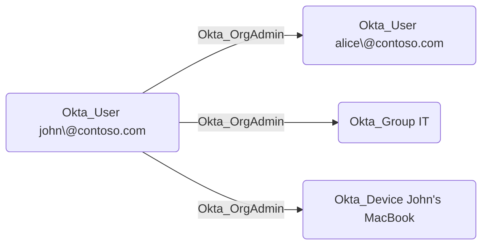

## Edge Schema

- Traversable: ✅

| Source | Destination |
| --- | --- |
| [Okta_Application](/opengraph/extensions/okta/nodes/okta_application) | [Okta_Device](/opengraph/extensions/okta/nodes/okta_device) |
| [Okta_Application](/opengraph/extensions/okta/nodes/okta_application) | [Okta_Group](/opengraph/extensions/okta/nodes/okta_group) |
| [Okta_Application](/opengraph/extensions/okta/nodes/okta_application) | [Okta_User](/opengraph/extensions/okta/nodes/okta_user) |
| [Okta_Group](/opengraph/extensions/okta/nodes/okta_group) | [Okta_Device](/opengraph/extensions/okta/nodes/okta_device) |
| [Okta_Group](/opengraph/extensions/okta/nodes/okta_group) | [Okta_Group](/opengraph/extensions/okta/nodes/okta_group) |
| [Okta_Group](/opengraph/extensions/okta/nodes/okta_group) | [Okta_User](/opengraph/extensions/okta/nodes/okta_user) |
| [Okta_User](/opengraph/extensions/okta/nodes/okta_user) | [Okta_Device](/opengraph/extensions/okta/nodes/okta_device) |
| [Okta_User](/opengraph/extensions/okta/nodes/okta_user) | [Okta_Group](/opengraph/extensions/okta/nodes/okta_group) |
| [Okta_User](/opengraph/extensions/okta/nodes/okta_user) | [Okta_User](/opengraph/extensions/okta/nodes/okta_user) |

## General Information

The traversable Okta_OrgAdmin edges represent Organization Administrator role assignments. Organization Administrators can manage most organizational settings except for administrative role assignments and some security settings.

