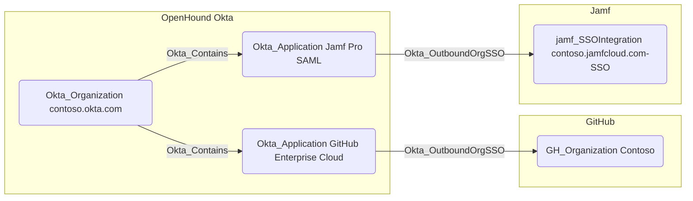

## Edge Schema

- Traversable: ✅

| Source | Destination |
| --- | --- |
| [Okta_Application](/opengraph/extensions/okta/nodes/okta_application) | [AZTenant](/resources/nodes/az-tenant) |
| [Okta_Application](/opengraph/extensions/okta/nodes/okta_application) | [GH_Organization](/opengraph/extensions/github/nodes/gh_organization) |
| [Okta_Application](/opengraph/extensions/okta/nodes/okta_application) | [OP_Account](https://github.com/SpecterOps/1PassHound) |
| [Okta_Application](/opengraph/extensions/okta/nodes/okta_application) | [Okta_IdentityProvider](/opengraph/extensions/okta/nodes/okta_identityprovider) |
| [Okta_Application](/opengraph/extensions/okta/nodes/okta_application) | [SNOW_Account](https://github.com/SpecterOps/SnowHound) |
| [Okta_Application](/opengraph/extensions/okta/nodes/okta_application) | [jamf_SSOIntegration](/opengraph/extensions/jamf/nodes/jamf_ssointegration) |

## General Information

The traversable Okta_OutboundOrgSSO edges represent the Single Sign-On (SSO) relationships between Okta applications and supported external organizations or tenants, such as GitHub Enterprise or Jamf Pro, using SAML 2.0 or OIDC protocols.



The respective BloodHound collectors, e.g., OpenHound Github for GitHub organizations and OpenHound Jamf for Jamf Pro tenants, must be used to gather the external node information.

## Abuse Info

Control of the Okta application’s effective federation configuration may influence the destination tenant’s trust. Establish protocol, signing authority, audience, subject mapping, and destination policy before asserting arbitrary impersonation. This procedure inspects the application; it does not prescribe changing claims or signing material.

1. Establish control of the source identity or system described above. Inherited group access requires a controlled member. Use native Okta IDs from the API, not normalized BloodHound object IDs.
2. Inspect **outbound federation configuration** through the matching object in the Okta Admin Console, or use this read-only API check. The token must belong to the identity being assessed; a separate administrator’s token does not prove the source’s access. OAuth callers use `Authorization: Bearer $OKTA_ACCESS_TOKEN` instead.

```bash
export OKTA_ORG="https://example.okta.com"
export OKTA_API_TOKEN="YOUR_CONTROLLED_IDENTITY_TOKEN"
export APP_ID="YOUR_OKTA_APPLICATION_ID"
curl -i -sS -H "Authorization: SSWS $OKTA_API_TOKEN" \
  -H "Accept: application/json" "$OKTA_ORG/api/v1/apps/$APP_ID"
```

3. Expect HTTP 200 and confirm the response identifies the intended tenant and object. Follow pagination for a complete list. Compare the returned scope, membership, or configuration with the represented relationship; a 403 or an empty response does not prove the relationship is absent. This inspection does not validate additional compromise claims.

## Opsec Considerations

Correlate application federation changes and sign-ons with destination trust and administrative audit logs. Tenant-level trust is distinct from an individual account mapping. Review the Okta System Log alongside the relevant source-system logs. The API check above reads state; no environmental change or restoration is included in it. These steps have not been exercised against a lab.


## References

- [Application SSO](https://developer.okta.com/docs/api/openapi/okta-management/management/tags/applicationsso)
- [Okta System Log](https://developer.okta.com/docs/api/openapi/okta-management/management/tags/systemlog)
