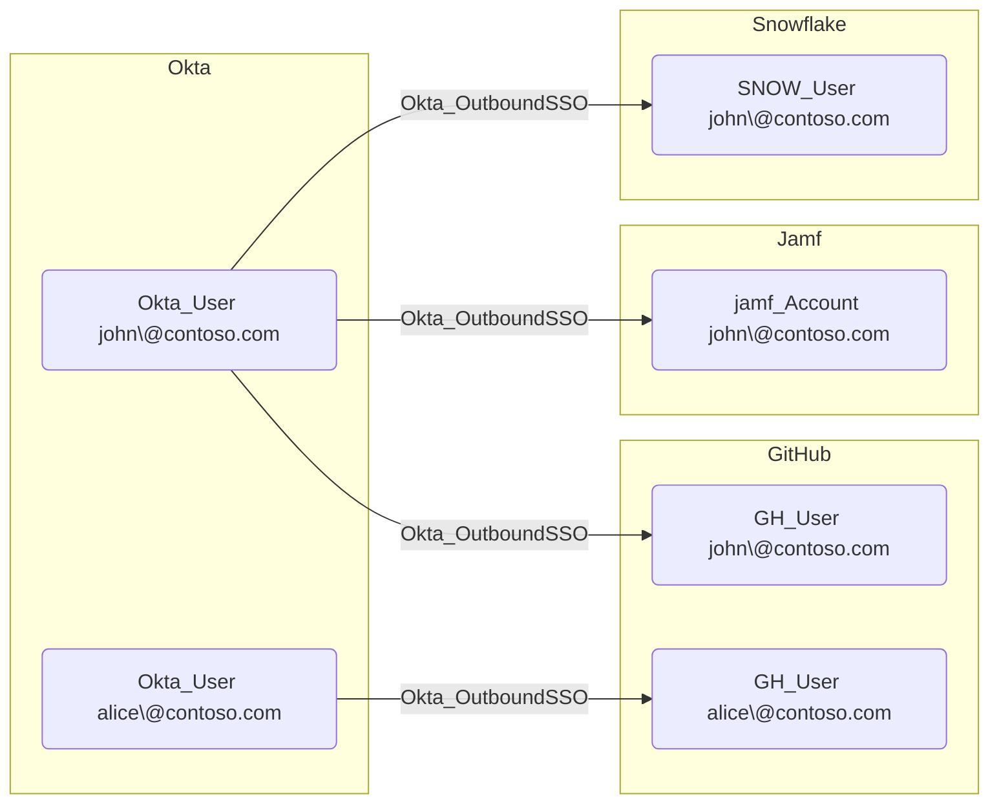

## Edge Schema

- Traversable: ✅

| Source | Destination |
| --- | --- |
| [Okta_User](/opengraph/extensions/okta/nodes/okta_user) | [AZUser](/resources/nodes/az-user) |
| [Okta_User](/opengraph/extensions/okta/nodes/okta_user) | [GH_User](/opengraph/extensions/github/nodes/gh_user) |
| [Okta_User](/opengraph/extensions/okta/nodes/okta_user) | [OP_User](https://github.com/SpecterOps/1PassHound) |
| [Okta_User](/opengraph/extensions/okta/nodes/okta_user) | [Okta_User](/opengraph/extensions/okta/nodes/okta_user) |
| [Okta_User](/opengraph/extensions/okta/nodes/okta_user) | [SNOW_User](https://github.com/SpecterOps/SnowHound) |
| [Okta_User](/opengraph/extensions/okta/nodes/okta_user) | [jamf_Account](/opengraph/extensions/jamf/nodes/jamf_account) |

## General Information

The traversable hybrid Okta_OutboundSSO edges represent Single Sign-On relationships between Okta users and their linked accounts in external applications using federated authentication (SAML 2.0 or OIDC).

