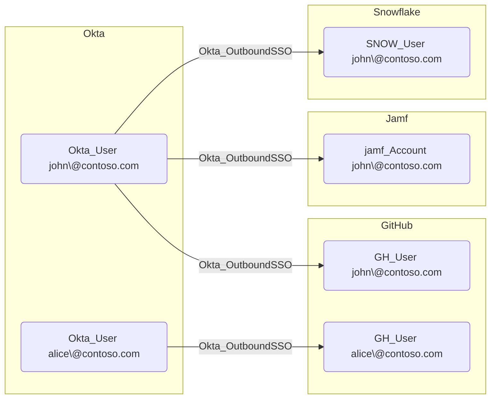

## Edge Schema

- Traversable: ✅

| Source | Destination |
| --- | --- |
| [Okta_User](/opengraph/extensions/okta/nodes/okta_user) | [AZUser](/resources/nodes/az-user) |
| [Okta_User](/opengraph/extensions/okta/nodes/okta_user) | [GH_User](/opengraph/extensions/github/nodes/gh_user) |
| [Okta_User](/opengraph/extensions/okta/nodes/okta_user) | [OP_User](https://github.com/SpecterOps/1PassHound) |
| [Okta_User](/opengraph/extensions/okta/nodes/okta_user) | [Okta_User](/opengraph/extensions/okta/nodes/okta_user) |
| [Okta_User](/opengraph/extensions/okta/nodes/okta_user) | [SNOW_User](https://github.com/SpecterOps/SnowHound) |
| [Okta_User](/opengraph/extensions/okta/nodes/okta_user) | [jamf_Account](/opengraph/extensions/jamf/nodes/jamf_account) |

## General Information

The traversable hybrid Okta_OutboundSSO edges represent Single Sign-On relationships between Okta users and their linked accounts in external applications using federated authentication (SAML 2.0 or OIDC).



## Abuse Info

Use the existing controlled Okta user’s normal application launch to authenticate to its mapped destination account. Verify the destination’s actual account and roles. Assignment, matching names, or a graph path alone do not bypass destination MFA, account linking, session, or authorization controls.

1. Establish control of the source identity or system described above. Inherited group access requires a controlled member. Use native Okta IDs from the API, not normalized BloodHound object IDs.
2. Inspect **application user assignment** through the matching object in the Okta Admin Console, or use this read-only API check. The token must belong to the identity being assessed; a separate administrator’s token does not prove the source’s access. OAuth callers use `Authorization: Bearer $OKTA_ACCESS_TOKEN` instead.

```bash
export OKTA_ORG="https://example.okta.com"
export OKTA_API_TOKEN="YOUR_CONTROLLED_IDENTITY_TOKEN"
export APP_ID="YOUR_OKTA_APPLICATION_ID"
export USER_ID="YOUR_OKTA_USER_ID"
curl -i -sS -H "Authorization: SSWS $OKTA_API_TOKEN" \
  -H "Accept: application/json" "$OKTA_ORG/api/v1/apps/$APP_ID/users/$USER_ID"
```

3. Expect HTTP 200 and confirm the response identifies the intended tenant and object. Follow pagination for a complete list. Compare the returned scope, membership, or configuration with the represented relationship; a 403 or an empty response does not prove the relationship is absent. This inspection does not validate additional compromise claims.

## Opsec Considerations

Correlate Okta application sign-on with the downstream service’s login, session, and role logs. A successful Okta launch is not proof of downstream authorization. Review the Okta System Log alongside the relevant source-system logs. The API check above reads state; no environmental change or restoration is included in it. These steps have not been exercised against a lab.


## References

- [Application SSO](https://developer.okta.com/docs/api/openapi/okta-management/management/tags/applicationsso)
- [Okta System Log](https://developer.okta.com/docs/api/openapi/okta-management/management/tags/systemlog)
