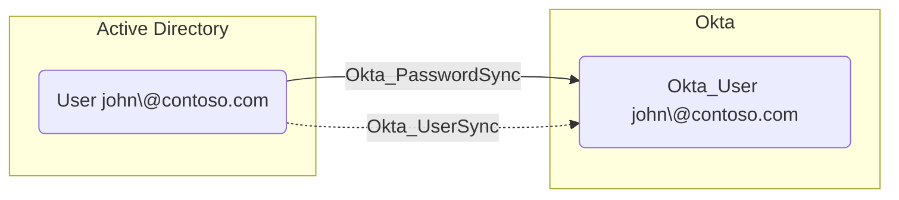
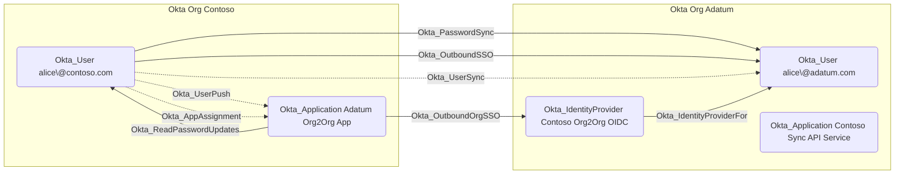

## Edge Schema

- Traversable: ✅

| Source | Destination |
| --- | --- |
| [Okta_User](/opengraph/extensions/okta/nodes/okta_user) | [Okta_User](/opengraph/extensions/okta/nodes/okta_user) |
| [Okta_User](/opengraph/extensions/okta/nodes/okta_user) | [User](/resources/nodes/user) |
| [User](/resources/nodes/user) | [Okta_User](/opengraph/extensions/okta/nodes/okta_user) |

## General Information

The traversable Okta_PasswordSync edge represents password synchronization between user accounts. This indicates that credentials are synchronized from a source user to a target user.

In **Active Directory** hybrid setups, this edge is created between [User](/resources/nodes/user) (AD) and [Okta_User](/opengraph/extensions/okta/nodes/okta_user) when delegated authentication or password push is enabled. In **Org2Org** setups, this edge is created between [Okta_User](/opengraph/extensions/okta/nodes/okta_user) nodes across organizations when password synchronization is configured.

<Warning>
The Okta API does not indicate if the actual password or a randomly generated value is pushed to the other organization.
</Warning>

### Active Directory Hybrid



### Org2Org



## Abuse Info

An already controlled password may authenticate the linked destination account only if the configured password flow actually shares that value. Delegated AD authentication and password push are different mechanisms. Org2Org may push a generated password; this edge is a candidate credential correlation, not proof of equal passwords.

1. Establish control of the source identity or system described above. Inherited group access requires a controlled member. Use native Okta IDs from the API, not normalized BloodHound object IDs.
2. Inspect **linked okta account and credential provider** through the matching object in the Okta Admin Console, or use this read-only API check. The token must belong to the identity being assessed; a separate administrator’s token does not prove the source’s access. OAuth callers use `Authorization: Bearer $OKTA_ACCESS_TOKEN` instead.

```bash
export OKTA_ORG="https://example.okta.com"
export OKTA_API_TOKEN="YOUR_CONTROLLED_IDENTITY_TOKEN"
export USER_ID="YOUR_OKTA_USER_ID"
curl -i -sS -H "Authorization: SSWS $OKTA_API_TOKEN" \
  -H "Accept: application/json" "$OKTA_ORG/api/v1/users/$USER_ID"
```

3. Expect HTTP 200 and confirm the response identifies the intended tenant and object. Follow pagination for a complete list. Compare the returned scope, membership, or configuration with the represented relationship; a 403 or an empty response does not prove the relationship is absent. This inspection does not validate additional compromise claims.

## Opsec Considerations

Correlate source password changes, delegated-authentication or provisioning activity, and destination authentication. Do not trigger a password change merely to inspect the relationship. Review the Okta System Log alongside the relevant source-system logs. The API check above reads state; no environmental change or restoration is included in it. These steps have not been exercised against a lab.


## References

- [SCIM provisioning and source authority](https://developer.okta.com/docs/concepts/scim/)
- [Okta System Log](https://developer.okta.com/docs/api/openapi/okta-management/management/tags/systemlog)
