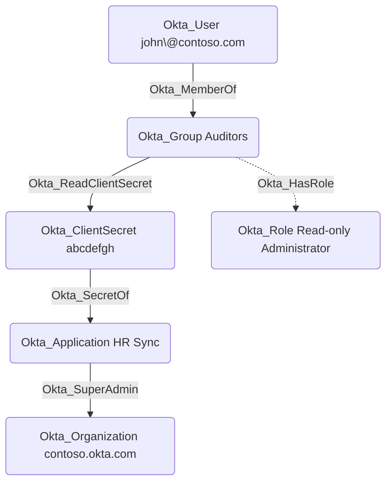

## Edge Schema

- Traversable: ✅

| Source | Destination |
| --- | --- |
| [Okta_Application](/opengraph/extensions/okta/nodes/okta_application) | [Okta_ClientSecret](/opengraph/extensions/okta/nodes/okta_clientsecret) |
| [Okta_Group](/opengraph/extensions/okta/nodes/okta_group) | [Okta_ClientSecret](/opengraph/extensions/okta/nodes/okta_clientsecret) |
| [Okta_User](/opengraph/extensions/okta/nodes/okta_user) | [Okta_ClientSecret](/opengraph/extensions/okta/nodes/okta_clientsecret) |

## General Information

The traversable Okta_ReadClientSecret edges represent permissions that allow a principal (user, group, or application) to read OAuth client secrets for scoped Okta applications. These edges are created for the **Application Administrator**, **API Access Management Administrator**, and **Read-only Administrator** built-in roles and for custom roles with the `okta.apps.clientCredentials.read` permission.



## Potential Attack Scenarios

An attacker with the ability to read client secrets for an application assigned the Super Administrator role could potentially use the client secret to authenticate as that application and perform privileged actions in Okta.

## Abuse Info

Authenticate as the source principal and read only credentials in its effective application scope. A group requires control of an authorized member; an application requires its own usable credential. The graph secret hash is not the secret. Client-secret read access does not establish that every target accepts that secret for Okta-scoped OAuth.

1. Establish control of the source identity or system described above. Inherited group access requires a controlled member. Use native Okta IDs from the API, not normalized BloodHound object IDs.
2. Inspect **oauth client secret records** through the matching object in the Okta Admin Console, or use this read-only API check. The token must belong to the identity being assessed; a separate administrator’s token does not prove the source’s access. OAuth callers use `Authorization: Bearer $OKTA_ACCESS_TOKEN` instead.

```bash
export OKTA_ORG="https://example.okta.com"
export OKTA_API_TOKEN="YOUR_CONTROLLED_IDENTITY_TOKEN"
export APP_ID="YOUR_OKTA_APPLICATION_ID"
curl -i -sS -H "Authorization: SSWS $OKTA_API_TOKEN" \
  -H "Accept: application/json" "$OKTA_ORG/api/v1/apps/$APP_ID/credentials/secrets"
```

3. Expect HTTP 200 and confirm the response identifies the intended tenant and object. Follow pagination for a complete list. Compare the returned scope, membership, or configuration with the represented relationship; a 403 or an empty response does not prove the relationship is absent. This inspection does not validate additional compromise claims.

## Opsec Considerations

Credential reads can expose plaintext for supported applications. Protect the response, correlate API activity with the source principal, and arrange credential rotation with the owner if the test exposes a usable secret. Review the Okta System Log alongside the relevant source-system logs. The API check above reads state; no environmental change or restoration is included in it. These steps have not been exercised against a lab.


## References

- [Application public keys and client secrets](https://developer.okta.com/docs/api/openapi/okta-management/management/tags/applicationssopublickeys)
- [Okta System Log](https://developer.okta.com/docs/api/openapi/okta-management/management/tags/systemlog)
