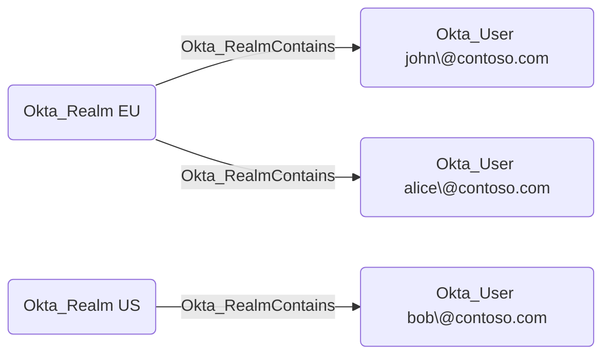

## Edge Schema

- Traversable: ✅

| Source | Destination |
| --- | --- |
| [Okta_Realm](/opengraph/extensions/okta/nodes/okta_realm) | [Okta_User](/opengraph/extensions/okta/nodes/okta_user) |

## General Information

The traversable Okta_RealmContains edges represent containment relationships between realms and the users assigned to those realms.



<Info>
Realm collection depends on the Okta organization’s subscription and API authorization. Missing realm data does not establish that the organization has no realms.
</Info>

## Abuse Info

This is the model’s realm-to-user containment path. Realm membership alone is not a credential or a demonstrated account-takeover primitive. Review the administrator’s realm scope and the user’s realm assignment before interpreting the path as user control.

1. Establish control of the source identity or system described above. Inherited group access requires a controlled member. Use native Okta IDs from the API, not normalized BloodHound object IDs.
2. Inspect **available realms** through the matching object in the Okta Admin Console, or use this read-only API check. The token must belong to the identity being assessed; a separate administrator’s token does not prove the source’s access. OAuth callers use `Authorization: Bearer $OKTA_ACCESS_TOKEN` instead.

```bash
export OKTA_ORG="https://example.okta.com"
export OKTA_API_TOKEN="YOUR_CONTROLLED_IDENTITY_TOKEN"
curl -i -sS -H "Authorization: SSWS $OKTA_API_TOKEN" \
  -H "Accept: application/json" "$OKTA_ORG/api/v1/realms"
```

3. Expect HTTP 200 and confirm the response identifies the intended tenant and object. Follow pagination for a complete list. Compare the returned scope, membership, or configuration with the represented relationship; a 403 or an empty response does not prove the relationship is absent. This inspection does not validate additional compromise claims.

## Opsec Considerations

Review realm profile and user-assignment changes, correlated with the administrator and user IDs. Review the Okta System Log alongside the relevant source-system logs. The API check above reads state; no environmental change or restoration is included in it. These steps have not been exercised against a lab.


## References

- [Realms and required subscriptions](https://developer.okta.com/docs/api/openapi/okta-management/management/tags/realm)
- [Okta System Log](https://developer.okta.com/docs/api/openapi/okta-management/management/tags/systemlog)
