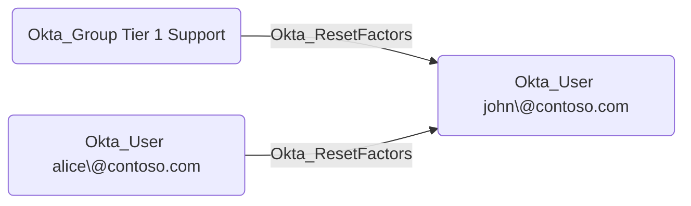

## Edge Schema

- Traversable: ✅

| Source | Destination |
| --- | --- |
| [Okta_Application](/opengraph/extensions/okta/nodes/okta_application) | [Okta_User](/opengraph/extensions/okta/nodes/okta_user) |
| [Okta_Group](/opengraph/extensions/okta/nodes/okta_group) | [Okta_User](/opengraph/extensions/okta/nodes/okta_user) |
| [Okta_User](/opengraph/extensions/okta/nodes/okta_user) | [Okta_User](/opengraph/extensions/okta/nodes/okta_user) |

## General Information

The traversable Okta_ResetFactors edges represent custom role permissions that allow a principal to reset MFA authenticators for scoped Okta users. These edges are created when a custom role includes the `okta.users.credentials.resetFactors` or `okta.users.credentials.manage` permissions.



## Abuse Info

A controlled source principal can reset authenticators for an in-scope user when authorized by policy. Removing enrollment can force re-enrollment, but does not prove that the attacker can complete recovery or bypass the remaining sign-on policy. This procedure inventories factors only; a destructive reset requires a disposable user and an owner-approved re-enrollment plan.

1. Establish control of the source identity or system described above. Inherited group access requires a controlled member. Use native Okta IDs from the API, not normalized BloodHound object IDs.
2. Inspect **target factor inventory** through the matching object in the Okta Admin Console, or use this read-only API check. The token must belong to the identity being assessed; a separate administrator’s token does not prove the source’s access. OAuth callers use `Authorization: Bearer $OKTA_ACCESS_TOKEN` instead.

```bash
export OKTA_ORG="https://example.okta.com"
export OKTA_API_TOKEN="YOUR_CONTROLLED_IDENTITY_TOKEN"
export USER_ID="YOUR_OKTA_USER_ID"
curl -i -sS -H "Authorization: SSWS $OKTA_API_TOKEN" \
  -H "Accept: application/json" "$OKTA_ORG/api/v1/users/$USER_ID/factors"
```

3. Expect HTTP 200 and confirm the response identifies the intended tenant and object. Follow pagination for a complete list. Compare the returned scope, membership, or configuration with the represented relationship; a 403 or an empty response does not prove the relationship is absent. This inspection does not validate additional compromise claims.

## Opsec Considerations

Review factor reset and enrollment activity, user notifications, and subsequent policy decisions. Enrollment secrets cannot be reconstructed from an inventory response. Review the Okta System Log alongside the relevant source-system logs. The API check above reads state; no environmental change or restoration is included in it. These steps have not been exercised against a lab.


## References

- [User lifecycle operations](https://developer.okta.com/docs/api/openapi/okta-management/management/tags/userlifecycle)
- [Okta System Log](https://developer.okta.com/docs/api/openapi/okta-management/management/tags/systemlog)
